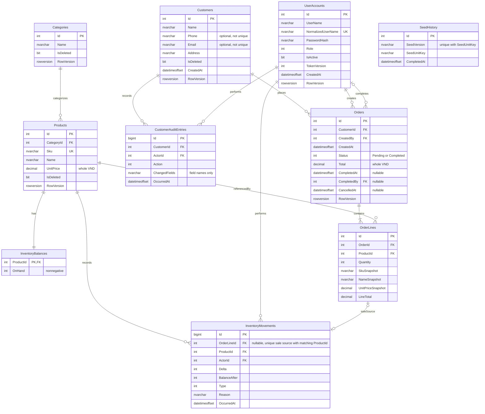

# Order & Inventory API

REST API ASP.NET Core cho một cửa hàng. Hiện có nền tảng bốn tầng, đăng nhập JWT, quản trị tài khoản, CRUD danh mục/sản phẩm/khách hàng, lịch sử thay đổi khách hàng, sổ tồn kho, tạo đơn nguyên tử, tra cứu đơn có phân trang/lọc/sắp xếp và hoàn tất đơn. Hủy/hoàn kho và báo cáo còn thuộc các bước tiếp theo.

- [COMET System Design](docs/system-design.md): requirement/UC/BR, quyết định Identity đã chốt và thiết kế Proposed/TBD còn lại.

Tests, scripts hỗ trợ, kế hoạch và hướng dẫn làm việc nội bộ được giữ riêng trên máy, không nằm trong repository này. Solution chỉ chứa các project chạy ứng dụng và migrator.

## Chuẩn bị

Cần .NET SDK **10.0.403** theo [global.json](global.json) để build bằng SDK; Docker Desktop với engine **Linux/amd64** và Docker Compose để chạy container. Phiên bản NuGet nằm trong [Directory.Packages.props](Directory.Packages.props); SQL Server và container images được pin trong [compose.yaml](compose.yaml) và [Dockerfile](Dockerfile).

Chạy các lệnh từ repository root với SDK đúng phiên bản có trong PATH:

```powershell
dotnet --version
dotnet tool restore
dotnet restore --locked-mode --disable-parallel -m:1
dotnet build --no-restore -m:1
```

## Cấu hình và chạy local

Tạo `.env` từ [.env.example](.env.example) nếu chưa có:

```powershell
if (-not (Test-Path .env)) { Copy-Item .env.example .env }
```

Chỉnh `.env` riêng trên máy: thay các placeholder bằng username Admin/Staff khác nhau, mật khẩu ngẫu nhiên dài 12–128 ký tự và đáp ứng độ phức tạp SQL Server cho `SQL_SA_PASSWORD`. `JWT_SIGNING_KEY_BASE64` phải là Base64 của ít nhất 32 byte ngẫu nhiên mật mã. Có thể tạo key riêng trong PowerShell bằng `[Convert]::ToBase64String([Security.Cryptography.RandomNumberGenerator]::GetBytes(64))`. Giữ bí mật các giá trị này; `.env` đã bị ignore. Các giá trị cấu hình khác có mặc định trong file mẫu.

Sau khi hoàn tất cấu hình:

```powershell
docker compose config --quiet
docker compose up --build -d --wait
```

Chạy Compose khi Docker engine đã phản hồi bình thường. Mặc định API ở `http://localhost:8080`, SQL ở `127.0.0.1:14333`; có thể đổi port trong cấu hình local. Compose chờ service `sql` healthy, chạy migrator một lần rồi mới khởi động API. Truy cập [Swagger UI](http://localhost:8080/swagger) hoặc [OpenAPI JSON](http://localhost:8080/swagger/v1/swagger.json) trong Development. UI/spec được phép anonymous **chỉ ở Development**; mọi endpoint nghiệp vụ ngoài login cần JWT.

Đọc thông tin đăng nhập Admin/Staff từ `.env` **riêng trên máy** để dùng Swagger/HTTP client. Không đưa mật khẩu, hash hay token vào tài liệu, log, ảnh chụp hoặc báo cáo. `.env.example` chỉ là mẫu cấu hình, không chứa thông tin đăng nhập dùng được.

Nếu chạy API bằng SDK thay vì container, cấp `ConnectionStrings:Database`, `Jwt:*` và `Bootstrap:*` qua biến môi trường hoặc user-secrets ID `order-inventory-local`; SDK không tự đọc file `.env`. Với SQL container mặc định, dùng host `127.0.0.1,14333`. Các field tương ứng được mô tả trong `.env.example` và [cấu hình Infrastructure](src/OrderInventory.Infrastructure/DependencyInjection.cs).

```powershell
docker compose up -d --wait sql
dotnet run --project tools/OrderInventory.DbMigrator
$env:ASPNETCORE_ENVIRONMENT = 'Development'
$env:ASPNETCORE_URLS = 'http://localhost:8080'
dotnet run --project src/OrderInventory.Api
```

API yêu cầu migration đã áp dụng và có Admin active trước khi nhận request. Readiness container dùng CLI riêng trong [HealthProbe](src/OrderInventory.Api/Hosting/HealthProbe.cs); không có anonymous health endpoint. Volume SQL giữ dữ liệu qua restart; README không yêu cầu xóa volume để khôi phục môi trường.

## API hiện có

Contract DTO/validation thuộc [Application Identity](src/OrderInventory.Application/Identity/Contracts.cs) và [IdentityValidation](src/OrderInventory.Application/Identity/IdentityValidation.cs); routing thuộc [AuthController](src/OrderInventory.Api/Controllers/AuthController.cs) và [UsersController](src/OrderInventory.Api/Controllers/UsersController.cs). OpenAPI được tạo từ các owner này qua [Program](src/OrderInventory.Api/Program.cs).

| Method | Route | UC | Quyền / kết quả thành công |
|---|---|---|---|
| POST | `/api/v1/auth/login` | UC-AUTH01 | Username + password; 200 `LoginResult` |
| GET | `/api/v1/users` | UC-USR02 | Admin; 200 danh sách phân trang |
| GET | `/api/v1/users/{id}` | UC-USR03 | Admin; 200 `UserDto` |
| POST | `/api/v1/users` | UC-USR04 | Admin; 201 `UserDto` và Location |
| PATCH | `/api/v1/users/{id}/role` | UC-USR05 | Admin; 200 `UserDto` |
| PATCH | `/api/v1/users/{id}/active` | UC-USR06 | Admin; 200 `UserDto` |
| GET | `/api/v1/categories`, `/api/v1/categories/{id}` | UC-CAT01/02 | Admin/Staff; 200 |
| POST | `/api/v1/categories` | UC-CAT03 | Admin; 201 + Location |
| PUT | `/api/v1/categories/{id}` | UC-CAT04 | Admin; 200 |
| DELETE | `/api/v1/categories/{id}` | UC-CAT05 | Admin; 204, kể cả xóa lặp |
| GET | `/api/v1/products`, `/api/v1/products/{id}` | UC-PRD01/02 | Admin/Staff; 200 |
| POST | `/api/v1/products` | UC-PRD03 | Admin; 201 + Location, tồn 0 |
| PUT | `/api/v1/products/{id}` | UC-PRD04 | Admin; 200, giữ SKU |
| DELETE | `/api/v1/products/{id}` | UC-PRD05 | Admin; 204, kể cả xóa lặp |
| GET | `/api/v1/inventory` | UC-INV01 | Admin/Staff; 200 |
| POST | `/api/v1/inventory/receipts` | UC-INV02 | Admin/Staff; 200 `MovementDto` |
| POST | `/api/v1/inventory/adjustments` | UC-INV03 | Admin; 200 `MovementDto` |
| GET | `/api/v1/inventory/movements` | UC-INV04 | Admin/Staff; 200, gồm lịch sử product đã xóa |
| GET | `/api/v1/customers`, `/api/v1/customers/{id}` | UC-CUS01/02 | Admin/Staff; 200, ẩn customer đã xóa |
| POST | `/api/v1/customers` | UC-CUS03 | Admin/Staff; 201 + Location |
| PUT | `/api/v1/customers/{id}` | UC-CUS04 | Admin/Staff; 200, thay thế toàn bộ profile |
| DELETE | `/api/v1/customers/{id}` | UC-CUS05 | Admin; 204, kể cả xóa lặp |
| GET | `/api/v1/customers/{id}/history` | UC-CUS06 | Admin; 200, đọc được sau xóa mềm |
| POST | `/api/v1/orders` | UC-ORD01 | Admin/Staff; 201 + Location, Pending; bắt buộc Customer chưa xóa |
| GET | `/api/v1/orders/{id}` | UC-ORD03 | Admin/Staff xem mọi đơn; 200 OrderDto với snapshots |
| GET | `/api/v1/orders` | UC-ORD02 | Admin/Staff xem mọi đơn; 200 PagedResult<OrderSummaryDto> |
| POST | `/api/v1/orders/{id}/complete` | UC-ORD05 | Không body; Admin mọi đơn, Staff chỉ đơn mình tạo; 200 OrderDto |

Access JWT có hạn 30 phút, không refresh token. Đổi role hoặc active state thực sự làm token cũ hết hiệu lực ở request kế tiếp; không được hạ quyền hay vô hiệu hóa Admin active cuối cùng. Staff gọi user-management trả 403. Hợp đồng lỗi dùng ProblemDetails với `errorCode`, `traceId`, và `errors` cho validation; xem [ProblemResponses](src/OrderInventory.Api/Errors/ProblemResponses.cs) và các kiểm tra HTTP.

Catalog/kho dùng số lượng nguyên và giá VND nguyên dương; phần lẻ bị từ chối. SKU trim/uppercase, không đổi sau tạo và không tái sử dụng sau xóa mềm. Category còn active product/product còn tồn trả 409 khi xóa. Điều chỉnh nhận signed delta khác 0 và lý do; mỗi thay đổi tồn ghi một movement trong cùng transaction, không tự retry khi mất phản hồi. Các bounds/query allowlist thuộc [CatalogRules](src/OrderInventory.Domain/Catalog/CatalogRules.cs), [CatalogValidation](src/OrderInventory.Application/Catalog/CatalogValidation.cs) và [Inventory contracts](src/OrderInventory.Application/Inventory/Contracts.cs); Swagger mô tả input limits qua [CatalogSchemaFilter](src/OrderInventory.Api/OpenApi/CatalogSchemaFilter.cs).

Ví dụ query sản phẩm: `/api/v1/products?categoryId=1&minPrice=10000&inStock=true&sort=-unitPrice&page=1&pageSize=20`. History hỗ trợ `productId`, `actorId`, `type=Receipt|Adjustment`, `from`/`to` theo khoảng `[from,to)` và sort `id`/`occurredAt` có dấu `-` để đảo chiều. Không nhận actor hoặc tồn hiện tại từ payload catalog.

Customer là dữ liệu khách hàng, không có tài khoản đăng nhập. Quyết định về trường/quyền/xóa/lịch sử nằm trong [COMET](docs/system-design.md#17-business-rule-register); DTO/query và validation thuộc [Customer contracts](src/OrderInventory.Application/Customers/Contracts.cs), [CustomerRules](src/OrderInventory.Domain/Customers/CustomerRules.cs), [CustomerValidation](src/OrderInventory.Application/Customers/CustomerValidation.cs); routing thuộc [CustomersController](src/OrderInventory.Api/Controllers/CustomersController.cs). Phone/email không cần duy nhất. PUT thay thế profile; optional bị bỏ qua hoặc rỗng sẽ thành null.

Ví dụ tìm khách: `/api/v1/customers?search=An&sort=name&page=1&pageSize=20`; search tên/phone/email, sort `id`, `name`, `createdAt` và chiều ngược với `-`. List/history mặc định page 1, size 20, tối đa 100. History mới nhất trước, giữ thứ tự bằng ID khi trùng thời điểm. [CustomerService](src/OrderInventory.Application/Customers/CustomerService.cs) ghi lịch sử cùng transaction với thay đổi; sự kiện chỉ chứa actor ID, thời điểm, loại thao tác và tên trường, không lưu bản sao thông tin liên hệ. Update không thay đổi giá trị và xóa lặp không thêm sự kiện. Staff gọi delete/history trả 403.

## Cấu trúc và schema hiện có

Đơn hàng dùng [OrderService](src/OrderInventory.Application/Orders/OrderService.cs), [contracts](src/OrderInventory.Application/Orders/Contracts.cs) và [OrderPricingPolicy](src/OrderInventory.Application/Orders/OrderPricingPolicy.cs); HTTP tại [OrdersController](src/OrderInventory.Api/Controllers/OrdersController.cs). Tối đa 100 dòng đầu vào; gộp productId trùng, quantity sau gộp tối đa int.MaxValue. SKU/tên/giá lấy từ server dưới transaction và giữ snapshot. Giá/tổng là VND nguyên, tối đa 18 chữ số cho từng dòng và cả đơn; vượt giới hạn trả 400. Sale history hỗ trợ `type=Sale`; DB giữ tham chiếu dòng đơn/product, một movement cho mỗi dòng chuẩn hóa. Thiếu kho trả 409 và không lưu một phần đơn/kho/history.

POST tạo đơn không có idempotency key và không tự retry. Nếu lỗi tại commit trả 503 `commit_outcome_unknown`, `orderId` và traceId để đối soát bằng GET trước khi gửi lại. Khi mất toàn bộ phản hồi mạng, không thể suy ra đơn chưa được lưu. GET dùng retained snapshots, không phụ thuộc Product/Customer còn active. Customer contact không được sao chép vào DTO đơn.

Quyết định lifecycle nằm trong [COMET — Business rules](docs/system-design.md#17-business-rule-register). Hoàn tất chuyển Pending → Completed, không đổi tồn/lịch sử kho; `completedAt` và `completedBy` lấy từ server. Gọi hoàn tất lặp trả 200, giữ nguyên audit gốc. Staff hoàn tất đơn người khác trả 403; không tìm thấy đơn trả 404; trạng thái không hợp lệ trả 409 `invalid_order_state`. Commit chưa rõ kết quả dùng cùng contract 503/đối soát, không tự retry. Owners là [OrderLifecyclePolicy](src/OrderInventory.Application/Orders/OrderLifecyclePolicy.cs), [OrderService](src/OrderInventory.Application/Orders/OrderService.cs) và [EfOrderData](src/OrderInventory.Infrastructure/Persistence/EfOrderData.cs). Chưa có cancel endpoint; Cancelled chưa được lưu trong schema hiện tại, `cancelledAt` vẫn null. Chính sách doanh thu chưa được duyệt.

List/query contract thuộc [OrderQueryValidation](src/OrderInventory.Application/Orders/OrderQueryValidation.cs), [DTO](src/OrderInventory.Application/Orders/Contracts.cs), [SQL adapter](src/OrderInventory.Infrastructure/Persistence/EfOrderData.cs) và [OpenAPI metadata](src/OrderInventory.Api/OpenApi/OrderListOperationFilter.cs). Ví dụ `/api/v1/orders?search=DEMO-ORDER-ITEM&sort=-createdAt&page=1&pageSize=20`. List trả summary + lineCount, dùng detail để đọc các dòng snapshot; không trả contact Customer. Search tìm SKU/tên snapshot nên vẫn tìm được đơn sau khi Product đổi tên hoặc bị xóa mềm.

Page mặc định1, size20/max100; sort `id`, `createdAt`, `total` và chiều ngược với `-`, default `-createdAt`, ID tăng dần để phân xử tie. Lọc `customerId`, `createdBy`, `productId`, `status=Pending|Completed`, `from`/`to` theo CreatedAt UTC `[from,to)`, `minTotal`/`maxTotal` VND nguyên. Các mặc định/bounds là lựa chọn kỹ thuật cho API v1. Count/filter/sort/page đều thực hiện trong SQL, không tải toàn bộ đơn/dòng vào memory để phân trang.

[OrderInventory.sln](OrderInventory.sln) gồm API → Application → Domain, Infrastructure triển khai các port của Application; Domain không phụ thuộc tầng khác. [DbMigrator](tools/OrderInventory.DbMigrator/Program.cs) là công cụ migration/seed, không phải tầng nghiệp vụ mới. [BootstrapSeedService](src/OrderInventory.Application/Seeding/BootstrapSeedService.cs) sở hữu transaction cho dữ liệu tài khoản và marker seed.

ERD phản ánh schema hiện có. Mapping thuộc [DbContext](src/OrderInventory.Infrastructure/Persistence/OrderInventoryDbContext.cs) và [configurations](src/OrderInventory.Infrastructure/Persistence/Configurations); lịch sử schema tại [migrations](src/OrderInventory.Infrastructure/Persistence/Migrations).



[CatalogSeedService](src/OrderInventory.Application/Seeding/CatalogSeedService.cs) tạo demo category, `DEMO-COFFEE` và `DEMO-TEA` với receipt/history ban đầu dưới cùng transaction với seed marker. Migration/seed chạy lại giữ nguyên dữ liệu đã sửa; không ghi đè tồn hoặc thông tin đăng nhập.

[OrderSeedService](src/OrderInventory.Application/Seeding/OrderSeedService.cs) tạo bộ demo riêng `DEMO-ORDER-ITEM` giá10.000 VND: receipt5, một đơn Pending quantity2/tổng20.000, tồn còn3. Customer/category riêng; không trừ/reset tồn coffee/tea hoặc dữ liệu cũ. Seed dùng chung transaction core của OrderService; Customer/audit/catalog/opening receipt/order/Sale và marker `v1/order-demo` cùng commit/rollback. Chạy lại không tạo thêm đơn hoặc reset chỉnh sửa. Nếu SKU đã được dùng nhưng chưa có marker, seed từ chối thay vì nhận nhầm dữ liệu người dùng. Đây là demo tạo đơn, chưa phải fixture doanh thu cho báo cáo.

## Kiểm tra

Repository không phân phối test projects. Kiểm tra build bằng các lệnh ở phần chuẩn bị; kiểm tra model/migration bằng:

```powershell
dotnet ef migrations has-pending-model-changes --project src/OrderInventory.Infrastructure --startup-project tools/OrderInventory.DbMigrator
```

Sau khi Compose ready, dùng Swagger kiểm tra đăng nhập Admin/Staff, Admin gọi `GET /api/v1/users` trả 200 và Staff gọi cùng endpoint trả 403. `dotnet test` ở solution này không chạy các suite được giữ riêng trên máy. V1 chỉ chạy local, không gồm frontend, thanh toán online hay multi-tenant.
