# Order & Inventory Management — System Design and Overall Architecture

| Metadata | Nội dung |
|---|---|
| Document type | Requirement & Design Specification, theo COMET (Collaborative Object Modeling and Architectural Design Method) |
| Trạng thái | Identity đã có source; các subsystem còn lại là thiết kế Proposed/TBD. Kết quả nghiệm thu nằm trong report, không suy ra từ mô hình |
| Đối tượng đọc | Người phát triển, người review và người đánh giá portfolio |
| Nguồn yêu cầu | `brief.md` (local-only) và `AGENTS.md` (local-only) |
| Mẫu trình bày | `report_template.md` (local-only), chỉ tham khảo bố cục và độ chi tiết |

Quy ước trạng thái áp dụng cho toàn bộ tài liệu:

| Nhãn | Ý nghĩa |
|---|---|
| **Required** | Có căn cứ trực tiếp trong brief hoặc AGENTS; không tự chứng minh đã triển khai/kiểm chứng. |
| **Confirmed** | Quyết định sản phẩm do user xác nhận, với phạm vi được ghi rõ. |
| **Selected** | Lựa chọn kỹ thuật của người triển khai trong phạm vi được giao; không phải user approval. |
| **Implemented** | Có executable owner trong source; trạng thái kiểm tra xem report. |
| **Proposed** | Phương án thiết kế để review, chưa phải quyết định đã được chấp thuận. |
| **TBD** | Thiếu thông tin hoặc chưa chốt; phải giải quyết trước khi triển khai phần phụ thuộc. |

Identity và nền tảng local có executable owners được dẫn bên dưới. Mô hình catalog, kho, khách hàng, đơn hàng và báo cáo vẫn **Proposed**, kể cả khi không lặp nhãn ở từng tên class/DTO/route. Quyết định Identity không đóng gate nghiệp vụ của các subsystem này. [README](../README.md) là điểm vào chạy local, ERD hiện có và API hiện có; `report Phase 01–02` (local-only) giữ bằng chứng kiểm tra.

## Table of Contents

1. [Introduction](#1-introduction)
2. [Actors](#2-actors)
3. [Complete Use Case Inventory](#3-complete-use-case-inventory)
4. [Detailed Use Case Specifications](#4-detailed-use-case-specifications)
5. [Static Modeling](#5-static-modeling)
6. [Object and Class Structuring](#6-object-and-class-structuring)
7. [Overall Software Architecture](#7-overall-software-architecture)
8. [Software Quality Attributes](#8-software-quality-attributes)
9. [Traceability Matrix](#9-traceability-matrix)

## 1. Introduction

### 1.1 Purpose

Hệ thống cung cấp REST API cho một cửa hàng nhỏ quản lý danh mục, sản phẩm, tồn kho, khách hàng, đơn hàng và báo cáo doanh thu. Staff thực hiện nghiệp vụ hằng ngày; Admin quản trị dữ liệu và xem báo cáo. Mục tiêu portfolio ưu tiên tính đúng đắn, khả năng giải thích thiết kế và bằng chứng kiểm thử hơn số lượng tính năng.

Tài liệu áp dụng COMET theo chuỗi: xác định actor và use case → phân tích đối tượng miền → phân bổ boundary/entity/control/application logic → mô hình tương tác và trạng thái → thiết kế kiến trúc → kiểm tra chất lượng và traceability. Đây là đầu vào cho việc chốt thiết kế và lập kế hoạch triển khai; không phải bằng chứng nghiệm thu sản phẩm.

### 1.2 Scope and Non-goals

| Miền | Phạm vi Required của v1 | Điểm chưa chốt |
|---|---|---|
| Identity & Access | Đăng nhập username/password; access JWT 30 phút, không refresh; Admin quản lý tài khoản | Đã Confirmed: list/detail/create/change-role/set-active, bảo vệ Admin active cuối cùng; token cũ bị từ chối ở request kế tiếp sau thay đổi role/active |
| Catalog | CRUD danh mục/sản phẩm, SKU duy nhất, giá, xóa mềm | Chính sách SKU khi đã xóa, xử lý danh mục còn sản phẩm |
| Inventory | Một kho; xem tồn, nhập kho, điều chỉnh, lịch sử mỗi thay đổi | Đơn vị số lượng, quyền xem lịch sử, nhập/xuất thủ công ngoài các thao tác đã nêu |
| Customers | CRUD cơ bản | Trường dữ liệu, quyền Staff, bắt buộc gắn khách hàng vào đơn hay không |
| Orders | Tạo đơn nhiều dòng, xem đơn, hủy theo trạng thái; transaction và trừ kho | Luồng trạng thái, quyền hủy, hoàn kho, thao tác hoàn tất |
| Reporting | Doanh thu theo ngày/tháng, top sản phẩm; chỉ Admin | Công thức, trạng thái được tính, mốc thời gian, tiêu chí xếp hạng |
| Local delivery | Dockerfile, Docker Compose cho API + SQL Server, migration/seed tự động, Swagger, test, README | Manifest và bootstrap Identity đã có; startup đầy đủ và restart cần bằng chứng trong report |

**Ngoài v1:** frontend, thanh toán online, nhiều kho, multi-tenant, email/SMS, import/export CSV, message queue, caching và microservices. Không suy diễn thêm nhà cung cấp, đơn mua hàng, vận chuyển, khuyến mãi, thuế, trả hàng hay tự đăng ký tài khoản từ mẫu tham khảo. Các đặc tính này chưa được brief yêu cầu.

### 1.3 Technology Stack

| Concern | Công nghệ / ràng buộc | Trạng thái |
|---|---|---|
| HTTP API | ASP.NET Core Web API | Required; .NET 10, SDK 10.0.403 Selected tại [global.json](../global.json) |
| Persistence | EF Core, SQL Server | Required; EF Core 10.0.14 Selected tại [package manifest](../Directory.Packages.props); SQL image tại [Compose](../compose.yaml) |
| Authentication | JWT, role Admin/Staff | Required; access-only 30 phút và hiệu lực thay đổi quyền Confirmed |
| Layers | API / Application / Domain / Infrastructure | Required |
| Contracts & errors | DTO + validation; global exception handler trả ProblemDetails | Required; manual Application validation Selected, không FluentValidation/MediatR/generic repository |
| API description | Swagger/OpenAPI | Required; anonymous UI/spec chỉ Development Confirmed; owner [Program](../src/OrderInventory.Api/Program.cs) |
| Logging | Serilog | Required; sink, retention và mức log TBD-14 |
| Reporting access | Stored procedure hoặc query tối ưu | Required có ít nhất một; lựa chọn TBD-06 |
| Tests | Unit test service layer | Required; `Application tests` (local-only), `SQL tests` (local-only), `HTTP tests` (local-only) hiện có |
| Packaging | Dockerfile và Docker Compose | Required; single migrator trước API ready Selected; [README](../README.md) giữ hướng dẫn |

### 1.4 Terminology

| Thuật ngữ | Ý nghĩa trong tài liệu |
|---|---|
| Actor | Vai trò bên ngoài chủ động tương tác với API; khác với entity được lưu trữ |
| UC | Use case; ID định danh một mục tiêu hoặc hành vi dùng chung có ý nghĩa |
| SKU | Mã sản phẩm duy nhất; chuẩn hóa chữ hoa/thường và tái sử dụng mã còn TBD |
| On-hand / tồn kho | Số lượng hiện có của một sản phẩm trong kho duy nhất |
| InventoryMovement | Bản ghi dự kiến cho một lần thay đổi tồn kho, gồm chênh lệch và số dư sau thay đổi |
| Order / OrderLine | Đơn hàng và dòng sản phẩm thuộc đơn |
| Snapshot | Bản sao thông tin sản phẩm/giá tại thời điểm bán; cơ chế Proposed để giữ đúng đơn cũ |
| Soft delete | Đánh dấu ngừng hiển thị trong truy vấn nghiệp vụ thông thường, giữ dữ liệu lịch sử |
| Atomicity | Toàn bộ thay đổi trong một transaction cùng commit hoặc cùng rollback |
| Concurrency control | Cơ chế xử lý các yêu cầu đồng thời; transaction đơn thuần chưa xác định cơ chế này |
| Idempotency | Lặp lại cùng yêu cầu không tạo thêm hiệu ứng nghiệp vụ; chưa được yêu cầu/chốt cho v1 |
| DTO / RBAC | Data Transfer Object / Role-Based Access Control |
| COMET control | Đối tượng điều phối một use case hoặc vòng đời; không đồng nghĩa HTTP controller |
| COMET application logic | Đối tượng chứa quy tắc/tính toán; không đồng nghĩa toàn bộ tầng Application |

### 1.5 Requirement Register

Các ID dưới đây đặt tên cho nội dung đã có trong nguồn, không bổ sung yêu cầu. AC-01…AC-11 giữ đúng thứ tự tiêu chí nghiệm thu trong mục 7 của brief.

| Requirement | Nội dung Required | Căn cứ |
|---|---|---|
| R-F01 | Đăng nhập, JWT và xác thực mọi endpoint nghiệp vụ ngoài đăng nhập | brief mục 2, 3, 4; AC-02 |
| R-F02 | Phân quyền Admin/Staff; Staff không quản lý người dùng hoặc xem báo cáo | brief mục 2, 6; AC-02 |
| R-F03 | CRUD danh mục/sản phẩm, SKU duy nhất, giá và xóa mềm | brief mục 4; AC-07 |
| R-F04 | Một kho, nhập kho, điều chỉnh, xem tồn và lịch sử biến động | brief mục 4; AC-05 |
| R-F05 | CRUD khách hàng cơ bản | brief mục 4 |
| R-F06 | Tạo đơn nhiều dòng, xem, hủy theo trạng thái | brief mục 4 |
| R-F07 | Báo cáo doanh thu ngày/tháng, top sản phẩm, chỉ Admin | brief mục 4, 6; AC-08 |
| R-F08 | Admin xem danh sách/chi tiết, tạo tài khoản, đổi role, bật/tắt active; bảo vệ Admin active cuối cùng | brief mục 2, 6; user xác nhận cho Phase 01–02 |
| R-T01 | Stack .NET/EF Core/SQL Server; bốn tầng, Domain độc lập, controller mỏng | brief mục 3; AGENTS |
| R-T02 | DTO + validation; global exception handler trả ProblemDetails, không lộ stack trace | brief mục 3; AGENTS; AC-09 |
| R-T03 | Danh sách hỗ trợ phân trang/lọc/sắp xếp; sản phẩm và đơn phải nghiệm thu được | brief mục 3; AC-06 |
| R-T04 | Đơn cũ hiển thị đúng thông tin sản phẩm đã xóa mềm | AC-07 |
| R-T05 | Tạo đơn và trừ kho trong transaction; thiếu kho không lưu thay đổi nào | brief mục 3; AGENTS; AC-03 |
| R-T06 | Không âm kho; hai đơn tranh đơn vị cuối cùng thì đúng một đơn thành công | AGENTS; AC-04 |
| R-T07 | Mỗi thay đổi tồn có đúng một dòng lịch sử, số dư sau thay đổi khớp thực tế | brief mục 4; AC-05 |
| R-T08 | Có stored procedure hoặc query tối ưu cho báo cáo; số liệu khớp fixture đã biết | brief mục 3; AC-08 |
| R-T09 | Swagger/OpenAPI và Serilog | brief mục 3; AC-01 |
| R-T10 | Unit test service layer, test tạo đơn/trừ kho; test trước khi sửa lỗi | brief mục 3; AGENTS; AC-10 |
| R-T11 | Docker Compose chạy API + SQL Server, tự migration/seed | brief mục 3; AC-01 |
| R-T12 | README có ERD, hướng dẫn chạy, danh sách API | brief mục 3; AC-11 |
| R-T13 | Không hardcode/lưu lộ secret; dùng môi trường hoặc user-secrets; cung cấp `.env.example` không có secret thật | brief mục 8; AGENTS |
| R-S01 | Giữ phạm vi và giới hạn v1; chưa deploy môi trường thật | brief mục 5, 8, 9; AGENTS |

### 1.6 Decision and TBD Register

Register giữ nguyên ID để truy vết. Các dòng đã đóng một phần chỉ áp dụng cho Identity; phần còn mở tiếp tục chặn schema/contract phụ thuộc. User xác nhận trong lượt triển khai Phase 01–02: tập thao tác quản trị, bảo vệ Admin cuối cùng, username/password, access-only JWT 30 phút, hiệu lực token ở request kế tiếp và ngoại lệ Swagger Development. Phiên bản, schema và kỹ thuật bên dưới là lựa chọn của người triển khai, không ghi thành user Approved.

| ID | Quyết định còn thiếu | Proposed để review | Phần phụ thuộc |
|---|---|---|---|
| TBD-01 | Cơ chế chống bán quá tồn | Cập nhật tồn có điều kiện trong SQL Server, kiểm tra số dòng bị ảnh hưởng, cùng transaction | UC-ORD01, UC-ORD07, InventoryWriter |
| TBD-02 | Staff được hủy đơn của ai | Chỉ đơn do mình tạo, đúng như bản nháp brief; chưa cấp quyền khi chưa chốt | UC-ORD04, policy ownership |
| TBD-03 | Trạng thái, hoàn tất và hoàn kho khi hủy | Pending → Completed hoặc Cancelled; trừ kho khi tạo; hủy Pending hoàn kho; Completed không hủy trong v1 | UC-ORD04/05, báo cáo, state diagram |
| TBD-04 | Phạm vi/chính sách xóa mềm và SKU sau xóa | Catalog dùng xóa mềm; không xóa vật lý đơn/lịch sử kho; cách xóa khách hàng và danh mục đang được tham chiếu cần chốt | UC-CAT05, UC-PRD05, UC-CUS05 |
| TBD-05 | **Closed cho Identity** | Confirmed: username/password, access JWT 30 phút, không refresh; đổi role/active thực sự làm token cũ bị từ chối ở request kế tiếp | UC-AUTH01, UC-USR05/06; [token validator](../src/OrderInventory.Api/Security/CurrentAccountTokenValidator.cs) |
| TBD-06 | Định nghĩa và cách đọc báo cáo | Chỉ Completed; thời điểm completedAt; tổng quantity × unitPriceSnapshot; query tối ưu qua EF Core | UC-REP01/02/03, RevenuePolicy |
| TBD-07 | **Selected cho nền tảng dùng chung** | Service thuần + port chuyên biệt, manual Application validation; không MediatR/FluentValidation/generic repository | [Application](../src/OrderInventory.Application), [Infrastructure](../src/OrderInventory.Infrastructure) |
| TBD-08 | **Partial: Account ID Selected**; lượng/tiền còn mở | UserAccount dùng int identity; PK của entity tương lai, quantity unit/range, money precision/scale/currency chưa chốt | [Identity schema](../src/OrderInventory.Infrastructure/Persistence/OrderInventoryDbContext.cs); gate schema phase 3/4 vẫn mở |
| TBD-09 | Khách hàng có bắt buộc trên đơn, trường dữ liệu và xử lý xóa | Quan hệ Customer tùy chọn, giữ tham chiếu lịch sử; cần duyệt trước khi dùng | Customer, Order, UC-CUS05 |
| TBD-10 | **Partial: quản trị tài khoản Confirmed**; Staff policies khác còn mở | UC-USR02…06 chỉ Admin; Staff customer CRUD, lịch sử kho, phạm vi xem đơn và quyền complete vẫn TBD | Permission matrix và mục 4.13 |
| TBD-11 | **Identity Selected**; contract nghiệp vụ còn mở | Bounds/normalization/query Identity thuộc [IdentityValidation](../src/OrderInventory.Application/Identity/IdentityValidation.cs); quantity, giá 0, dòng trùng, product/order filters/sorts chưa chốt | DTO từng phase; không áp mặc định UserList cho mọi list |
| TBD-12 | **Identity Selected không automatic write retries**; nghiệp vụ còn mở | Chưa cam kết idempotency tạo đơn/nhập kho; commit timeout không tự chứng minh rollback | UC-ORD01/04, UC-INV02/03 vẫn chờ quyết định |
| TBD-13 | **Local baseline Selected** | Pins ở global/package/Compose/Dockerfile; one-shot migrator; Application-owned atomic seed; UI/spec anonymous chỉ Development do user Confirmed | Mục 7.5 và [README](../README.md); nghiệm thu startup ở report |
| TBD-14 | **Auth bounds Selected**; vận hành/hiệu năng còn mở | Password 12–128, JWT HS256 key Base64 tối thiểu 32 byte, zero clock skew; tải/latency/log retention/rate limit vẫn TBD | [IdentityValidation](../src/OrderInventory.Application/Identity/IdentityValidation.cs), [JwtOptions](../src/OrderInventory.Infrastructure/Configuration/JwtOptions.cs), [Program](../src/OrderInventory.Api/Program.cs) |

Trong TBD-06 còn phải chốt timezone, khoảng ngày, tiền tệ/làm tròn, top theo số lượng hay tiền, xử lý đồng hạng và đơn hủy. Không được dùng phương án Proposed làm oracle nghiệm thu trước khi chính sách được duyệt.

### 1.7 Business Rule Register

| ID | Quy tắc | Trạng thái / nguồn |
|---|---|---|
| BR-01 | Ngoài đăng nhập, mọi endpoint nghiệp vụ cần xác thực; thông tin đăng nhập sai không cấp JWT | Required, R-F01 |
| BR-02 | Admin toàn quyền trong phạm vi v1; Staff không xem doanh thu/không quản lý người dùng; quyền còn thiếu giữ TBD | Required, R-F02; phần draft xem TBD-02/10 |
| BR-03 | SKU duy nhất; phạm vi duy nhất có bao gồm bản ghi đã xóa và cách chuẩn hóa còn TBD | Required, R-F03; TBD-04/11 |
| BR-04 | Validate DTO ở server; không trả entity trực tiếp; lỗi theo ProblemDetails | Required, R-T02; chi tiết field Proposed |
| BR-05 | Tồn kho không bao giờ âm sau bất kỳ thao tác nào | Required, R-T06 |
| BR-06 | Mỗi thay đổi tồn có đúng một InventoryMovement với delta và balanceAfter khớp thay đổi đó | Required, R-T07; field names Proposed |
| BR-07 | Đơn + các dòng + toàn bộ trừ kho + lịch sử kho phải cùng commit hoặc rollback | Required từ R-T05/07; transaction boundary Proposed |
| BR-08 | Các yêu cầu đồng thời phải bảo vệ BR-05; kiểm tra tồn rồi ghi lại mà không có bảo vệ cạnh tranh không đủ | Required, R-T06; cơ chế TBD-01 |
| BR-09 | Xóa mềm sản phẩm không làm mất/sai thông tin đơn cũ | Required, R-T04; snapshot là cơ chế Proposed |
| BR-10 | Bản ghi xóa mềm không xuất hiện trong danh sách sản phẩm thông thường; chính sách thực thể khác còn TBD | Required, AC-07; TBD-04 |
| BR-11 | Chỉ cho phép chuyển trạng thái theo bảng được chốt; phương án Pending → Completed/Cancelled chưa được duyệt | Proposed, TBD-03 |
| BR-12 | Nếu hủy có hoàn kho: đổi trạng thái + hoàn kho + lịch sử cùng transaction; một đơn không hoàn kho hai lần | Proposed, TBD-03/12; tính đúng lịch sử theo BR-06 |
| BR-13 | Báo cáo chỉ Admin; số liệu phải khớp chính sách doanh thu và bộ dữ liệu chuẩn đã duyệt | Required về quyền/độ đúng; công thức TBD-06 |
| BR-14 | Không đưa mật khẩu, token hay khóa ký vào code/tài liệu/log; chỉ cấu hình qua kênh secret phù hợp | Required, R-T13 |
| BR-15 | Định giá từ server, chụp SKU/tên/đơn giá lúc tạo; tổng đơn bằng tổng dòng; không nhận tổng tiền từ client làm giá trị có thẩm quyền | Proposed, TBD-08/11; phục vụ BR-09 |
| BR-16 | Danh sách có paging/filter/sort; dùng tập sort field cho phép và khóa phụ duy nhất để thứ tự ổn định | Required chức năng; cơ chế Proposed, TBD-11 |
| BR-17 | Chưa có bảo đảm chống tạo trùng cho HTTP retry; commit timeout là kết quả chưa rõ, không đồng nghĩa rollback | Giới hạn thiết kế Proposed, TBD-12 |
| BR-18 | Customer là entity dữ liệu, không tự trở thành tài khoản/actor; liên kết bắt buộc với đơn còn TBD | Required về scope actor; cardinality Proposed, TBD-09 |
| BR-19 | Không hạ quyền hoặc vô hiệu hóa Admin active cuối cùng; bảo vệ cả khi có yêu cầu cạnh tranh | Confirmed bởi user cho UC-USR05/06; [UserAdministrationService](../src/OrderInventory.Application/Identity/UserAdministrationService.cs) và `SQL policy tests` (local-only) |
| BR-20 | Role/active thay đổi thực sự làm token đã cấp bị từ chối ở request kế tiếp; no-op không thu hồi token | Confirmed về hiệu lực; Selected dùng TokenVersion và kiểm account/role/active mỗi request, xem [UserAccount](../src/OrderInventory.Domain/Identity/UserAccount.cs) và [token validator](../src/OrderInventory.Api/Security/CurrentAccountTokenValidator.cs) |

## 2. Actors

### 2.1 Actor Definitions

| Actor | Loại | Trách nhiệm / quyền |
|---|---|---|
| Account Holder | Actor trừu tượng, Proposed | Người sở hữu tài khoản dùng đăng nhập và các nghiệp vụ chung đã được cho phép; không phải role JWT mới |
| Staff | Actor cụ thể, Required | Xem catalog/tồn kho, nhập kho, tạo/xem đơn; các quyền chưa có trong brief giữ TBD |
| Admin | Actor cụ thể, Required | Nghiệp vụ chung và quản trị catalog, điều chỉnh tồn, báo cáo, quản lý người dùng |

Không có actor Customer tự mua hàng qua API trong v1. SQL Server là thành phần hạ tầng của hệ thống; không phải actor nghiệp vụ. Developer/test runner vận hành Compose là tác nhân vận hành, không có quyền Admin/Staff mặc định.

### 2.2 Actor Generalization — Proposed Modeling

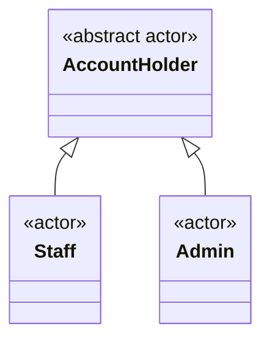

Mũi tam giác hướng về actor tổng quát. Admin và Staff cùng chuyên biệt hóa Account Holder; mô hình không dùng kế thừa Admin từ Staff để suy diễn các quyền Staff đang TBD. Admin có đầy đủ quyền từ brief, được ghi riêng trong matrix.

Đăng nhập diễn ra khi chưa có JWT nhưng người gọi vẫn là người sở hữu tài khoản. Điều này không tạo quyền truy cập ẩn danh vào dữ liệu nghiệp vụ. Đăng nhập là UC độc lập; các UC được bảo vệ có xác thực làm precondition, không `include` đăng nhập ở mỗi request.

### 2.3 Permission Matrix

`Có` có căn cứ từ brief hoặc xác nhận Identity của user; `Không` là bị cấm; `TBD` chưa thể coi là quyền đã cấp. Quyền nghiệp vụ ngoài Identity trong brief vẫn là bản nháp cần chốt.

| Nhóm UC | Admin | Staff | Điểm cần chốt |
|---|---|---|---|
| UC-AUTH01 | Có | Có | Access JWT 30 phút, không refresh; Confirmed |
| UC-CAT01/02, UC-PRD01/02 | Có | Có | Danh sách mặc định ẩn bản ghi xóa mềm |
| UC-CAT03/04/05, UC-PRD03/04/05 | Có | Không | Chính sách xóa: TBD-04 |
| UC-INV01 — xem tồn | Có | Có | Filter và chi tiết field: TBD-11 |
| UC-INV02 — nhập kho | Có | Có | Validation Proposed |
| UC-INV03 — điều chỉnh | Có | Không | Staff chỉ được nhập theo draft brief |
| UC-INV04 — lịch sử kho | Có | TBD | TBD-10 |
| UC-CUS01…05 | Có | TBD | TBD-09/10; không suy ra từ quyền tạo đơn |
| UC-ORD01/02/03 | Có | Có | Phạm vi Staff xem mọi đơn hay đơn của mình: TBD-10 |
| UC-ORD04 — hủy | Có, trong trạng thái hợp lệ | TBD; Proposed chỉ đơn mình tạo | TBD-02/03 |
| UC-ORD05 — hoàn tất | Proposed: Có | TBD | UC và quyền đều phụ thuộc TBD-03/10 |
| UC-REP01/02/03 | Có | Không | Công thức TBD-06 |
| UC-USR01; UC-USR02…06 | Có | Không | List/detail/create/change-role/set-active Confirmed; BR-19/20 |

UC-ORD06, UC-ORD07 và UC-INV05 là hành vi nội bộ được `include`; không có endpoint hay quyền gọi trực tiếp. Chúng sử dụng danh tính của UC khởi tạo để ghi nhận người thực hiện.

## 3. Complete Use Case Inventory

### 3.1 ID and Relationship Conventions

ID dùng prefix theo subsystem: AUTH, CAT, PRD, INV, CUS, ORD, REP, USR. ID không đổi theo người gọi. `Base` là mục tiêu actor; `Include` là phần bắt buộc của một UC khác; `Conditional Proposed` chỉ tồn tại nếu phương án mở được duyệt. Lỗi thiếu kho hay token hết hạn là nhánh của UC, không phải UC mới.

### 3.2 Full Inventory

`Required scope` là mục tiêu từ brief; mô hình UC cho các subsystem tương lai vẫn Proposed. UC-AUTH01 và các UC-USR02…06 có contract và source hiện có, không có nghĩa toàn bộ inventory đã triển khai.

| ID | Use Case | Actor khởi tạo | Quan hệ | Scope / ghi chú |
|---|---|---|---|---|
| UC-AUTH01 | Đăng nhập và nhận JWT | Account Holder | Base | Confirmed; source hiện có, xem mục 4.1 |
| UC-CAT01 | Liệt kê/tìm danh mục | Admin, Staff | Base | Required scope; paging/filter/sort |
| UC-CAT02 | Xem chi tiết danh mục | Admin, Staff | Base | Required scope |
| UC-CAT03 | Tạo danh mục | Admin | Base | Required scope |
| UC-CAT04 | Sửa danh mục | Admin | Base | Required scope |
| UC-CAT05 | Xóa mềm danh mục | Admin | Base | Catalog soft delete theo brief; quy tắc tham chiếu TBD-04 |
| UC-PRD01 | Liệt kê/tìm sản phẩm | Admin, Staff | Base | Required scope; paging/filter/sort |
| UC-PRD02 | Xem chi tiết sản phẩm | Admin, Staff | Base | Required scope |
| UC-PRD03 | Tạo sản phẩm | Admin | Base | Required scope; SKU duy nhất |
| UC-PRD04 | Sửa sản phẩm | Admin | Base | Required scope; ảnh hưởng giá tương lai |
| UC-PRD05 | Xóa mềm sản phẩm | Admin | Base | Required scope; giữ đơn cũ |
| UC-INV01 | Xem tồn kho | Admin, Staff | Base | Required scope; kho duy nhất |
| UC-INV02 | Nhập kho | Admin, Staff | Base | Required scope; tăng tồn |
| UC-INV03 | Điều chỉnh tồn kho | Admin | Base | Required scope; tăng/giảm, không âm |
| UC-INV04 | Xem lịch sử biến động kho | Admin; Staff TBD | Base | Required scope; quyền Staff TBD-10 |
| UC-INV05 | Ghi nhận biến động kho | Nội bộ | Include | Bắt buộc khi tồn thay đổi; không endpoint |
| UC-CUS01 | Liệt kê/tìm khách hàng | Admin; Staff TBD | Base | Required scope; quyền TBD-10 |
| UC-CUS02 | Xem chi tiết khách hàng | Admin; Staff TBD | Base | Required scope |
| UC-CUS03 | Tạo khách hàng | Admin; Staff TBD | Base | Required scope; field TBD-09 |
| UC-CUS04 | Sửa khách hàng | Admin; Staff TBD | Base | Required scope |
| UC-CUS05 | Xóa khách hàng | Admin; Staff TBD | Base | Required scope; soft/hard, tham chiếu TBD-04/09 |
| UC-ORD01 | Tạo đơn hàng nhiều dòng | Admin, Staff | Base | Required scope |
| UC-ORD02 | Liệt kê/tìm đơn hàng | Admin, Staff | Base | Required scope; phạm vi đọc TBD-10 |
| UC-ORD03 | Xem chi tiết đơn hàng | Admin, Staff | Base | Required scope; dữ liệu lịch sử |
| UC-ORD04 | Hủy đơn hàng | Admin; Staff TBD | Base | Required scope; trạng thái/hoàn kho TBD-02/03 |
| UC-ORD05 | Hoàn tất đơn hàng | Admin Proposed; Staff TBD | Conditional Proposed | Chỉ cần nếu duyệt workflow TBD-03 |
| UC-ORD06 | Kiểm tra và định giá đơn | Nội bộ | Include từ UC-ORD01 | Kiểm tra sản phẩm, số lượng, giá; policy TBD-11 |
| UC-ORD07 | Trừ kho cho đơn hàng | Nội bộ | Include từ UC-ORD01 | Bảo vệ cạnh tranh và gọi UC-INV05 |
| UC-REP01 | Xem doanh thu theo ngày | Admin | Base | Required scope; semantics TBD-06 |
| UC-REP02 | Xem doanh thu theo tháng | Admin | Base | Required scope; semantics TBD-06 |
| UC-REP03 | Xem top sản phẩm bán chạy | Admin | Base | Required scope; ranking TBD-06 |
| UC-USR01 | Quản lý người dùng | Admin | Umbrella | Required capability, phân rã thành UC-USR02…06 |
| UC-USR02 | Liệt kê/tìm tài khoản | Admin | Base thuộc UC-USR01 | Confirmed, source hiện có |
| UC-USR03 | Xem chi tiết tài khoản | Admin | Base thuộc UC-USR01 | Confirmed, source hiện có |
| UC-USR04 | Tạo tài khoản | Admin | Base thuộc UC-USR01 | Confirmed, source hiện có |
| UC-USR05 | Đổi role tài khoản | Admin | Base thuộc UC-USR01 | Confirmed; BR-19/20 |
| UC-USR06 | Bật/tắt active tài khoản | Admin | Base thuộc UC-USR01 | Confirmed; BR-19/20 |

UC-USR01 giữ ID umbrella để không phá traceability cũ. Phân rã này không bổ sung tự đăng ký, refresh, đặt lại mật khẩu hay xóa người dùng.

### 3.3 Use Case Relationships — Proposed

Mermaid dùng flowchart để biểu diễn quan hệ use case; nhãn `include` tương ứng quan hệ UML, không biểu diễn HTTP call riêng.

```mermaid
flowchart LR
    A["Admin / Staff"] --> O["UC-ORD01 Create Order"]
    A --> R["UC-INV02 Receive Stock"]
    ADM["Admin"] --> J["UC-INV03 Adjust Stock"]
    O -.->|include| V["UC-ORD06 Validate and Price"]
    O -.->|include| D["UC-ORD07 Deduct Stock"]
    D -.->|include| M["UC-INV05 Record Movement"]
    R -.->|include| M
    J -.->|include| M
    ADM --> C["UC-ORD04 Cancel Order"]
    ADM --> Q["UC-REP01 / 02 / 03 Reports"]
```

UC-INV05 được thực hiện cho từng sản phẩm có thay đổi tồn, không phải một dòng lịch sử cho toàn bộ đơn. UC-ORD04 chỉ dùng hành vi ghi lịch sử khi nhánh hoàn kho Proposed được duyệt và thực sự thay đổi tồn; vì vậy không vẽ `include` vô điều kiện từ hủy đơn.

### 3.4 Detail Selection and Shared Contract

Phần 4 mô tả sâu các UC có rủi ro về bảo mật, dữ liệu lịch sử, cạnh tranh kho, vòng đời đơn và định nghĩa báo cáo. Catalog/customer CRUD còn lại tái sử dụng hợp đồng DTO/validation/authorization, nhưng không vì thế được coi là đã đặc tả field hay quyền còn TBD.

**Error mapping nền tảng đã Selected/Implemented:** 400 validation, 401 thiếu/sai xác thực, 403 thiếu quyền, 404 không tìm thấy, 409 xung đột và 500 lỗi không dự kiến; ProblemDetails có `errorCode`, `traceId`, validation `errors`. Owner là [ProblemResponses](../src/OrderInventory.Api/Errors/ProblemResponses.cs), [GlobalExceptionHandler](../src/OrderInventory.Api/Errors/GlobalExceptionHandler.cs) và [Program](../src/OrderInventory.Api/Program.cs). 401 giữ Bearer challenge. Staff gọi endpoint Admin-only trả 403 theo AC-02. Chính sách che giấu tài nguyên của subsystem chưa triển khai vẫn TBD-10.

Không ghi số lượng truy cập, tác giả cá nhân hoặc ngày phê duyệt giả định. Tần suất sử dụng, giới hạn tải và người duyệt là TBD.

## 4. Detailed Use Case Specifications

UC-AUTH01 và UC-USR02…06 ghi contract Identity đã chốt. Các main flow khác là **Proposed realization**; flow có gate TBD không được xem là business contract đã duyệt. Ngoại lệ theo hợp đồng lỗi chung; không trả exception/EF entity cho người gọi.

### 4.1 UC-AUTH01 — Đăng nhập và nhận JWT

| Field | Specification |
|---|---|
| Primary actor | Account Holder, chuyên biệt thành Admin hoặc Staff |
| Trigger | Người dùng gửi thông tin đăng nhập |
| Preconditions | Tài khoản đã được cấp và active; cấu hình ký token hợp lệ |
| Success postconditions | Danh tính được xác thực; JWT được cấp với role đã xác định; không trả password/hash |
| Failure postconditions | Không cấp JWT; không thay đổi đơn/tồn kho |
| Rules | BR-01, BR-02, BR-04, BR-14, BR-20 |
| Status / owner | Confirmed cho username/password, access-only 30 phút; [AuthenticationService](../src/OrderInventory.Application/Identity/AuthenticationService.cs), [JWT issuer](../src/OrderInventory.Infrastructure/Identity/JwtTokenIssuer.cs) |

**Main flow — Confirmed contract, Selected realization**

Actor gửi username/password; server xác thực tài khoản active và lấy role từ dữ liệu có thẩm quyền, rồi trả `LoginResult`. DTO và HTTP status nằm ở [API hiện có](../README.md#api-hiện-có); validation/normalization thuộc [IdentityValidation](../src/OrderInventory.Application/Identity/IdentityValidation.cs). Không cho client tự cấp role qua login request.

**Alternative flows**

- **A1 — Access token hết hạn:** đăng nhập lại; không có refresh UC/endpoint.
- **A2 — Quản trị thay đổi role/active:** token cũ bị từ chối ở request kế tiếp theo BR-20. Selected: TokenVersion tăng khi có thay đổi thực sự; kiểm active/current role/version từ DB cho mỗi request. Điều này chấp nhận một DB lookup để tránh token giữ quyền cũ đến hết 30 phút.

**Exceptions**

- **E1:** Credentials sai hoặc tài khoản inactive → 401 với thông báo chung, không tiết lộ tài khoản có tồn tại.
- **E2:** DTO không hợp lệ → 400; không trả lại password đã gửi.
- **E3:** Thiếu khóa ký hoặc lỗi persistence → không cấp token; lỗi cấu hình phải làm startup/readiness thất bại theo phương án deployment.

Không có refresh hoặc self-register. Ngoại lệ anonymous đã Confirmed cho Swagger UI/spec chỉ ở Development không cấp quyền anonymous vào dữ liệu nghiệp vụ.

### 4.2 UC-PRD03 — Tạo sản phẩm

| Field | Specification |
|---|---|
| Primary actor | Admin |
| Trigger | Admin yêu cầu tạo sản phẩm với SKU, tên, giá và danh mục dự kiến |
| Preconditions | JWT hợp lệ, role Admin; danh mục được tham chiếu hợp lệ theo policy TBD-04/11 |
| Success postconditions | Sản phẩm mới có SKU duy nhất; DTO được trả; phương án tạo tồn ban đầu bằng 0 chưa chốt |
| Failure postconditions | Không có sản phẩm hoặc số dư kho được lưu dở dang |
| Rules | BR-02, BR-03, BR-04, BR-05, BR-15 |
| Open decisions | TBD-04, TBD-08, TBD-11 |

**Main flow — Proposed**

1. Catalog boundary xác thực/kiểm tra quyền và validate CreateProductRequest.
2. CatalogService kiểm tra danh mục, tên, đơn giá và chính sách SKU.
3. Service tạo Product; Proposed tạo InventoryBalance bằng 0 trong cùng transaction nếu chọn số dư tách riêng.
4. Persistence áp dụng ràng buộc duy nhất SKU ở database, kể cả khi hai request tạo cùng lúc.
5. Transaction commit; API trả ProductDto với Proposed 201 và định danh mới.

**Alternative flows**

- **A1 — SKU thuộc sản phẩm đã xóa mềm:** áp dụng chính sách tái sử dụng TBD-04; không tự tạo mới hay tự khôi phục.
- **A2 — Cần tồn ban đầu khác 0:** Proposed dùng UC-INV02 để có lịch sử; không ghi thẳng số dư dương mà thiếu movement. Việc tạo bản ghi balance bằng 0 không được tính là một thay đổi số lượng.

**Exceptions**

- **E1:** SKU trùng → Proposed 409, kể cả xung đột chỉ xuất hiện lúc ghi database.
- **E2:** Giá/số trường không hợp lệ → Proposed 400; giới hạn và việc cho phép giá 0 vẫn TBD-11.
- **E3:** Danh mục không hợp lệ/đã xóa → Proposed 404 hoặc 409 theo policy được chốt.
- **E4:** Ghi Product hoặc InventoryBalance thất bại → rollback cả hai.

UC-PRD04 sửa sản phẩm sẽ dùng cùng validation và SKU constraint. Giá/tên mới không được viết lại snapshot của đơn cũ theo BR-09/15.

### 4.3 UC-PRD05 — Xóa mềm sản phẩm

| Field | Specification |
|---|---|
| Primary actor | Admin |
| Trigger | Admin yêu cầu xóa sản phẩm |
| Preconditions | JWT Admin; sản phẩm tồn tại trong phạm vi quản trị |
| Success postconditions | Sản phẩm không xuất hiện trong danh sách thông thường; đơn cũ vẫn đọc đúng thông tin |
| Failure postconditions | Trạng thái sản phẩm không thay đổi |
| Rules | BR-02, BR-09, BR-10 |
| Open decisions | TBD-04, TBD-11; chính sách sản phẩm còn tồn hoặc đang được đặt |

**Main flow — Proposed**

1. Boundary kiểm tra quyền, chuyển productId cho CatalogService.
2. Service đọc trạng thái và kiểm tra policy xóa đã duyệt.
3. Service đặt dấu xóa mềm, giữ bản ghi và các tham chiếu lịch sử.
4. Persistence commit; API trả kết quả không chứa entity.
5. UC-PRD01 ẩn sản phẩm này; UC-ORD03 đọc dữ liệu bán hàng lịch sử từ OrderLine snapshot.

**Alternative flows**

- **A1 — Đã xóa:** Proposed trả thành công không đổi dữ liệu; cần chốt cách phản hồi ở TBD-04.
- **A2 — Danh mục bị xóa khi còn sản phẩm:** UC-CAT05 phải có policy riêng; Proposed từ chối nếu còn sản phẩm hoạt động, không cascade xóa đơn/lịch sử.

**Exceptions**

- **E1:** Không tồn tại → Proposed 404.
- **E2:** Vướng policy tồn kho/tham chiếu → Proposed 409; điều kiện cụ thể TBD-04.
- **E3:** Xung đột với sửa/xóa hoặc tạo đơn đồng thời → xử lý theo policy đồng bộ TBD-01/11; không khẳng định xóa mềm tự giải quyết race.

### 4.4 UC-INV02 — Nhập kho

| Field | Specification |
|---|---|
| Primary actor | Admin hoặc Staff |
| Trigger | Actor gửi số lượng nhập cho một sản phẩm |
| Preconditions | JWT và quyền nhập; sản phẩm hợp lệ; quantity theo đơn vị đã chốt |
| Success postconditions | Tồn tăng đúng quantity; có đúng một movement cho thay đổi này; balanceAfter là số dư ngay sau cập nhật |
| Failure postconditions | Không đổi tồn, không tạo movement |
| Rules | BR-02, BR-04, BR-05, BR-06, BR-17 |
| Open decisions | TBD-08, TBD-11, TBD-12 |

**Main flow — Proposed**

1. Inventory boundary validate productId và quantity; Proposed quantity phải dương.
2. InventoryService mở transaction và kiểm tra sản phẩm được phép nhập.
3. InventoryWriter tăng số dư bằng cập nhật nguyên tử tại database; lấy số dư thực tế sau cập nhật.
4. Thực hiện UC-INV05 với delta dương, balanceAfter, loại Receipt, actor và tham chiếu nghiệp vụ nếu có.
5. Commit số dư và movement cùng transaction.
6. API trả InventoryBalanceDto/MovementDto; không trả tracked entity.

**Alternative flows**

- **A1 — Có yêu cầu thay đổi tồn đồng thời:** database phải tuần tự hóa các cập nhật trên cùng balance; movement lấy giá trị sau chính cập nhật của nó, không lấy từ lần đọc cũ.
- **A2 — Nhập nhiều sản phẩm một lần:** không được brief định nghĩa; batch receipt là TBD, không mặc định endpoint này hỗ trợ batch.

**Exceptions**

- **E1:** Quantity không hợp lệ hoặc vượt kiểu/giới hạn → Proposed 400.
- **E2:** Sản phẩm không tồn tại/không được phép nhập → Proposed 404/409 theo policy.
- **E3:** Ghi movement thất bại → rollback tăng tồn.
- **E4:** Client timeout sau khi có thể đã commit → kết quả chưa rõ; không tự gửi lại với giả định chưa nhập. Idempotency chưa chốt tại TBD-12.

### 4.5 UC-INV03 — Điều chỉnh tồn kho

| Field | Specification |
|---|---|
| Primary actor | Admin |
| Trigger | Admin gửi điều chỉnh do kiểm kê/sai lệch |
| Preconditions | JWT Admin; sản phẩm hợp lệ; policy quantity/reason đã được chốt |
| Success postconditions | Tồn phản ánh delta đã chấp nhận, không âm; đúng một movement tương ứng |
| Failure postconditions | Số dư và lịch sử không đổi |
| Rules | BR-02, BR-04, BR-05, BR-06, BR-08 |
| Open decisions | TBD-08, TBD-11, TBD-12 |

**Main flow — Proposed**

1. Actor gửi signed delta và lý do; chọn delta thay vì “ghi đè số tồn” là Proposed.
2. Boundary validate DTO và quyền Admin.
3. InventoryService mở transaction.
4. InventoryWriter cập nhật có điều kiện: số dư sau delta phải không âm, đồng thời kiểm tra số dòng thực sự cập nhật.
5. UC-INV05 ghi loại Adjustment, delta và số dư sau cập nhật.
6. Commit; trả DTO của thay đổi.

**Alternative flows**

- **A1 — Delta dương:** dùng cùng transaction/history contract như tăng kho.
- **A2 — Người dùng muốn nhập số kiểm kê tuyệt đối:** chỉ hỗ trợ sau khi chốt concurrency token hoặc policy xử lý số dư đã thay đổi; không biến số đọc cũ thành delta ngầm.
- **A3 — Delta bằng 0:** Proposed từ chối như no-op; không tạo movement khi số lượng không thay đổi.

**Exceptions**

- **E1:** Staff gọi điều chỉnh → 403 theo AC-02, không ghi dữ liệu.
- **E2:** Số dư sau điều chỉnh âm → Proposed 409; không ghi movement.
- **E3:** Bất kỳ persistence step nào thất bại → rollback toàn bộ.

### 4.6 UC-ORD01 — Tạo đơn hàng nhiều dòng

| Field | Specification |
|---|---|
| Primary actor | Admin hoặc Staff |
| Trigger | Actor gửi danh sách productId/quantity và customerId nếu policy yêu cầu |
| Preconditions | JWT hợp lệ; quyền tạo đơn; request có dòng hợp lệ; lựa chọn khách hàng, đơn vị và giá đã chốt |
| Success postconditions | Một Order và các OrderLine được lưu; tồn giảm đúng tổng lượng bán; mỗi thay đổi có movement; DTO giữ thông tin lịch sử |
| Failure postconditions | Không lưu đơn, dòng, giảm kho hay movement của yêu cầu bị từ chối/rollback |
| Rules | BR-03…BR-09, BR-11, BR-15, BR-17, BR-18 |
| Open decisions | TBD-01, TBD-03, TBD-08, TBD-09, TBD-11, TBD-12 |

**Main flow — Proposed**

1. Orders boundary kiểm tra quyền và cấu trúc CreateOrderRequest.
2. OrderService mở một transaction bao phủ toàn bộ use case.
3. Thực hiện UC-ORD06: kiểm tra sản phẩm, trạng thái có thể bán, customer nếu có, quantity và chính sách giá.
4. Theo phương án TBD-11, gộp các dòng trùng productId, kiểm tra tổng quantity sau gộp và giới hạn số học. Nếu chọn từ chối dòng trùng thì phải đổi flow/validation tương ứng.
5. Chụp SKU, tên, unitPrice từ dữ liệu server; tính tổng dòng và tổng đơn theo policy tiền tệ. Không tin tổng tiền client gửi.
6. Tạo Order với createdBy, thời điểm và trạng thái khởi tạo Proposed Pending; thêm các OrderLine snapshot.
7. Thực hiện UC-ORD07 cho từng sản phẩm theo một thứ tự khóa ổn định Proposed để giảm deadlock.
8. InventoryWriter chỉ giảm khi số dư còn đủ tại thời điểm cập nhật. Nếu số dòng bị ảnh hưởng không đúng kỳ vọng thì dừng và rollback.
9. Với mỗi thay đổi thành công, UC-INV05 ghi delta âm, balanceAfter và tham chiếu Order/OrderLine trong cùng transaction.
10. Lưu các thay đổi và commit. Chỉ sau commit thành công mới trả OrderDto và Proposed 201.

**Alternative flows**

- **A1 — Không có customerId:** chỉ được chấp nhận nếu TBD-09 duyệt khách lẻ; không tự tạo Customer giả.
- **A2 — Dữ liệu giá thay đổi đồng thời:** phương án giá snapshot tại thời điểm đọc trong transaction cần được chốt; không cam kết tự động lấy “giá mới nhất” nếu policy không định nghĩa thời điểm đó.
- **A3 — Sản phẩm được soft-delete trong lúc tạo đơn:** policy thời điểm xác nhận khả năng bán thuộc TBD-11. Dù chọn policy nào, BR-05/07/09 vẫn phải giữ.
- **A4 — Một sản phẩm không đủ kho sau khi các sản phẩm trước đã được cập nhật:** rollback mọi thay đổi của đơn, kể cả số dư/movement đã ghi tạm trong transaction.

**Exceptions**

- **E1:** Body rỗng, quantity không hợp lệ, tổng vượt miền giá trị → Proposed 400.
- **E2:** Product/customer không hợp lệ → Proposed 404/409 theo policy; không lưu một phần đơn.
- **E3:** Thiếu kho hoặc bị đơn đồng thời lấy trước → Proposed 409 với ProblemDetails rõ sản phẩm thiếu nếu chính sách tiết lộ cho phép; không âm kho.
- **E4:** Ghi OrderLine/movement, deadlock hoặc lỗi database trước commit → rollback toàn transaction; retry policy TBD-12, không trả thành công giả.
- **E5:** Mất kết nối khi commit → kết quả có thể chưa xác định; không kết luận chắc chắn rollback. Chưa cam kết chống trùng khi actor retry.

**Included behavior contracts**

| UC | Đầu vào dự kiến | Kết quả / trách nhiệm |
|---|---|---|
| UC-ORD06 | Các dòng request, dữ liệu catalog/customer và policy | Các dòng hợp lệ, snapshot và tổng tiền; không tự commit |
| UC-ORD07 | Product và quantity đã chuẩn hóa; transaction hiện hành | Giảm tồn có bảo vệ cạnh tranh, lấy balanceAfter; gọi UC-INV05; không mở transaction độc lập |
| UC-INV05 | Product, delta, balanceAfter, actor, loại và tham chiếu | Ghi một movement cho đúng thay đổi; không tự commit hay retry riêng |

### 4.7 UC-ORD04 — Hủy đơn hàng

| Field | Specification |
|---|---|
| Primary actor | Admin; quyền Staff chờ TBD-02 |
| Trigger | Actor gửi yêu cầu hủy một đơn |
| Preconditions | JWT và policy ownership hợp lệ; trạng thái đơn cho phép hủy theo quyết định TBD-03 |
| Success postconditions | Đơn chuyển trạng thái hủy; nếu policy hoàn kho được duyệt thì hoàn kho và movement commit cùng trạng thái, tối đa một lần |
| Failure postconditions | Không đổi trạng thái, tồn hoặc lịch sử |
| Rules | BR-02, BR-05, BR-06, BR-11, BR-12, BR-17 |
| Open decisions | TBD-02, TBD-03, TBD-10, TBD-12 |

**Main flow — Proposed, chỉ cho phương án Pending → Cancelled có hoàn kho**

1. Boundary xác thực; OrderService kiểm tra quyền hủy. Staff không được cấp quyền chỉ từ sơ đồ.
2. Service mở transaction và đọc đơn trong phạm vi actor được phép tác động.
3. Kiểm tra đơn đang Pending; thực hiện chuyển trạng thái có điều kiện trên trạng thái/version hiện hành.
4. Nếu chuyển trạng thái được đúng một lần, hoàn lại số lượng đã trừ của từng dòng bằng cập nhật nguyên tử.
5. Với mỗi sản phẩm thực sự đổi tồn, UC-INV05 ghi loại CancellationReturn, delta dương, balanceAfter và tham chiếu đơn gốc.
6. Lưu thời điểm/người hủy dự kiến, commit toàn bộ rồi trả OrderDto.

**Alternative flows**

- **A1 — Đã Cancelled:** Proposed trả trạng thái hiện tại mà không hoàn kho/ghi thêm movement. HTTP response cụ thể cần chốt; yêu cầu không hoàn hai lần vẫn giữ.
- **A2 — Nếu chốt hủy không hoàn kho:** bước 4–5 bị loại bỏ; phải cập nhật state table, sequence và QA liên quan, không giữ cả hai phương án làm contract cùng lúc.
- **A3 — Sản phẩm đã xóa mềm:** nếu hoàn kho được duyệt, phải cập nhật balance lịch sử theo productId gốc; không mất khả năng hoàn chỉ vì danh sách catalog ẩn sản phẩm. Quyền bán lại vẫn theo catalog policy.

**Exceptions**

- **E1:** Actor không có quyền/Staff không phải chủ đơn theo policy đã duyệt → Proposed 403 hoặc 404 theo chính sách che giấu.
- **E2:** Đơn Completed hoặc trạng thái không cho hủy → Proposed 409 trong workflow này.
- **E3:** Complete và cancel chạy đồng thời → đúng một chuyển trạng thái hợp lệ thắng; phía thua không hoàn kho, Proposed 409.
- **E4:** Hoàn kho/movement thất bại → rollback cả trạng thái hủy và mọi thay đổi tồn.

### 4.8 UC-ORD05 — Hoàn tất đơn hàng, Conditional Proposed

| Field | Specification |
|---|---|
| Primary actor | Admin Proposed; Staff TBD-10 |
| Trigger | Actor được phép yêu cầu hoàn tất đơn |
| Preconditions | Đã duyệt workflow TBD-03; actor được phép; đơn Pending |
| Success postconditions | Đơn Completed, có completedAt Proposed; không trừ kho lần hai |
| Failure postconditions | Trạng thái và số dư không đổi |
| Rules | BR-02, BR-07, BR-11, BR-13 |
| Open decisions | TBD-03, TBD-06, TBD-10 |

**Main flow — Proposed**

1. Boundary kiểm tra quyền đã được duyệt.
2. OrderService xác nhận đơn Pending và chuyển Pending → Completed có điều kiện trong transaction.
3. Ghi completedAt; không tạo thêm stock movement vì tồn đã giảm ở UC-ORD01.
4. Commit và trả DTO; báo cáo chỉ tính đơn này nếu chính sách TBD-06 được duyệt.

**Alternative flows**

- **A1 — Đã Completed:** Proposed trả trạng thái hiện tại, không thay đổi tồn hay timestamp gốc.
- **A2 — Chốt tạo đơn là Completed ngay:** UC-ORD05 không còn cần thiết; phải sửa inventory, UC-ORD01, lifecycle, API và report policy trước triển khai.

**Exceptions**

- **E1:** Đơn Cancelled → Proposed 409, không tự mở lại.
- **E2:** Race với cancel → chuyển trạng thái có điều kiện chỉ cho một bên thành công.
- **E3:** Thiếu quyền → Proposed 403; không dùng quyền tạo đơn để suy ra quyền hoàn tất.

### 4.9 UC-REP01 / UC-REP02 — Doanh thu theo ngày / tháng

| Field | Specification |
|---|---|
| Primary actor | Admin |
| Trigger | Admin yêu cầu báo cáo trong một khoảng ngày, group theo ngày (UC-REP01) hoặc tháng (UC-REP02) |
| Preconditions | JWT Admin; đã chốt RevenuePolicy, timezone, currency và cách diễn giải khoảng thời gian |
| Success postconditions | Trả RevenueReportDto khớp policy và dữ liệu nguồn; không đổi đơn/tồn kho |
| Failure postconditions | Không trả dữ liệu một phần hay dữ liệu của vai trò không có quyền |
| Rules | BR-02, BR-04, BR-13, BR-15 |
| Open decisions | TBD-03, TBD-06, TBD-08, TBD-14 |

**Main flow — Proposed, theo phương án báo cáo tại TBD-06**

1. Boundary xác thực và chặn Staff trước khi truy vấn số liệu.
2. Validate from/to, granularity và giới hạn khoảng thời gian; giá trị giới hạn còn TBD.
3. RevenuePolicy xác định khoảng nửa mở `[from, to)`, timezone nghiệp vụ và trạng thái được tính.
4. RevenueReadService gọi IRevenueQuery để đọc các Order Completed có completedAt thuộc khoảng đã chuyển đổi.
5. Query aggregate theo ngày hoặc tháng trong timezone đã chốt, dùng quantity và unitPriceSnapshot của OrderLine; không dùng giá hiện tại của Product.
6. Trả các bucket doanh thu cùng metadata diễn giải thời gian/tiền tệ cần thiết.

**Alternative flows**

- **A1 — Không có đơn đủ điều kiện:** Proposed trả kết quả rỗng; có lấp bucket bằng 0 hay không thuộc TBD-06.
- **A2 — Đổi policy ghi nhận doanh thu:** phải thay đồng thời query, fixture và tài liệu; không tự suy ra tiền đã thanh toán vì v1 không có thanh toán online.

**Exceptions**

- **E1:** Staff gọi → 403 theo AC-02, không lộ tổng doanh thu trong message/log trả về.
- **E2:** Khoảng ngày/timezone/granularity không hợp lệ → Proposed 400.
- **E3:** Query thất bại → lỗi qua global handler; không trả tổng một phần như kết quả đầy đủ.

Formula Proposed là tổng `quantity × unitPriceSnapshot` của dòng thuộc đơn đủ điều kiện. Thuế, chiết khấu, hoàn tiền, đa tiền tệ và các khoản phí không được brief định nghĩa. Không cộng/trừ các thành phần giả định này; phải làm rõ trước nếu chúng ảnh hưởng cách cửa hàng hiểu “doanh thu”.

### 4.10 UC-REP03 — Top sản phẩm bán chạy

| Field | Specification |
|---|---|
| Primary actor | Admin |
| Trigger | Admin yêu cầu top sản phẩm trong khoảng thời gian |
| Preconditions | JWT Admin; policy thời gian/trạng thái giống báo cáo doanh thu; metric và top N đã chốt |
| Success postconditions | Danh sách xếp hạng đúng policy, vẫn gồm sản phẩm lịch sử đã xóa nếu có giao dịch đủ điều kiện |
| Failure postconditions | Không trả kết quả sai/không được phép; dữ liệu không đổi |
| Rules | BR-02, BR-09, BR-13 |
| Open decisions | TBD-06, TBD-11, TBD-14 |

**Main flow — Proposed**

1. Kiểm tra quyền Admin, khoảng thời gian và top N.
2. Áp dụng cùng tập đơn đủ điều kiện như UC-REP01/02.
3. Aggregate theo productId ổn định; Proposed xếp giảm dần theo tổng quantity, productId là khóa phụ khi đồng hạng.
4. Tên/SKU hiển thị lấy từ snapshot theo policy biểu diễn sản phẩm đã đổi tên; cách chọn nhãn snapshot cụ thể TBD-06.
5. Trả TopProductReportDto; không lọc mất lịch sử chỉ vì Product hiện đã soft-delete.

**Alternative flows**

- **A1 — Chọn top theo tiền thay vì quantity:** là phương án khác cần duyệt; metric phải hiện rõ trong contract và fixture.
- **A2 — Không có dữ liệu:** Proposed trả danh sách rỗng.

**Exceptions**

- **E1:** Staff → 403 theo AC-02.
- **E2:** top N/metric/khoảng thời gian không hợp lệ → Proposed 400.
- **E3:** Không đọc được dữ liệu → ProblemDetails; không dùng giá bán hiện tại để thay dữ liệu lịch sử bị thiếu.

### 4.11 UC-PRD01 / UC-ORD02 — Liệt kê, lọc và sắp xếp

| Field | Specification |
|---|---|
| Primary actor | Admin hoặc Staff |
| Trigger | Actor yêu cầu danh sách sản phẩm hoặc đơn |
| Preconditions | JWT hợp lệ; policy phạm vi xem đơn của Staff được chốt trước khi mở quyền đọc |
| Success postconditions | Trả DTO phân trang, filter/sort đúng contract và phạm vi actor |
| Failure postconditions | Không lộ bản ghi ngoài quyền; không đổi dữ liệu |
| Rules | BR-02, BR-04, BR-10, BR-16 |
| Open decisions | TBD-10, TBD-11, TBD-14 |

**Main flow — Proposed**

1. Boundary validate page/pageSize, filter và sort trong allowlist.
2. Với UC-PRD01, CatalogService áp dụng điều kiện chưa xóa và filter sản phẩm/danh mục dự kiến.
3. Với UC-ORD02, OrderService áp dụng scope actor trước filter trạng thái/thời gian/người tạo được phép.
4. Persistence sort bằng field được cho phép cộng khóa phụ định danh; paging tại database.
5. Trả PagedResultDto; metadata tổng số dòng là Proposed và chỉ tính trong cùng scope/filter.

**Alternative flows**

- **A1 — Không có dòng phù hợp hoặc trang vượt dữ liệu:** Proposed trả trang rỗng.
- **A2 — Dữ liệu đổi giữa hai lần đọc trang:** offset pagination Proposed không cam kết snapshot xuyên request; tính ổn định tuyệt đối cần quyết định riêng.

**Exceptions**

- **E1:** pageSize/sort/filter không hợp lệ → Proposed 400; không đưa trực tiếp biểu thức sort client vào SQL.
- **E2:** Chưa xác định quyền xem đơn của Staff → chưa thể nghiệm thu/mở contract đó; không tự cho xem mọi đơn.

### 4.12 UC-CUS05 — Xóa khách hàng

| Field | Specification |
|---|---|
| Primary actor | Admin; Staff TBD-10 |
| Trigger | Actor yêu cầu xóa Customer |
| Preconditions | Có quyền theo policy đã chốt; Customer tồn tại; đã chốt soft/hard delete và tham chiếu đơn |
| Success postconditions | Áp dụng đúng chính sách xóa; không xóa dây chuyền đơn hoặc làm sai dữ liệu lịch sử |
| Failure postconditions | Customer và đơn không đổi |
| Rules | BR-02, BR-04, BR-18 |
| Open decisions | TBD-04, TBD-09, TBD-10 |

**Main flow — Proposed, chọn soft delete để review**

1. Boundary kiểm tra quyền; CustomerService tải Customer và kiểm tra tham chiếu.
2. Áp dụng policy đã duyệt đối với Customer đang được Order tham chiếu.
3. Đặt dấu xóa mềm, giữ tham chiếu lịch sử, commit.
4. Trả kết quả; field lịch sử khách hàng trên đơn và điều kiện chọn Customer cho đơn mới cần chốt.

**Alternative flows**

- **A1 — Chọn hard delete:** chỉ có thể áp dụng sau khi định nghĩa ràng buộc FK và dữ liệu lịch sử; không mặc định cascade xóa Order.
- **A2 — Đã xóa:** Proposed no-op; response theo contract TBD-04.

**Exceptions**

- **E1:** Không có quyền → Proposed 403/404 theo policy.
- **E2:** Policy cấm xóa Customer đang được tham chiếu → Proposed 409.
- **E3:** Lỗi ghi → rollback; không sửa đơn để lách lỗi tham chiếu.

### 4.13 UC-USR01 — Quản lý người dùng; UC-USR02…06

| Field | Specification |
|---|---|
| Primary actor | Admin |
| Trigger | Admin xem danh sách/chi tiết, tạo tài khoản, đổi role hoặc bật/tắt active |
| Preconditions | JWT Admin hợp lệ theo trạng thái account hiện tại |
| Success postconditions | Đọc/trả UserDto hoặc cập nhật tài khoản; không lộ password/hash/token; giữ BR-19/20 |
| Failure postconditions | Không đổi tài khoản/quyền |
| Rules | BR-01, BR-02, BR-04, BR-14, BR-16, BR-19, BR-20 |
| Status / owners | Tập thao tác và bảo vệ Admin cuối cùng Confirmed bởi user; [UsersController](../src/OrderInventory.Api/Controllers/UsersController.cs), [UserAdministrationService](../src/OrderInventory.Application/Identity/UserAdministrationService.cs), [IdentityValidation](../src/OrderInventory.Application/Identity/IdentityValidation.cs) |

**Main flows — Confirmed scope**

| Child UC | Mục tiêu / điều kiện thành công | Rationale / owner |
|---|---|---|
| UC-USR02 | Admin yêu cầu list với query hợp lệ; nhận trang UserDto và metadata | Không lộ account data cho Staff; [ListAsync](../src/OrderInventory.Application/Identity/UserAdministrationService.cs) |
| UC-USR03 | Admin yêu cầu account theo ID; nhận UserDto khi tồn tại | Không trả entity/hash; [GetAsync](../src/OrderInventory.Application/Identity/UserAdministrationService.cs) |
| UC-USR04 | Admin gửi username/password/role hợp lệ; tạo account active và trả UserDto | Username duy nhất sau normalization; password chỉ được hash qua adapter; [CreateAsync](../src/OrderInventory.Application/Identity/UserAdministrationService.cs) |
| UC-USR05 | Admin đổi role trong Admin/Staff; nếu thay đổi, giữ ít nhất một Admin active và thu hồi token cũ | BR-19/20; [ChangeRoleAsync](../src/OrderInventory.Application/Identity/UserAdministrationService.cs) |
| UC-USR06 | Admin gửi active state rõ ràng; nếu thay đổi, giữ ít nhất một Admin active và thu hồi token cũ | BR-19/20; [SetActiveAsync](../src/OrderInventory.Application/Identity/UserAdministrationService.cs) |

Selected realization: UserAccount int PK; trim username và `ToUpperInvariant` cho uniqueness; username 3–64 ký tự ASCII, bắt đầu chữ/số rồi cho phép chữ/số/`_`/`.`/`-`; password 12–128. Role nhận literal Admin/Staff không phân biệt hoa thường. UserList dùng page=1, pageSize=20, tối đa 100; search tối đa 64; filter role/active; sort allowlist ở IdentityValidation. Đây là giới hạn Identity, không chốt Money/quantity hay query của nghiệp vụ khác.

Selected concurrency: transaction Serializable và rowversion; không tự retry write. [EfUserStore](../src/OrderInventory.Infrastructure/Identity/EfUserStore.cs) và `SQL last-Admin tests` (local-only) là owner của bằng chứng bảo vệ cạnh tranh.

**Alternative flows**

- **A1 — List không có kết quả/trang vượt dữ liệu:** trả trang rỗng theo query contract.
- **A2 — Role/active đã bằng giá trị yêu cầu:** trả trạng thái hiện tại; không tăng TokenVersion.

**Exceptions**

- **E1:** Staff gọi bất kỳ thao tác quản lý người dùng → 403 theo AC-02.
- **E2:** Input sai/thiếu active state → 400; ID không tồn tại → 404.
- **E3:** Username trùng, vi phạm BR-19 hoặc write conflict → 409 ProblemDetails; không lưu mutation một phần.

Method/path/status được ghi một lần trong [API hiện có](../README.md#api-hiện-có). Không suy diễn thêm sửa username, reset password, xóa account hay thao tác hàng loạt.

## 5. Static Modeling

### 5.1 System Context — Proposed

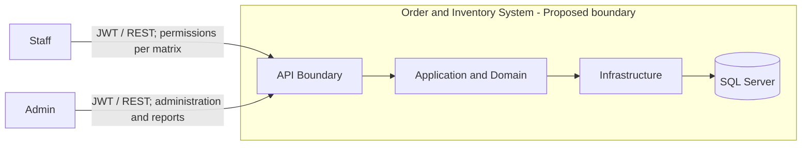

API bao gồm các subsystem nghiệp vụ; SQL Server nằm trong ranh giới giải pháp triển khai. Client gọi API là công cụ bên ngoài phạm vi frontend v1, có thể là Swagger hoặc HTTP client. Customer không có tài khoản/luồng tự đặt hàng chỉ vì được lưu trong database. Không thêm payment gateway hay dịch vụ thông báo vào context.

### 5.2 Conceptual Class Model — Proposed

Mô hình sau là miền v1 dự kiến, không phải ERD hiện có. Riêng UserAccount đã có [Domain owner](../src/OrderInventory.Domain/Identity/UserAccount.cs); các class nghiệp vụ còn lại chưa có C#/EF/schema. `Identifier`, `Quantity`, `Money`, `Instant` là kiểu khái niệm; quantity/Money và ID các entity tương lai còn TBD-08. ERD Identity thực tế nằm trong [README](../README.md#cấu-trúc-và-schema-hiện-có).

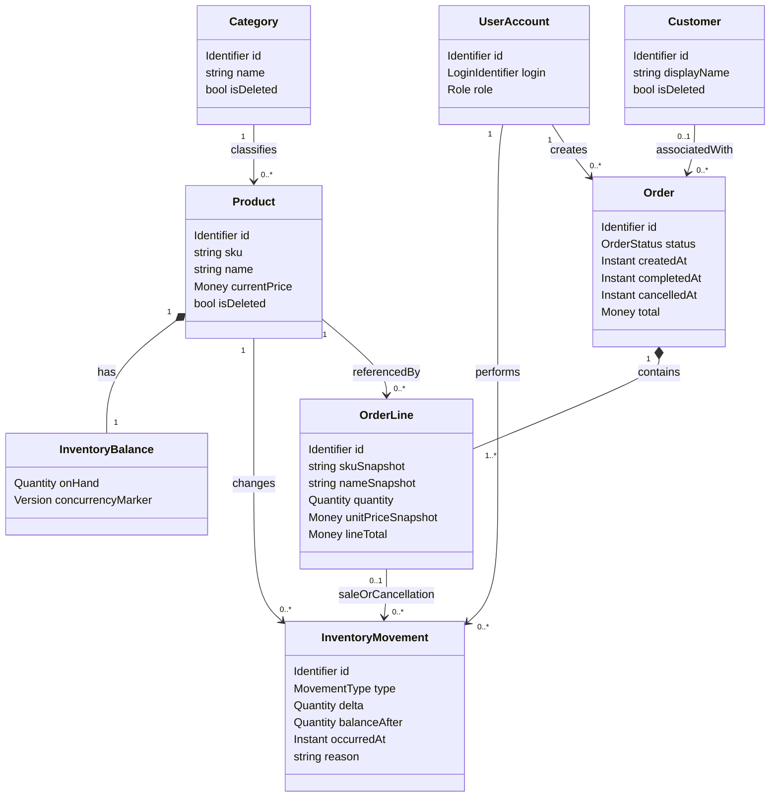

Các multiplicity là Proposed: mỗi Product thuộc một Category; mỗi Product có một balance cho kho duy nhất; Order có ít nhất một dòng; Customer của Order có thể vắng nếu TBD-09 được duyệt. Một movement nhập/điều chỉnh không cần OrderLine; movement bán/hoàn có thể tham chiếu một dòng. Nếu chọn mô hình một product xuất hiện nhiều dòng trong đơn thay vì gộp, phải sửa policy history và cardinality ở chỗ phân bổ movement.

`concurrencyMarker` chỉ là điểm mở cho rowversion/optimistic concurrency. Phương án conditional update không bắt buộc phải có cột version. Thuộc tính này không chốt cơ chế tại TBD-01. Customer.isDeleted, các timestamp trạng thái và snapshot đều là Proposed; không coi là schema đã duyệt.

### 5.3 Entity Responsibilities and Invariants

| Concept | Trách nhiệm / bất biến | Trạng thái |
|---|---|---|
| UserAccount | Danh tính Admin/Staff, active state và hiệu lực token; giữ BR-19/20 | Identity Implemented; [Domain owner](../src/OrderInventory.Domain/Identity/UserAccount.cs), liên kết nghiệp vụ tương lai Proposed |
| Category | Phân loại sản phẩm; policy xóa không cascade phá lịch sử | Proposed association; xóa theo TBD-04 |
| Product | SKU duy nhất; giữ liên kết lịch sử khi xóa mềm | BR-03/09/10 Required; cách enforce Proposed |
| InventoryBalance | onHand ≥ 0; một số dư cho mỗi sản phẩm trong kho duy nhất | BR-05 Required; schema Proposed |
| InventoryMovement | balanceAfter = balanceBefore + delta tại thời điểm thay đổi; một dòng cho một thay đổi thực tế | BR-06 Required; tên field Proposed |
| Customer | Thông tin khách hàng; không đồng nhất với UserAccount | BR-18; field và delete policy TBD |
| Order | Bao gồm nhiều dòng, createdBy và trạng thái; commit cùng tác động kho | BR-07 Required; state policy Proposed |
| OrderLine | Lượng bán và thông tin bán tại thời điểm tạo; không phụ thuộc giá hiện tại để đọc đơn cũ | BR-09 Required; snapshot/giá tính toán Proposed |

Số dư sau của một movement cũ không nhất thiết bằng tồn hiện tại, vì có thể đã có movement mới. Kiểm tra đối soát phải so cùng thời điểm hoặc dùng chuỗi `openingBalance + Σ delta = onHand`. Seed tồn dương phải đi qua cơ chế ghi lịch sử/điểm mở đầu được định nghĩa; không tạo số dư mà không thể đối soát.

### 5.4 Conceptual Persistence Constraints — Proposed

| Constraint dự kiến | Mục đích | Quyết định còn mở |
|---|---|---|
| Unique index SKU | Đảm bảo duy nhất cả khi tạo đồng thời | Normalization, collation, phạm vi soft delete TBD-04/11 |
| Unique balance key theo productId | Không có hai số dư cho cùng sản phẩm | Có tách bảng balance hay không TBD-07/08 |
| Check constraint onHand ≥ 0 | Lớp bảo vệ cuối cho bất biến kho | Conditional update/isolation vẫn phải chốt; constraint không thay thế flow |
| FK OrderLine → Order/Product | Giữ liên kết và ngăn xóa vật lý phá đơn cũ | Soft delete và lịch sử TBD-04 |
| FK Movement → Product/actor và OrderLine tùy loại | Truy vết nguồn thay đổi tồn | Nullability và seed actor TBD-13 |
| Ràng buộc chuyển trạng thái/version | Ngăn complete/cancel cùng thắng, hoàn kho hai lần | TBD-01/03/12 |
| Money precision/scale, quantity bounds | Tránh mất chính xác/tràn số | TBD-08/11 |

Các constraint nghiệp vụ trên chưa được triển khai. Identity hiện có được sở hữu bởi [DbContext](../src/OrderInventory.Infrastructure/Persistence/OrderInventoryDbContext.cs) và [InitialIdentity](../src/OrderInventory.Infrastructure/Persistence/Migrations/20261103010353_InitialIdentity.cs); ERD trong README chỉ thể hiện UserAccounts/SeedHistory. Không suy diễn schema Product/Order từ mô hình này thành migration đã có.

## 6. Object and Class Structuring

### 6.1 COMET Categories and Layer Mapping — Proposed

| COMET stereotype | Trách nhiệm | Phân bổ tầng dự kiến |
|---|---|---|
| «boundary» | Nhận/trả HTTP, hợp đồng DTO, chuyển lỗi; adapter giao tiếp persistence/token | API cho HTTP; Infrastructure cho adapter bên ngoài; port do Application sở hữu |
| «entity» | Trạng thái/khái niệm miền tồn tại lâu dài, bất biến nội tại | Domain; mapping persistence ở Infrastructure |
| «control» | Điều phối một UC, authorization theo tài nguyên, transaction và thứ tự thực hiện | Application services |
| «application logic» | Quy tắc chuyển trạng thái, tính giá, kiểm tra lượng và chính sách doanh thu | Domain cho logic miền thuần; Application cho policy của use case |

HTTP controller là boundary. OrderService mới là control điều phối UC; OrderPricingPolicy là application logic. Không cần thêm một class “control” và một class “service” trùng trách nhiệm chỉ để đủ nhãn COMET. Dependency inversion cho phép control gọi port mà không phụ thuộc EF Core.

### 6.2 Boundary Objects — Current Identity and Proposed Remaining

| Object / contract | Trách nhiệm | UC liên quan |
|---|---|---|
| [AuthController](../src/OrderInventory.Api/Controllers/AuthController.cs), LoginRequest, LoginResult | Identity owner hiện có; contract tại [Application](../src/OrderInventory.Application/Identity/Contracts.cs) | UC-AUTH01 |
| CatalogController, ProductDto, CategoryDto | Catalog CRUD/list; chỉ chuyển request vào service | UC-CAT01…05, UC-PRD01…05 |
| InventoryController, StockChangeRequest, MovementDto | Tồn kho, nhập/điều chỉnh, lịch sử | UC-INV01…04 |
| CustomersController, CustomerDto | Hợp đồng CRUD khách hàng theo field/quyền được chốt | UC-CUS01…05 |
| OrdersController, CreateOrderRequest, OrderDto | Tạo/list/detail/cancel; complete nếu được duyệt | UC-ORD01…05 |
| ReportsController, RevenueReportDto, TopProductReportDto | Validate query báo cáo và trả projection | UC-REP01…03 |
| [UsersController](../src/OrderInventory.Api/Controllers/UsersController.cs), UserDto | Identity owner hiện có; contract tại Application | UC-USR02…06 |
| GlobalExceptionHandler | Ánh xạ exception được phân loại thành ProblemDetails, che lỗi nội bộ | Tất cả UC HTTP |
| RequestValidators, PagedResultDto | Validation và kết quả danh sách | CRUD/list/report |
| EfInventoryWriter / EfDataAccess | Adapter SQL/EF cho đọc/ghi có ràng buộc | Catalog, inventory, customer, order |
| SqlRevenueQuery | Adapter aggregate báo cáo; EF query tối ưu hoặc stored procedure còn TBD | UC-REP01…03 |
| [JwtTokenIssuer](../src/OrderInventory.Infrastructure/Identity/JwtTokenIssuer.cs), [PasswordService](../src/OrderInventory.Infrastructure/Identity/PasswordService.cs) | Adapter bảo mật hiện có | UC-AUTH01, UC-USR04 |

### 6.3 Entity and Control Objects — Proposed

| Category | Object | Trách nhiệm | Realizes |
|---|---|---|---|
| «entity» | UserAccount, Category, Product, Customer | Danh tính, catalog và khách hàng | AUTH, CAT, PRD, CUS, USR |
| «entity» | InventoryBalance, InventoryMovement | Số dư và dấu vết thay đổi kho | UC-INV01…05, UC-ORD07 |
| «entity» | Order, OrderLine | Đơn/dòng và thông tin bán hàng lịch sử | UC-ORD01…05 |
| «control» | AuthenticationService | Kiểm tra credentials, lấy role, cấp token qua port | UC-AUTH01 |
| «control» | CatalogService | Điều phối CRUD, kiểm tra SKU/tham chiếu, paging | UC-CAT01…05, UC-PRD01…05 |
| «control» | InventoryService | Transaction của nhập/điều chỉnh, đọc tồn/lịch sử | UC-INV01…04; dùng UC-INV05 |
| «control» | CustomerService | Điều phối CRUD và policy Customer | UC-CUS01…05 |
| «control» | OrderService | Transaction toàn đơn; validation/giá/kho; lifecycle | UC-ORD01…07 |
| «control» | RevenueReadService | Quyền báo cáo, chuẩn hóa query và aggregate projection | UC-REP01…03 |
| «control» | [UserAdministrationService](../src/OrderInventory.Application/Identity/UserAdministrationService.cs) | Owner quản trị tài khoản hiện có | UC-USR02…06; gate Staff policies nghiệp vụ khác vẫn mở |

### 6.4 Application Logic and Ports — Proposed Business Design

Identity hiện có dùng các port trong [Application/Abstractions](../src/OrderInventory.Application/Abstractions); [BootstrapSeedService](../src/OrderInventory.Application/Seeding/BootstrapSeedService.cs) sở hữu transaction của account data và marker qua `ISeedHistoryStore`. Các tên port nghiệp vụ trong bảng là Proposed, không phải inventory source.

| Object / port | Trách nhiệm | Quy tắc / gate |
|---|---|---|
| OrderPricingPolicy | Chuẩn hóa dòng, tính snapshot/tổng theo Money policy | BR-15; TBD-08/11 |
| StockRules | Quantity hợp lệ và số dư không âm về mặt nghiệp vụ; không thay thế database concurrency | BR-05/08 |
| OrderLifecyclePolicy | Kiểm tra chuyển trạng thái và việc có hoàn kho | BR-11/12; TBD-03 |
| ResourceAuthorizationPolicy | Role và ownership/phạm vi đọc | BR-02; TBD-02/10 |
| RevenuePolicy | Eligibility, timestamp, bucket, metric và rounding | BR-13; TBD-06/08 |
| IInventoryWriter | Tăng/giảm có điều kiện, trả balanceAfter; ghi movement trong transaction hiện hành | BR-05…08 |
| IUnitOfWork | Bắt đầu/commit/rollback transaction chung; không cho helper commit riêng | BR-07/12 |
| ICatalogData, ICustomerData, IOrderData | Các port đọc/ghi dự kiến theo nhu cầu nghiệp vụ | Service/port style đã Selected; shape cụ thể theo từng UC chưa chốt |
| IRevenueQuery | Projection báo cáo được lọc và aggregate tại SQL | R-T08 |
| ITokenIssuer, IPasswordVerifier | Hợp đồng bảo mật tách khỏi orchestration | BR-01/14 |

UC-INV05 có thể do IInventoryWriter thực hiện cùng persistence update. Không nhất thiết có một public service riêng cho mỗi UC `include`. Domain không tham chiếu các port/Application service này ngược lên trên.

### 6.5 Sequence — UC-ORD01 Create Order, Proposed

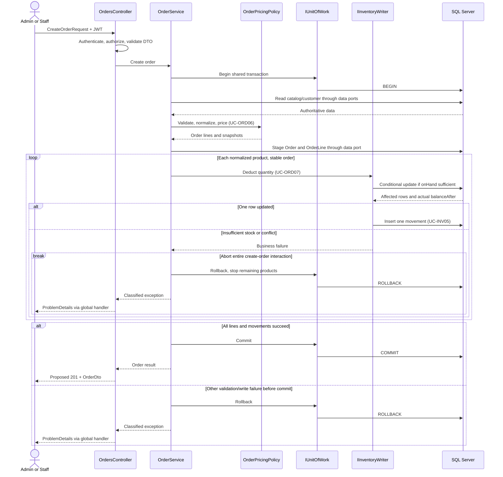

Gọi SQL trực tiếp trong sơ đồ là lược giản tương tác qua adapter, không cho phép OrderService phụ thuộc SQL Server/EF. Khi bất kỳ dòng thất bại, vòng lặp dừng ngay và đi vào rollback; các bước còn lại không được thực hiện. Lỗi chưa biết kết quả tại commit cần reconciliation theo TBD-12, không thuộc nhánh “đã rollback chắc chắn”.

### 6.6 Sequence — UC-ORD04 Cancel With Restock, Conditional Proposed

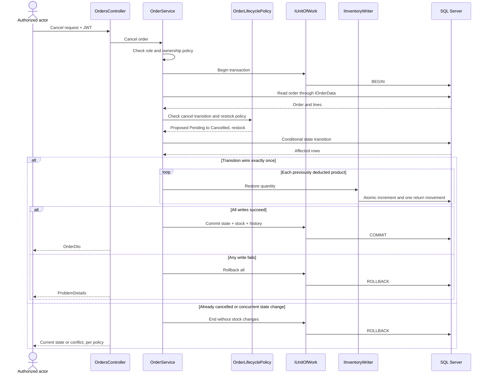

Sequence chỉ có hiệu lực nếu duyệt TBD-02/03. Actor “Authorized actor” không mở quyền Staff ngoài matrix. Không gọi UC-INV02 để hoàn kho, vì hoàn kho cần giữ nguyên transaction hủy đơn và loại movement riêng.

### 6.7 Sequence — UC-REP01/02/03, Proposed

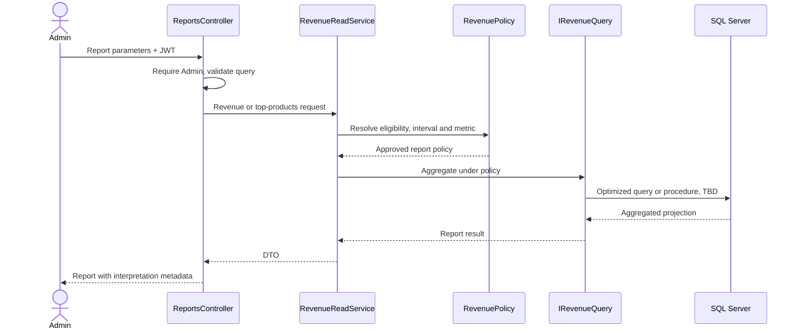

Không đưa toàn bộ đơn về memory để tính báo cáo. Chọn query tối ưu hay stored procedure là TBD-06; sequence không khẳng định đã có procedure.

### 6.8 Order State Model — Conditional Proposed

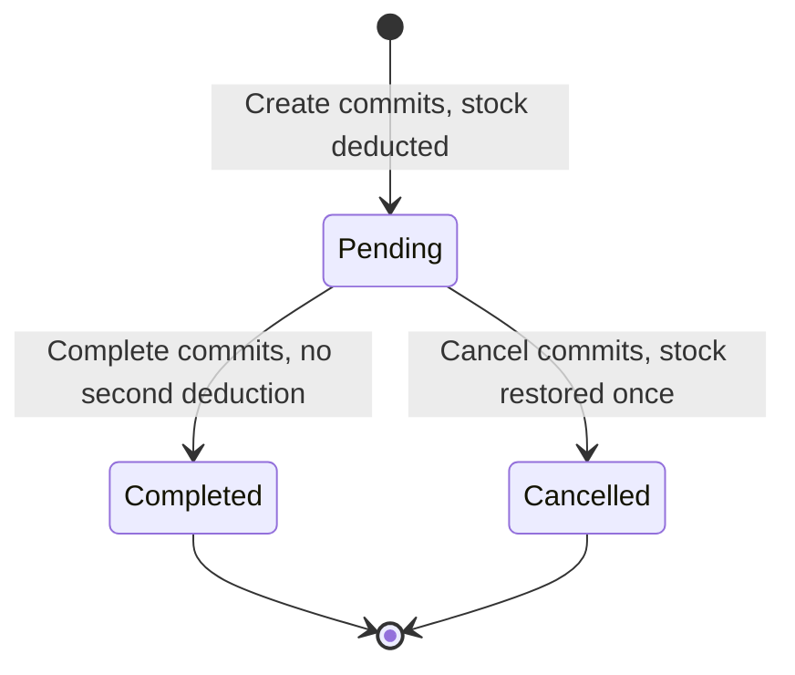

| Transition | UC | Guard dự kiến | Tác động kho | Trạng thái |
|---|---|---|---|---|
| Chưa tồn tại → Pending | UC-ORD01 | DTO, sản phẩm, giá và tồn hợp lệ | Trừ kho + movement trong transaction tạo | Proposed, TBD-03 |
| Pending → Completed | UC-ORD05 | Quyền hoàn tất được duyệt; conditional state update thắng | Không đổi tồn | Conditional Proposed |
| Pending → Cancelled | UC-ORD04 | Quyền hủy + ownership; conditional update thắng | Hoàn đúng lượng đã trừ + movement cùng transaction | Conditional Proposed |
| Completed → Cancelled | Không có UC trong phương án này | Bị từ chối; trả hàng/hoàn tiền ngoài scope | Không đổi tồn | Proposed restriction |
| Cancelled → Pending/Completed | Không có UC | Bị từ chối; không tự mở lại đơn | Không đổi tồn | Proposed restriction |

Pending trong phương án này đã giữ hàng bằng cách giảm on-hand, không phải một reservation subsystem riêng. Timeout tự hủy Pending chưa được brief yêu cầu. Completed/Cancelled là terminal trong phương án, không phải business rule đã duyệt. Nếu TBD-03 chọn workflow khác, phải sửa đồng bộ UC, report policy và API.

### 6.9 Product State Model — Proposed

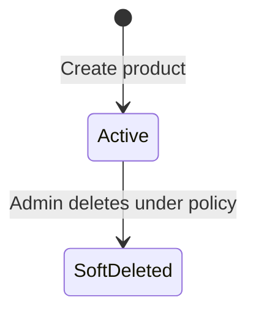

SoftDeleted là trạng thái dữ liệu vẫn được giữ, không phải xóa vật lý. Không vẽ restore vì brief chưa yêu cầu UC khôi phục. Đơn cũ tiếp tục đọc snapshot ở cả hai trạng thái. InventoryBalance là một giá trị có bất biến, không cần ép thành state machine theo từng số lượng.

## 7. Overall Software Architecture

### 7.1 Architectural Style

**Required:** Web API với bốn tầng API / Application / Domain / Infrastructure, SQL Server và EF Core. Domain không phụ thuộc tầng khác; controller mỏng, nghiệp vụ ở Application theo AGENTS.

**Proposed:** một ứng dụng phân lớp, chia module nghiệp vụ trong cùng đơn vị triển khai (modular monolith). Một database và transaction cục bộ giúp giữ đơn/kho/lịch sử đồng nhất. Không cần event bus, distributed transaction, cache hay dịch vụ tách riêng cho v1. Logic miền thuần có thể đặt trong Domain và được Application điều phối; không đặt orchestration/I/O trong entity.

| Layer | Trách nhiệm | Không được làm |
|---|---|---|
| API | HTTP routing, authentication/authorization boundary, DTO binding, validation integration, ProblemDetails, OpenAPI | Tính giá/trừ kho trực tiếp trong controller; trả EF entity |
| Application | Use case, resource policy, control objects, transaction boundary qua port, projection contract | Phụ thuộc implementation EF/SQL/JWT cụ thể |
| Domain | Entity/value concept, bất biến và logic miền thuần | Tham chiếu API/Application/Infrastructure, HTTP hoặc DbContext |
| Infrastructure | EF Core mappings, migrations, SQL query, concurrency adapter, token/password adapters | Tự định nghĩa lại policy doanh thu/trạng thái khác với use case |

### 7.2 Runtime Layer Interaction — Proposed

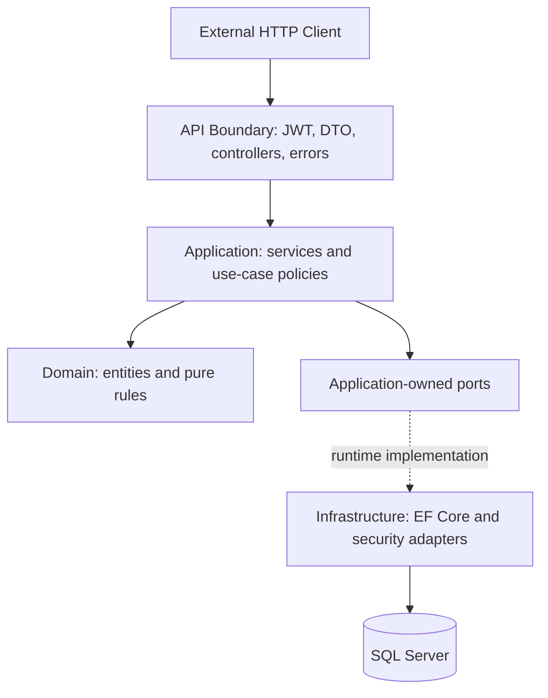

Mũi tên ở đây là tương tác runtime. Nó không phải compile dependency Application → Infrastructure. Hai loại quan hệ được tách ra ở package model để tránh vô tình đưa EF Core vào Domain/Application.

### 7.3 Subsystem Decomposition — Proposed

| Subsystem | Trách nhiệm | Control / logic chủ đạo | UC |
|---|---|---|---|
| Identity & Access — hiện có | Đăng nhập, kiểm token/account mỗi request, quản trị tài khoản | [Application Identity](../src/OrderInventory.Application/Identity), [API Security](../src/OrderInventory.Api/Security) | UC-AUTH01, UC-USR02…06 |
| Catalog | Catalog CRUD, SKU, giá hiện tại, soft delete | CatalogService | UC-CAT01…05, UC-PRD01…05 |
| Inventory | Balance, nhập, điều chỉnh, lịch sử và ghi kho dùng chung | InventoryService, StockRules, IInventoryWriter | UC-INV01…05 |
| Customers | CRUD thông tin khách hàng và policy tham chiếu | CustomerService | UC-CUS01…05 |
| Ordering | Đơn nhiều dòng, snapshot, trừ kho, trạng thái | OrderService, OrderPricingPolicy, OrderLifecyclePolicy | UC-ORD01…07 |
| Reporting | Projection doanh thu/top sản phẩm, không sửa dữ liệu | RevenueReadService, RevenuePolicy, IRevenueQuery | UC-REP01…03 |

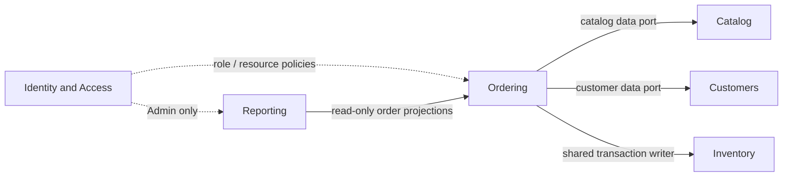

Ordering dùng cùng inventory persistence port trong transaction tạo/hủy đơn; không gọi endpoint nhập kho hoặc InventoryService tự commit. Reporting có thể query projection qua adapter từ dữ liệu đơn, không bắt buộc gọi OrderService rồi tải tất cả đơn. Các mũi tên thể hiện nhu cầu dữ liệu/phối hợp, không mặc định concrete service imports xuyên module.

### 7.4 Package Model and Dependency Rules — Selected Foundation

Các project hiện có trong [OrderInventory.sln](../OrderInventory.sln); project references là nguồn kiểm tra dependency. Nội dung nghiệp vụ tương lai vẫn Proposed.

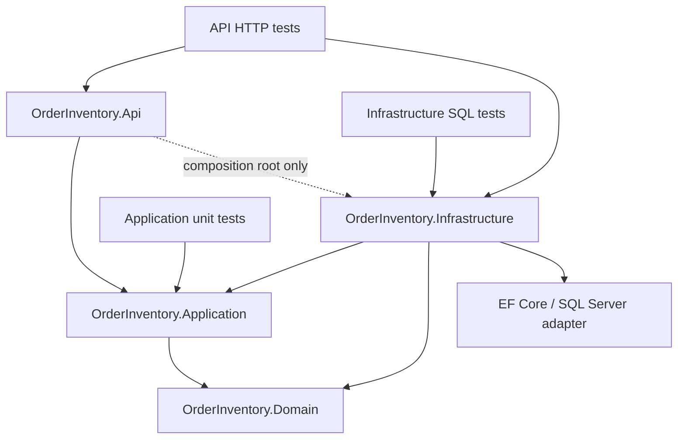

| From | To | Quy tắc dự kiến | Căn cứ |
|---|---|---|---|
| Domain | Tầng khác | Cấm | Required, R-T01 |
| Application | Domain | Cho phép | Logic miền dùng trong use case |
| Application | API / Infrastructure | Cấm | Selected dependency inversion |
| Infrastructure | Application / Domain | Cho phép | Triển khai port và mapping entity |
| API controllers | Application | Cho phép | Controller chỉ điều phối HTTP |
| API composition root | Infrastructure | Cho phép khi đăng ký dependency | Selected; không dùng để đưa DbContext vào controller |
| Domain/Application | EF Core, SQL connection, HTTP details | Cấm trong phương án này | Giữ logic độc lập và test được |
| Infrastructure | Quyết định nghiệp vụ mới | Không | Policy có chủ sở hữu trong Domain/Application |

**Lựa chọn của người triển khai:** service thuần và port chuyên biệt giữ Domain/Application độc lập, đủ cho quy mô v1. Không chọn MediatR/CQRS, generic repository hoặc DbContext trực tiếp trong Application vì thêm cơ chế hoặc làm mờ ranh giới đã chọn. Manual Application validation giữ quy tắc dùng lại được từ HTTP và bootstrap, không chỉ ở DTO binding.

### 7.5 Local Deployment — Selected, Verification Tracked Separately

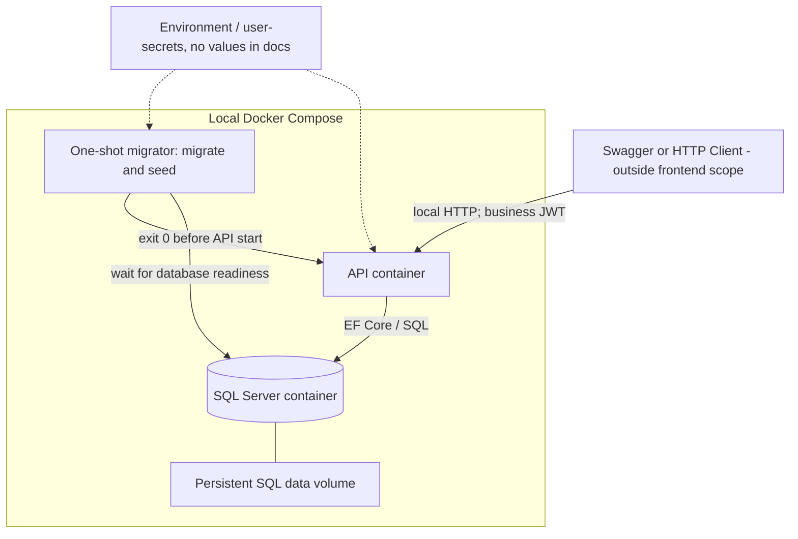

| Deployment concern | Owner / quyết định | Giới hạn |
|---|---|---|
| Khởi động / pins | [Compose](../compose.yaml), [Dockerfile](../Dockerfile), [global.json](../global.json), [package manifest](../Directory.Packages.props) | Manifest Selected không chứng minh clean startup pass |
| Migration / readiness | [DbMigrator](../tools/OrderInventory.DbMigrator/Program.cs) chạy trước API; [Program](../src/OrderInventory.Api/Program.cs) kiểm schema/Admin active | CLI [HealthProbe](../src/OrderInventory.Api/Hosting/HealthProbe.cs), không mở public health route |
| Seed | [BootstrapSeedService](../src/OrderInventory.Application/Seeding/BootstrapSeedService.cs) giữ data + SeedHistory cùng transaction; Infrastructure chỉ bridge/adapter | Chỉ seed Identity; demo stock/order/report chưa có policy được duyệt |
| Secrets | `Initialize-Local.ps1` (local-only), `.env` bị ignore và user-secrets; [mẫu](../.env.example) không có giá trị thật | Không overwrite secret đã có; không đưa vào build args/log/report |
| Logs | [Program](../src/OrderInventory.Api/Program.cs) cấu hình Serilog console | Retention/rate limit/hiệu năng vẫn TBD-14 |
| Swagger | UI/spec anonymous chỉ Development — user Confirmed | Không mở ngoại lệ cho endpoint nghiệp vụ |
| Persistence | Volume trong Compose giữ dữ liệu qua restart | Không tự xóa volume khi lỗi; backup/restore chưa thuộc v1 |

V1 dừng ở chạy cục bộ. [README](../README.md#cấu-hình-và-chạy-local) giữ command và đường lấy credentials riêng trên máy; `report` (local-only) giữ kết quả môi trường/startup.

### 7.6 API Surface — Current Identity and Proposed Business APIs

**Identity hiện có:** route/method/status cho UC-AUTH01 và UC-USR02…06 được ghi tại [README — API hiện có](../README.md#api-hiện-có), với link tới controller/DTO/OpenAPI owner. UC-USR01 là umbrella, không có endpoint riêng. **Toàn bộ endpoint nghiệp vụ trong bảng dưới vẫn Proposed**; các UC `include` cũng không có endpoint.

| Method | Proposed endpoint | UC | Quyền dự kiến |
|---|---|---|---|
| GET | `/api/v1/categories` | UC-CAT01 | Admin, Staff |
| GET | `/api/v1/categories/{id}` | UC-CAT02 | Admin, Staff |
| POST | `/api/v1/categories` | UC-CAT03 | Admin |
| PUT | `/api/v1/categories/{id}` | UC-CAT04 | Admin |
| DELETE | `/api/v1/categories/{id}` | UC-CAT05 | Admin; soft delete, tham chiếu TBD-04 |
| GET | `/api/v1/products` | UC-PRD01 | Admin, Staff |
| GET | `/api/v1/products/{id}` | UC-PRD02 | Admin, Staff |
| POST | `/api/v1/products` | UC-PRD03 | Admin |
| PUT | `/api/v1/products/{id}` | UC-PRD04 | Admin |
| DELETE | `/api/v1/products/{id}` | UC-PRD05 | Admin; soft delete |
| GET | `/api/v1/inventory` | UC-INV01 | Admin, Staff |
| POST | `/api/v1/inventory/receipts` | UC-INV02 | Admin, Staff |
| POST | `/api/v1/inventory/adjustments` | UC-INV03 | Admin |
| GET | `/api/v1/inventory/movements` | UC-INV04 | Admin; Staff TBD-10 |
| GET | `/api/v1/customers` | UC-CUS01 | Admin; Staff TBD-10 |
| GET | `/api/v1/customers/{id}` | UC-CUS02 | Admin; Staff TBD-10 |
| POST | `/api/v1/customers` | UC-CUS03 | Admin; Staff TBD-10 |
| PUT | `/api/v1/customers/{id}` | UC-CUS04 | Admin; Staff TBD-10 |
| DELETE | `/api/v1/customers/{id}` | UC-CUS05 | Admin; Staff và delete policy TBD |
| POST | `/api/v1/orders` | UC-ORD01 | Admin, Staff |
| GET | `/api/v1/orders` | UC-ORD02 | Admin, Staff; scope Staff TBD-10 |
| GET | `/api/v1/orders/{id}` | UC-ORD03 | Admin, Staff; scope Staff TBD-10 |
| POST | `/api/v1/orders/{id}/cancel` | UC-ORD04 | Admin; Staff và ownership TBD-02 |
| POST | `/api/v1/orders/{id}/complete` | UC-ORD05 | Conditional Proposed; Admin Proposed, Staff TBD |
| GET | `/api/v1/reports/revenue?groupBy=day` | UC-REP01 | Admin |
| GET | `/api/v1/reports/revenue?groupBy=month` | UC-REP02 | Admin |
| GET | `/api/v1/reports/top-products` | UC-REP03 | Admin |

Không có register, refresh, payment, shipment hay endpoint xóa đơn. Gate Staff policies chưa chốt không được suy ra từ contract Identity đã triển khai.

**Proposed DTO/query contracts**

| Contract | Nội dung dự kiến | Gate |
|---|---|---|
| CreateProductRequest | SKU, tên, categoryId, unit price | Required fields/limits/price 0 TBD-11 |
| StockChangeRequest | productId, quantity hoặc delta, reason theo loại thao tác | Unit/precision và reason bắt buộc TBD-08/11 |
| CreateOrderRequest | Danh sách productId/quantity; customerId tùy policy | Không nhận tổng client làm authoritative; TBD-09/11 |
| OrderDto | ID, status, actor/time, các dòng snapshot, tổng | State/money/field visibility TBD-03/08/10 |
| ListQuery | page, pageSize, filter được hỗ trợ, sort allowlist | Tên/default/max field TBD-11 |
| ReportQuery | from, to, granularity hoặc metric/top N | Timezone, interval, max range và ranking TBD-06/14 |

Identity DTO/query và ProblemDetails đã có owner dẫn ở mục 3.4 và 4.13. Đường dẫn query báo cáo trong bảng chỉ minh họa hai UC trên cùng resource; `day/month` và interval contract vẫn cần duyệt. Không expose raw SQL expression hay property arbitrary từ request.

### 7.7 Cross-cutting Design and Architecture Risks

| Concern | Proposed design | Giới hạn / bằng chứng cần có |
|---|---|---|
| Exception handling | GlobalExceptionHandler ánh xạ lỗi nghiệp vụ/infrastructure thành ProblemDetails | Authentication challenges/forbidden và model validation cũng cần tích hợp cùng shape; không mặc định exception handler bắt mọi response |
| Validation | Manual Application validation Selected cho nền tảng; domain giữ invariant, DB giữ uniqueness/check/FK | Bounds nghiệp vụ mới vẫn phải chốt trước implementation |
| Transaction ownership | OrderService/InventoryService sở hữu transaction theo UC; helper dùng transaction hiện hành | Không mở/commit transaction riêng cho movement hoặc từng dòng |
| Concurrency | Conditional stock update và conditional status transition | Phải kiểm tra affected rows; chưa chọn rowversion/isolation; test trên SQL Server |
| Historical reads | OrderLine snapshot, giữ Product/FK và đường đọc lịch sử có chủ ý | EF soft-delete filter/join không được làm mất dòng đơn; cần integration test |
| Reporting | Aggregate tại database, chỉ projection, index theo query plan | Stored procedure không tự chứng minh nhanh; cần plan/đo theo fixture và policy |
| Observability | Serilog + trace correlation; log transaction outcome phù hợp | Không log body login/token; không coi timeout commit là rollback đã biết |
| Authorization | JWT role + kiểm active/current role/version mỗi request đã có; resource scope nghiệp vụ Proposed | Token policy theo BR-20; Staff scope của đơn/khách hàng vẫn TBD-10 |
| Request retry | Giữ contract trung thực về kết quả chưa rõ | Chưa có idempotency store/key trong baseline; chỉ movement-per-change không ngăn HTTP duplicate |

Không dùng EF InMemory hoặc mock để kết luận đã giải quyết transaction, unique constraints và race kho trên SQL Server. Unit test chỉ chứng minh phần logic/application-owned contract tương ứng.

## 8. Software Quality Attributes

### 8.1 Quality Goals and Mechanisms

| Attribute | Mục tiêu | Proposed design support |
|---|---|---|
| Integrity / consistency | Không âm kho, không lưu đơn dở, history khớp balance | Transaction chung, conditional update, DB constraints |
| Security | Xác thực và phân quyền đúng; không lộ secret hoặc dữ liệu ngoài quyền | JWT/RBAC, resource policy, DTO, redaction và ProblemDetails |
| Auditability | Mọi thay đổi tồn truy được nguồn và số dư sau thay đổi | InventoryMovement cùng transaction, actor/source reference |
| Historical correctness | Đơn cũ không bị đổi do sửa/xóa catalog | Snapshot, giữ reference và đường query lịch sử |
| Reliability | Lỗi được xử lý có kiểm soát; startup không phục vụ schema chưa sẵn sàng | Rollback, bootstrap gate, classified errors |
| Performance | List/report truy vấn hữu hạn theo tải đã chốt | Database paging/filter/sort, projection/aggregate và query plan |
| Maintainability / testability | Domain độc lập, nghiệp vụ không nằm ở controller | Package dependency rules, services/ports, unit tests |
| Reproducibility | Chạy local và fixture lặp lại được | Compose, migration/seed có chủ sở hữu, test DB tách biệt |

### 8.2 Measurable Quality Scenarios

Các measure có căn cứ AC là yêu cầu nghiệm thu. Các measure bổ sung được ghi **Proposed target**, chưa là SLA, chưa đo và chưa đạt. Không có kết quả benchmark hay test thực tế trong tài liệu này.

| ID | Attribute / stimulus | Response dự kiến | Measure / acceptance | Status / source |
|---|---|---|---|---|
| QA-01 | Security: Staff gọi report hoặc user-management operation đã chốt | Từ chối, không chạy mutation hay trả dữ liệu bị cấm | Mọi request trong tập forbidden role cases trả 403; 0 dữ liệu/thay đổi ngoài quyền | Required, AC-02; Identity HTTP tests hiện có, report API chưa triển khai |
| QA-02 | Atomicity: đơn nhiều dòng có một sản phẩm thiếu kho | Rollback đơn, dòng, số dư và movement | So sánh trước/sau: 0 Order/OrderLine/movement mới và 0 thay đổi stock của request thất bại | Required, AC-03 |
| QA-03 | Concurrency: tồn = 1; hai request khác nhau đồng thời mua 1 | Một commit; request còn lại bị từ chối nghiệp vụ | Chính xác 1 đơn thành công, onHand = 0, 1 sale movement; không có thời điểm commit âm kho | Required, AC-04; cơ chế Proposed |
| QA-04 | Auditability: nhập, điều chỉnh hoặc bán làm đổi tồn | Ghi movement cùng thay đổi | Với mỗi thay đổi, đúng 1 row; balanceAfter khớp thời điểm cập nhật; chuỗi delta đối soát đúng tồn cuối | Required, AC-05 |
| QA-05 | Historical correctness: tạo đơn rồi xóa mềm sản phẩm; mở rộng Proposed thêm sửa tên/giá trước khi xóa | Catalog ẩn sản phẩm; đơn vẫn hiển thị đúng thông tin | Required: xóa mềm không mất/sai thông tin đơn. Proposed theo BR-15: SKU/tên/giá/tổng snapshot bất biến qua đổi catalog; 0 dòng bị mất do filter/join | AC-07 Required; mở rộng snapshot Proposed |
| QA-06 | Query correctness: fixture cố định, filter/sort/page sản phẩm và đơn | Chỉ trả dữ liệu đúng scope/filter, thứ tự ổn định | So kết quả từng trang với tập chuẩn; 0 dòng ngoài quyền, không thiếu/trùng trong dataset không đổi; page size đúng contract | Required, AC-06; chi tiết contract TBD |
| QA-07 | Report correctness: fixture gồm đơn đủ/không đủ điều kiện và biên ngày/tháng | Aggregate theo policy được duyệt | Tổng và ranking khớp oracle độc lập; mỗi giao dịch biên thuộc đúng 1 bucket theo `[from,to)` Proposed | Required, AC-08; oracle gate TBD-06 |
| QA-08 | Error safety: lỗi không dự kiến trong request | Global handler trả ProblemDetails, có correlation dự kiến | Proposed 500; 0 stack trace/password/token/connection secret trong response; log cũng không chứa secret | Required outcome, AC-09/R-T13 |
| QA-09 | Local operability: chạy Compose với cấu hình hợp lệ trên môi trường sạch | Database sẵn sàng → migrate/seed → API ready, Swagger dùng được theo policy | API + SQL chạy, fixture tồn tại một lần; lặp startup không nhân đôi seed; thời gian ready tối đa TBD-13/14 | Required core, AC-01; idempotent seed Proposed |
| QA-10 | Regression confidence: chạy suite sau thay đổi service | Unit tests chứng minh logic tạo đơn/trừ kho và lỗi liên quan | Các test thuộc scope đã chốt pass; test regression được thêm trước khi sửa lỗi | Required, AC-10/AGENTS; suite Identity hiện có, order/stock tests chờ phase tương ứng |
| QA-11 | Lifecycle race: cancel/cancel hoặc complete/cancel cùng một Pending | Conditional transition quyết định bên thắng; không hoàn kho hai lần | Nếu phương án hoàn kho được duyệt: tối đa 1 lần return mỗi lượng đã trừ; chỉ 1 terminal transition; rollback khi history lỗi | Proposed target, TBD-03/12 |
| QA-12 | Performance: tải list và report trên dataset đã đóng băng | Database paging/aggregation giữ thời gian đáp ứng trong mục tiêu | Candidate Proposed: 10 client đồng thời, mỗi client 100 request; 1.000 sản phẩm, 10.000 đơn × 2 dòng; p95 list ≤ 500 ms, report ≤ 2 s; cấu hình máy/index phải ghi lại | Proposed target, TBD-14; không phải số đo thực tế |
| QA-13 | Architecture: thêm rule hoặc use case mới | Không tạo dependency ngược từ Domain, không đặt business logic ở HTTP controller | 0 project reference từ Domain tới ba tầng còn lại; unit test rule không cần HTTP/SQL | Required architectural outcome, R-T01; cách kiểm tra Proposed |
| QA-14 | API contract: lỗi validation, thiếu token, thiếu role và lỗi nghiệp vụ | Error shape nhất quán dù không phải mọi lỗi đều ném exception | Tập kiểm thử mỗi nhóm trả ProblemDetails hợp lệ, không entity/secret; HTTP status theo contract | Required, R-T02; nền tảng lỗi đã Implemented, bằng chứng ở report |

**Proposed revenue fixture minh họa, chỉ dùng sau khi duyệt policy:** Completed A có `2 × 100`, Completed B có `1 × 50` trong cùng bucket → doanh thu 250 đơn vị tiền; Pending/Cancelled không cộng vào. Thêm đơn đúng biên đầu/cuối ngày và tháng để kiểm tra timezone và khoảng nửa mở. Đây là dữ liệu giả để thiết kế test, không phải dữ liệu seed đã có, currency thực hay business rule đã duyệt.

### 8.3 Verification Strategy — Current Identity and Future Business Evidence

| Verification level | Chứng minh điều gì | Không được kết luận từ nó |
|---|---|---|
| Unit — Domain/Application | Pricing/lifecycle/permission policy đã chốt; orchestration thành công/thiếu kho/lỗi ghi; controller không chứa nghiệp vụ | Không chứng minh transaction/isolation/SQL uniqueness bằng mock |
| SQL Server integration | Rollback nhiều dòng, conditional update, history balance, SKU race, complete/cancel nếu được duyệt | Không thay SQL Server bằng EF InMemory rồi tuyên bố AC-04 đạt |
| HTTP integration | JWT/role/resource scope, DTO validation, ProblemDetails kể cả 401/403, paging và projection | Không mặc định framework defaults đã khớp contract |
| Local smoke | Compose, startup migration/seed, Swagger, đăng nhập và một luồng tạo đơn | Không thay bằng mô tả deployment hoặc ảnh Swagger chưa chạy |
| Report verification | Query và oracle độc lập trên fixture nhỏ đã biết, biên ngày/tháng, sản phẩm đã xóa | Không dùng chính output query làm expected value |
| Targeted performance | Đo QA-12 sau khi đóng băng workload, môi trường và policy | Không gọi một query “tối ưu” chỉ vì viết stored procedure |

Test service layer là Required. Boundary unit/SQL/HTTP đã Selected và có suite Identity; bài stock/order/report còn chờ phần triển khai tương ứng. Bài test tranh đơn vị cuối phải có điểm đồng bộ rõ cho hai request, một fixture riêng và assertion kết quả; không dùng vòng stress ngẫu nhiên để thay bằng chứng xác định. Test database phải tách khỏi dữ liệu phát triển và secret phải được cấp bên ngoài code.

Chỉ chạy test hiệu năng khi mục tiêu/workload đã duyệt. Lệnh chạy nằm trong [README](../README.md#kiểm-tra), kết quả và blocker nằm trong `report Phase 01–02` (local-only). Thiết kế và source tồn tại không thay bằng chứng test pass.

## 9. Traceability Matrix

### 9.1 Requirements → Use Cases → Current or Proposed Design

Identity và nền tảng dẫn tới owner hiện có; các tên nghiệp vụ còn lại là Proposed ở mục 5–7. “Tất cả UC” chỉ những UC áp dụng trong inventory, không bổ sung chức năng để lấp bảng. Capability chưa rõ giữ gate TBD.

| Requirement | Use Cases | Proposed design components | Verification / gate |
|---|---|---|---|
| R-F01 | UC-AUTH01; precondition của tất cả UC được bảo vệ | [AuthenticationService](../src/OrderInventory.Application/Identity/AuthenticationService.cs), [token validator](../src/OrderInventory.Api/Security/CurrentAccountTokenValidator.cs) | QA-01/14; Identity contract Confirmed, evidence ở report |
| R-F02 | Catalog/inventory/order/customer theo matrix; UC-REP01…03, UC-USR01 | ResourceAuthorizationPolicy, role checks ở boundary, application resource scope | QA-01; TBD-02/10 |
| R-F03 | UC-CAT01…05, UC-PRD01…05 | CatalogController, CatalogService, Category, Product, SKU constraint | QA-05/06; TBD-04/11 |
| R-F04 | UC-INV01…05; UC-ORD07 | InventoryController, InventoryService, InventoryBalance, InventoryMovement, IInventoryWriter | QA-03/04; TBD-08/11 |
| R-F05 | UC-CUS01…05 | CustomersController, CustomerService, Customer, ICustomerData | Field/delete/role contract TBD-04/09/10 |
| R-F06 | UC-ORD01…04/06/07; UC-ORD05 nếu duyệt | OrdersController, OrderService, Order, OrderLine, OrderLifecyclePolicy | QA-02/03/11; TBD-02/03 |
| R-F07 | UC-REP01…03 | ReportsController, RevenueReadService, RevenuePolicy, IRevenueQuery | QA-01/07; TBD-06 |
| R-F08 | UC-USR01 umbrella; UC-USR02, UC-USR03, UC-USR04, UC-USR05, UC-USR06 | [UsersController](../src/OrderInventory.Api/Controllers/UsersController.cs), [UserAdministrationService](../src/OrderInventory.Application/Identity/UserAdministrationService.cs), [UserAccount](../src/OrderInventory.Domain/Identity/UserAccount.cs) | QA-01; BR-19/20, Identity tests hiện có |
| R-T01 | Tất cả UC | [Solution/project references](../OrderInventory.sln), Application services, Domain thuần | QA-13; nền tảng hiện có |
| R-T02 | Tất cả UC HTTP | [Identity contracts](../src/OrderInventory.Application/Identity/Contracts.cs), [ProblemResponses](../src/OrderInventory.Api/Errors/ProblemResponses.cs), [GlobalExceptionHandler](../src/OrderInventory.Api/Errors/GlobalExceptionHandler.cs) | QA-08/14; Identity Selected/Implemented |
| R-T03 | UC-CAT01, UC-PRD01, UC-INV01/04, UC-CUS01, UC-ORD02; UC-USR02 | [UserListQuery](../src/OrderInventory.Application/Identity/Contracts.cs) hiện có; ListQuery/data ports nghiệp vụ Proposed | QA-06; product/order vẫn TBD-10/11 |
| R-T04 | UC-PRD05, UC-ORD03; UC-REP01…03 đọc lịch sử | OrderLine snapshots, historical read projections, giữ Product reference | QA-05; TBD-04/11 |
| R-T05 | UC-ORD01/06/07; UC-INV05 | OrderService, IUnitOfWork, IInventoryWriter, EfDataAccess | QA-02; SQL Server integration Proposed |
| R-T06 | UC-ORD07, UC-INV03; mọi UC thay đổi tồn | StockRules, conditional update, check constraint | QA-03; gate TBD-01 |
| R-T07 | UC-INV02/03/05, UC-ORD07; UC-ORD04 nếu hoàn kho | InventoryMovement, shared transaction writer | QA-04/11; không có write-behind history |
| R-T08 | UC-REP01…03 | SqlRevenueQuery, RevenuePolicy, query/index design | QA-07/12; query plan và oracle TBD-06/14 |
| R-T09 | Tất cả UC HTTP | OpenAPI description, Serilog integration, correlation | QA-08/09/14; config/sinks TBD-13/14 |
| R-T10 | UC-AUTH01, UC-USR02…06; UC-ORD/INV tương lai | `Application tests` (local-only), `SQL tests` (local-only), `HTTP tests` (local-only) | QA-10; order/stock tests chưa có |
| R-T11 | Hỗ trợ mọi UC sau bootstrap | [Compose](../compose.yaml), [DbMigrator](../tools/OrderInventory.DbMigrator/Program.cs), [BootstrapSeedService](../src/OrderInventory.Application/Seeding/BootstrapSeedService.cs), [HealthProbe](../src/OrderInventory.Api/Hosting/HealthProbe.cs) | QA-09; current evidence ở report |
| R-T12 | Tài liệu hệ thống và API, không phải UC nghiệp vụ | [README](../README.md): ERD Identity, run guide và API owner | AC-11 toàn v1 chờ các phase nghiệp vụ và startup verification |
| R-T13 | UC-AUTH01, UC-USR04 và hạ tầng mọi UC | `Initialize-Local` (local-only), [PasswordService](../src/OrderInventory.Infrastructure/Identity/PasswordService.cs), [mẫu cấu hình](../.env.example) | QA-08/14; không lưu secret/hash/token trong docs/report |
| R-S01 | Toàn bộ inventory theo scope | Một kho, một local deployment, không payment/frontend/tenant modules | Review scope và TBD register; không deploy v1 |

### 9.2 Brief Acceptance Criteria → Design Verification

| Brief AC | Yêu cầu quan sát | Design / UC dự kiến | Bằng chứng cần có sau triển khai |
|---|---|---|---|
| AC-01 | Compose chạy API + SQL, tự migration/seed, Swagger mở được | Deployment/Bootstrap, UC-AUTH01 làm bước smoke tiếp theo | Chạy từ môi trường sạch; startup/seed và OpenAPI được kiểm chứng; QA-09 |
| AC-02 | JWT; Staff bị 403 với endpoint Admin | UC-AUTH01, UC-USR02…06; UC-REP01…03 tương lai | HTTP Identity tests hiện có; kết quả ở report; report security chờ phase 6 |
| AC-03 | Thiếu kho trả ProblemDetails, không lưu gì | UC-ORD01/07, shared transaction | Snapshot dữ liệu trước/sau failed multiline order; QA-02 |
| AC-04 | Hai đơn mua đơn vị cuối, đúng một thành công | UC-ORD07, conditional update | SQL Server concurrency test có đồng bộ; QA-03 |
| AC-05 | Mỗi thay đổi có một history row, số dư đúng | UC-INV02/03/05, UC-ORD07; cancel nếu hoàn kho | Đối soát movement/balance trong fixture; QA-04 |
| AC-06 | Sản phẩm/đơn paging/filter/sort | UC-PRD01, UC-ORD02 | HTTP/query fixture kiểm scope và thứ tự; QA-06 |
| AC-07 | Xóa mềm sản phẩm, đơn cũ vẫn đúng | UC-PRD05, UC-ORD03 | Required: create → delete → read order; mở rộng Proposed thêm rename/reprice theo BR-15; QA-05 |
| AC-08 | Báo cáo đúng dữ liệu mẫu đã biết | UC-REP01…03, RevenuePolicy, SqlRevenueQuery | Oracle theo policy được duyệt, biên ngày/tháng/ranking; QA-07 |
| AC-09 | Lỗi chưa xử lý trả ProblemDetails, không stack trace | GlobalExceptionHandler và pipeline lỗi | Fault-injection HTTP test, kiểm response/log; QA-08/14 |
| AC-10 | dotnet test pass; test tạo đơn/trừ kho | Application/Domain test boundary | Output suite thực tế, không thay bằng checklist thiết kế; QA-10 |
| AC-11 | README có ERD, cách chạy, API list | README + thiết kế này làm route ban đầu | ERD/schema và OpenAPI khớp implementation; hướng dẫn chạy được thử lại |

**Trạng thái bằng chứng:** Identity đã có kiểm tra từng phần; kết quả hiện hành, lỗi trước đó và các check chưa chạy lại nằm trong `report` (local-only). AC về catalog/stock/order/revenue chưa thực thi. Chưa nghiệm thu toàn bộ v1; không suy ra hoàn thành từ tài liệu hoặc số test Identity.

### 9.3 Consistency and Change Rules for This Design

- Khi chốt TBD-03, cập nhật cùng lúc UC-ORD01/04/05, state model, cancel sequence, RevenuePolicy, API và QA-07/11.
- Khi chốt quyền, dùng cùng matrix cho actor/UC/API/resource policy; không biến ô Staff TBD thành quyền mặc định.
- Khi chốt SKU/delete/snapshot, đối chiếu conceptual model, UC-PRD03/05, historical query và QA-05.
- Khi chốt report policy, cập nhật các UC-REP, formula, fixture và query contract; không sửa expected value để che sai lệch query.
- Khi triển khai, liên kết tới executable owners thật và đối chiếu lại tên Proposed; không giữ hai mô tả hành vi mâu thuẫn giữa thiết kế và source.

### 9.4 Source and Authority Index

| Artifact hiện có | Vai trò |
|---|---|
| `AGENTS.md` (local-only) | Quy tắc cộng tác/kiến trúc, test và secret |
| `brief.md` (local-only) | Nguồn yêu cầu nghiệp vụ, draft quyền, AC và câu hỏi mở |
| `report_template.md` (local-only) | Chỉ tham khảo cấu trúc COMET và độ chi tiết; không mang actor/domain/stack vào thiết kế này |
| [README.md](../README.md) | Điểm vào tài liệu project |
| [system-design.md](system-design.md) | Contract Identity đã chốt và bản thiết kế nghiệp vụ Proposed; không thay thế brief hoặc tự đóng TBD |
| `Implementation contract` (local-only) | Gate và lựa chọn thực thi có phân biệt user Confirmed với implementer Selected |
| `Phase 01–02 report` (local-only) | Bằng chứng stateful và phần verification còn thiếu |

Các executable owner hiện có được dẫn trong README và các dòng Identity ở trên. Các subsystem khác vẫn theo Proposed/TBD; không có deployment production được chọn hoặc thực hiện.
