# Order & Inventory Management — System Design and Overall Architecture

| Metadata | Nội dung |
|---|---|
| Document type | Requirement & Design Specification, theo COMET (Collaborative Object Modeling and Architectural Design Method) |
| Trạng thái | Identity, catalog, inventory và Customer CRUD/audit đã có source; Order create/list/detail và atomic demo seed đã có source; hoàn tất/hủy đơn và hoàn kho đã có source, báo cáo còn Proposed/TBD. Kết quả nghiệm thu nằm trong report, không suy ra từ mô hình |
| Đối tượng đọc | Người phát triển, người review và người đánh giá portfolio |
| Nguồn yêu cầu | `brief.md` (local-only) và `AGENTS.md` (local-only) |
| Mẫu trình bày | `report_template.md` (local-only), chỉ tham khảo bố cục và độ chi tiết |

Quy ước trạng thái áp dụng cho toàn bộ tài liệu:

| Nhãn | Ý nghĩa |
|---|---|
| **Required** | Có căn cứ trực tiếp trong brief hoặc AGENTS; không tự chứng minh đã triển khai/kiểm chứng. |
| **Confirmed** | Quyết định sản phẩm do user xác nhận, với phạm vi được ghi rõ. |
| **Selected** | Lựa chọn kỹ thuật của người triển khai trong phạm vi được giao; không phải user approval. |
| **Implemented** | Có executable owner trong source; trạng thái kiểm tra xem report. |
| **Proposed** | Phương án thiết kế để review, chưa phải quyết định đã được chấp thuận. |
| **TBD** | Thiếu thông tin hoặc chưa chốt; phải giải quyết trước khi triển khai phần phụ thuộc. |

Identity, catalog, inventory và Customer CRUD/audit có executable owners được dẫn bên dưới. Order create/list/detail, Customer bắt buộc và demo seed đã Implemented; lifecycle đã được user Confirmed; hoàn tất/hủy đơn và hoàn kho có source. Reporting vẫn **Proposed/TBD**, kể cả khi không lặp nhãn ở từng tên class/DTO/route. Policy Customer được user xác nhận riêng: bộ trường, quyền CRUD/xóa mềm và lịch sử thay đổi chỉ Admin đọc, không chứa bản sao thông tin liên hệ. Policy doanh thu chưa được chốt từ quyết định Customer hoặc lifecycle. [README](../README.md) là điểm vào chạy local, ERD hiện có và API hiện có; report thực thi giữ riêng trên máy.

## Table of Contents

1. [Introduction](#1-introduction)
2. [Actors](#2-actors)
3. [Complete Use Case Inventory](#3-complete-use-case-inventory)
4. [Detailed Use Case Specifications](#4-detailed-use-case-specifications)
5. [Static Modeling](#5-static-modeling)
6. [Object and Class Structuring](#6-object-and-class-structuring)
7. [Overall Software Architecture](#7-overall-software-architecture)
8. [Software Quality Attributes](#8-software-quality-attributes)
9. [Traceability Matrix](#9-traceability-matrix)

## 1. Introduction

### 1.1 Purpose

Hệ thống cung cấp REST API cho một cửa hàng nhỏ quản lý danh mục, sản phẩm, tồn kho, khách hàng, đơn hàng và báo cáo doanh thu. Staff thực hiện nghiệp vụ hằng ngày; Admin quản trị dữ liệu và xem báo cáo. Mục tiêu portfolio ưu tiên tính đúng đắn, khả năng giải thích thiết kế và bằng chứng kiểm thử hơn số lượng tính năng.

Tài liệu áp dụng COMET theo chuỗi: xác định actor và use case → phân tích đối tượng miền → phân bổ boundary/entity/control/application logic → mô hình tương tác và trạng thái → thiết kế kiến trúc → kiểm tra chất lượng và traceability. Đây là đầu vào cho việc chốt thiết kế và lập kế hoạch triển khai; không phải bằng chứng nghiệm thu sản phẩm.

### 1.2 Scope and Non-goals

| Miền | Phạm vi Required của v1 | Điểm chưa chốt |
|---|---|---|
| Identity & Access | Đăng nhập username/password; access JWT 30 phút, không refresh; Admin quản lý tài khoản | Đã Confirmed: list/detail/create/change-role/set-active, bảo vệ Admin active cuối cùng; token cũ bị từ chối ở request kế tiếp sau thay đổi role/active |
| Catalog | CRUD danh mục/sản phẩm, SKU duy nhất, giá, xóa mềm | Confirmed: SKU trim/uppercase, immutable và giữ unique sau xóa; category còn product active hoặc product còn tồn không được xóa |
| Inventory | Một kho; xem tồn, nhập kho, điều chỉnh, lịch sử mỗi thay đổi | Confirmed: số lượng nguyên, nhập > 0; Admin/Staff xem lịch sử; chỉ Admin điều chỉnh delta khác 0 kèm lý do |
| Customers | CRUD và lịch sử thay đổi chỉ Admin đọc | Fields/quyền/soft-delete/audit Confirmed; Customer bắt buộc trên Order Confirmed |
| Orders | Tạo đơn nhiều dòng, xem đơn, hủy theo trạng thái; transaction và trừ kho | Lifecycle/quyền/hoàn kho Confirmed; complete/cancel/hoàn kho có source |
| Reporting | Doanh thu theo ngày/tháng, top sản phẩm; chỉ Admin | Công thức, trạng thái được tính, mốc thời gian, tiêu chí xếp hạng |
| Local delivery | Dockerfile, Docker Compose cho API + SQL Server, migration/seed tự động, Swagger, test, README | Manifest và bootstrap Identity đã có; startup đầy đủ và restart cần bằng chứng trong report |

**Ngoài v1:** frontend, thanh toán online, nhiều kho, multi-tenant, email/SMS, import/export CSV, message queue, caching và microservices. Không suy diễn thêm nhà cung cấp, đơn mua hàng, vận chuyển, khuyến mãi, thuế, trả hàng hay tự đăng ký tài khoản từ mẫu tham khảo. Các đặc tính này chưa được brief yêu cầu.

### 1.3 Technology Stack

| Concern | Công nghệ / ràng buộc | Trạng thái |
|---|---|---|
| HTTP API | ASP.NET Core Web API | Required; .NET 10, SDK 10.0.403 Selected tại [global.json](../global.json) |
| Persistence | EF Core, SQL Server | Required; EF Core 10.0.14 Selected tại [package manifest](../Directory.Packages.props); SQL image tại [Compose](../compose.yaml) |
| Authentication | JWT, role Admin/Staff | Required; access-only 30 phút và hiệu lực thay đổi quyền Confirmed |
| Layers | API / Application / Domain / Infrastructure | Required |
| Contracts & errors | DTO + validation; global exception handler trả ProblemDetails | Required; manual Application validation Selected, không FluentValidation/MediatR/generic repository |
| API description | Swagger/OpenAPI | Required; anonymous UI/spec chỉ Development Confirmed; owner [Program](../src/OrderInventory.Api/Program.cs) |
| Logging | Serilog | Required; sink, retention và mức log TBD-14 |
| Reporting access | Stored procedure hoặc query tối ưu | Required có ít nhất một; lựa chọn TBD-06 |
| Tests | Unit test service layer | Required; `Application tests` (local-only), `SQL tests` (local-only), `HTTP tests` (local-only) hiện có |
| Packaging | Dockerfile và Docker Compose | Required; single migrator trước API ready Selected; [README](../README.md) giữ hướng dẫn |

### 1.4 Terminology

| Thuật ngữ | Ý nghĩa trong tài liệu |
|---|---|
| Actor | Vai trò bên ngoài chủ động tương tác với API; khác với entity được lưu trữ |
| UC | Use case; ID định danh một mục tiêu hoặc hành vi dùng chung có ý nghĩa |
| SKU | Mã ASCII trim/uppercase, bất biến sau tạo, không tái sử dụng kể cả sau xóa mềm — Confirmed |
| On-hand / tồn kho | Số lượng hiện có của một sản phẩm trong kho duy nhất |
| InventoryMovement | Bản ghi cho một lần thay đổi tồn kho, gồm chênh lệch và số dư sau chính cập nhật đó |
| Order / OrderLine | Đơn hàng và dòng sản phẩm thuộc đơn |
| Snapshot | Bản sao thông tin sản phẩm/giá tại thời điểm bán; cơ chế Proposed để giữ đúng đơn cũ |
| Soft delete | Đánh dấu ngừng hiển thị trong truy vấn nghiệp vụ thông thường, giữ dữ liệu lịch sử |
| Atomicity | Toàn bộ thay đổi trong một transaction cùng commit hoặc cùng rollback |
| Concurrency control | Cơ chế xử lý các yêu cầu đồng thời; transaction đơn thuần chưa xác định cơ chế này |
| Idempotency | Lặp cùng thao tác complete/cancel giữ audit và không thêm hiệu ứng là Confirmed; không có idempotency key cho create |
| DTO / RBAC | Data Transfer Object / Role-Based Access Control |
| COMET control | Đối tượng điều phối một use case hoặc vòng đời; không đồng nghĩa HTTP controller |
| COMET application logic | Đối tượng chứa quy tắc/tính toán; không đồng nghĩa toàn bộ tầng Application |

### 1.5 Requirement Register

Các ID dưới đây đặt tên cho nội dung đã có trong nguồn, không bổ sung yêu cầu. AC-01…AC-11 giữ đúng thứ tự tiêu chí nghiệm thu trong mục 7 của brief.

| Requirement | Nội dung Required | Căn cứ |
|---|---|---|
| R-F01 | Đăng nhập, JWT và xác thực mọi endpoint nghiệp vụ ngoài đăng nhập | brief mục 2, 3, 4; AC-02 |
| R-F02 | Phân quyền Admin/Staff; Staff không quản lý người dùng hoặc xem báo cáo | brief mục 2, 6; AC-02 |
| R-F03 | CRUD danh mục/sản phẩm, SKU duy nhất, giá và xóa mềm | brief mục 4; AC-07 |
| R-F04 | Một kho, nhập kho, điều chỉnh, xem tồn và lịch sử biến động | brief mục 4; AC-05 |
| R-F05 | CRUD khách hàng; Admin đọc lịch sử tạo/sửa/xóa sau xóa mềm, gồm actor/time/tên trường, không lưu bản sao thông tin liên hệ | brief mục 4; user xác nhận bổ sung lịch sử Customer |
| R-F06 | Tạo đơn nhiều dòng, xem, hủy theo trạng thái | brief mục 4 |
| R-F07 | Báo cáo doanh thu ngày/tháng, top sản phẩm, chỉ Admin | brief mục 4, 6; AC-08 |
| R-F08 | Admin xem danh sách/chi tiết, tạo tài khoản, đổi role, bật/tắt active; bảo vệ Admin active cuối cùng | brief mục 2, 6; user xác nhận cho Phase 01–02 |
| R-T01 | Stack .NET/EF Core/SQL Server; bốn tầng, Domain độc lập, controller mỏng | brief mục 3; AGENTS |
| R-T02 | DTO + validation; global exception handler trả ProblemDetails, không lộ stack trace | brief mục 3; AGENTS; AC-09 |
| R-T03 | Danh sách hỗ trợ phân trang/lọc/sắp xếp; sản phẩm và đơn phải nghiệm thu được | brief mục 3; AC-06 |
| R-T04 | Đơn cũ hiển thị đúng thông tin sản phẩm đã xóa mềm | AC-07 |
| R-T05 | Tạo đơn và trừ kho trong transaction; thiếu kho không lưu thay đổi nào | brief mục 3; AGENTS; AC-03 |
| R-T06 | Không âm kho; hai đơn tranh đơn vị cuối cùng thì đúng một đơn thành công | AGENTS; AC-04 |
| R-T07 | Mỗi thay đổi tồn có đúng một dòng lịch sử, số dư sau thay đổi khớp thực tế | brief mục 4; AC-05 |
| R-T08 | Có stored procedure hoặc query tối ưu cho báo cáo; số liệu khớp fixture đã biết | brief mục 3; AC-08 |
| R-T09 | Swagger/OpenAPI và Serilog | brief mục 3; AC-01 |
| R-T10 | Unit test service layer, test tạo đơn/trừ kho; test trước khi sửa lỗi | brief mục 3; AGENTS; AC-10 |
| R-T11 | Docker Compose chạy API + SQL Server, tự migration/seed | brief mục 3; AC-01 |
| R-T12 | README có ERD, hướng dẫn chạy, danh sách API | brief mục 3; AC-11 |
| R-T13 | Không hardcode/lưu lộ secret; dùng môi trường hoặc user-secrets; cung cấp `.env.example` không có secret thật | brief mục 8; AGENTS |
| R-S01 | Giữ phạm vi và giới hạn v1; chưa deploy môi trường thật | brief mục 5, 8, 9; AGENTS |

### 1.6 Decision and TBD Register

Register giữ nguyên ID để truy vết. Các dòng đã đóng một phần ghi rõ phạm vi Identity/catalog/inventory; phần còn mở tiếp tục chặn schema/contract phụ thuộc. User xác nhận trong lượt triển khai Phase 01–02: tập thao tác quản trị, bảo vệ Admin cuối cùng, username/password, access-only JWT 30 phút, hiệu lực token ở request kế tiếp và ngoại lệ Swagger Development. Phiên bản, schema và kỹ thuật bên dưới là lựa chọn của người triển khai, không ghi thành user Approved.

| ID | Quyết định còn thiếu | Proposed để review | Phần phụ thuộc |
|---|---|---|---|
| TBD-01 | **Selected cho stock writer** | ReadCommitted owner transaction, product update lock; conditional UPDATE + OUTPUT actual balance; movement cùng transaction, không commit/retry riêng | [EfInventoryWriter](../src/OrderInventory.Infrastructure/Persistence/EfInventoryWriter.cs); integration tạo đơn tranh tồn vẫn thuộc Phase 04 |
| TBD-02 | **Closed — user Confirmed lifecycle ownership** | Admin mọi đơn; Staff chỉ complete/cancel đơn mình tạo. Quyền đọc mọi đơn giữ nguyên | UC-ORD04/05 có source tại OrderLifecyclePolicy |
| TBD-03 | **Closed — user Confirmed lifecycle** | Pending → Completed hoặc Cancelled, cả hai terminal; complete không đổi kho; cancel Pending hoàn đúng lượng một lần, kể cả product đã xóa mềm; không hủy Completed | Complete/cancel/hoàn kho có source; revenue vẫn TBD-06 |
| TBD-04 | **Catalog/Customer Confirmed** | Catalog policy giữ nguyên. Customer xóa mềm bởi Admin; ẩn list/detail, delete lặp 204; giữ record/history/reference, không dùng cho đơn mới | [CatalogService](../src/OrderInventory.Application/Catalog/CatalogService.cs), [CustomerService](../src/OrderInventory.Application/Customers/CustomerService.cs); Order reference/snapshots hiện có |
| TBD-05 | **Closed cho Identity** | Confirmed: username/password, access JWT 30 phút, không refresh; đổi role/active thực sự làm token cũ bị từ chối ở request kế tiếp | UC-AUTH01, UC-USR05/06; [token validator](../src/OrderInventory.Api/Security/CurrentAccountTokenValidator.cs) |
| TBD-06 | Định nghĩa và cách đọc báo cáo | Chỉ Completed; thời điểm completedAt; tổng quantity × unitPriceSnapshot; query tối ưu qua EF Core | UC-REP01/02/03, RevenuePolicy |
| TBD-07 | **Selected cho nền tảng dùng chung** | Service thuần + port chuyên biệt, manual Application validation; không MediatR/FluentValidation/generic repository | [Application](../src/OrderInventory.Application), [Infrastructure](../src/OrderInventory.Infrastructure) |
| TBD-08 | **Quantity/whole VND và order bounds Confirmed** | Max100 input lines, merge quantity ≤int.MaxValue, line/order amounts ≤18 whole VND digits. Selected int Order/Line PK; decimal(18,0) amounts | OrderPricingPolicy, Domain/Orders, OrderConfiguration |
| TBD-09 | **Customer fields/delete/cardinality Confirmed** | Name≤200 required; optional phone≤32/email≤254 valid/address≤1000, trim/blank→null, no unique contact; Customer bắt buộc/chưa xóa cho đơn mới | CustomerRules; Orders migration/CustomerId FK Restrict hiện có |
| TBD-10 | **Identity/catalog/stock/Customer/order read Confirmed** | Customer Admin/Staff CRUD trừ delete/history Admin-only; Admin/Staff tạo và xem mọi đơn. Admin mọi đơn, Staff chỉ complete/cancel đơn mình tạo | Controllers/OrderLifecyclePolicy hiện có cho complete/cancel |
| TBD-11 | **Order query/create/detail Confirmed/Selected**; report còn mở | Business create/snapshot/bounds Confirmed giữ nguyên; list page/sort/filter/time defaults là implementer Selected, SQL count/page và retained snapshots | [OrderQueryValidation](../src/OrderInventory.Application/Orders/OrderQueryValidation.cs), [EfOrderData](../src/OrderInventory.Infrastructure/Persistence/EfOrderData.cs), [OpenAPI](../src/OrderInventory.Api/OpenApi/OrderListOperationFilter.cs); report TBD |
| TBD-12 | **No retry và lifecycle repeat Confirmed** | Không auto retry; commit chưa rõ trả503 commit_outcome_unknown + orderId/traceId, đối soát trước gửi lại. Lặp cùng complete/cancel trả200 giữ audit gốc, không thêm hiệu ứng; cross-state409 | UC-ORD01/04/05 có source |
| TBD-13 | **Local baseline Selected** | Pins ở global/package/Compose/Dockerfile; one-shot migrator; Application-owned atomic seed; UI/spec anonymous chỉ Development do user Confirmed | Mục 7.5 và [README](../README.md); nghiệm thu startup ở report |
| TBD-14 | **Auth bounds Selected**; vận hành/hiệu năng còn mở | Password 12–128, JWT HS256 key Base64 tối thiểu 32 byte, zero clock skew; tải/latency/log retention/rate limit vẫn TBD | [IdentityValidation](../src/OrderInventory.Application/Identity/IdentityValidation.cs), [JwtOptions](../src/OrderInventory.Infrastructure/Configuration/JwtOptions.cs), [Program](../src/OrderInventory.Api/Program.cs) |

Trong TBD-06 còn phải chốt timezone, khoảng ngày, tiền tệ/làm tròn, top theo số lượng hay tiền, xử lý đồng hạng và đơn hủy. Không được dùng phương án Proposed làm oracle nghiệm thu trước khi chính sách được duyệt.

Lifecycle do user xác nhận ngày 2026-11-10: states/transitions, actor scope, repeat/cross-state và no-retry như register trên. User đã giao complete, sau đó cancel/hoàn kho và integrated acceptance. Reporting cần giao việc và chốt policy riêng. Lựa chọn lock/schema/HTTP error mapping là Selected bởi người triển khai, không phải user chọn kỹ thuật.

### 1.7 Business Rule Register

| ID | Quy tắc | Trạng thái / nguồn |
|---|---|---|
| BR-01 | Ngoài đăng nhập, mọi endpoint nghiệp vụ cần xác thực; thông tin đăng nhập sai không cấp JWT | Required, R-F01 |
| BR-02 | Admin toàn quyền trong phạm vi v1; Staff không xem doanh thu/không quản lý người dùng; quyền còn thiếu giữ TBD | Required, R-F02; phần draft xem TBD-02/10 |
| BR-03 | SKU trim/uppercase, immutable sau tạo và unique kể cả row đã xóa mềm | Confirmed; CatalogRules và unique SQL index |
| BR-04 | Validate DTO ở server; không trả entity trực tiếp; lỗi theo ProblemDetails | Required, R-T02; chi tiết field Proposed |
| BR-05 | Tồn kho không bao giờ âm sau bất kỳ thao tác nào | Required, R-T06 |
| BR-06 | Mỗi thay đổi tồn có đúng một InventoryMovement với delta và balanceAfter khớp thay đổi đó | Required, R-T07; receipt/adjustment đã có writer + SQL tests (local-only) |
| BR-07 | Đơn + các dòng + toàn bộ trừ kho + lịch sử kho phải cùng commit hoặc rollback | Required từ R-T05/07; transaction boundary Proposed |
| BR-08 | Các yêu cầu đồng thời phải bảo vệ BR-05; kiểm tra tồn rồi ghi lại mà không có bảo vệ cạnh tranh không đủ | Required, R-T06; cơ chế TBD-01 |
| BR-09 | Xóa mềm sản phẩm không làm mất/sai thông tin đơn cũ | Required, R-T04; snapshot là cơ chế Proposed |
| BR-10 | Bản ghi xóa mềm không xuất hiện trong danh sách sản phẩm thông thường; chính sách thực thể khác còn TBD | Required, AC-07; TBD-04 |
| BR-11 | Pending → Completed hoặc Cancelled, cả hai terminal; complete không đổi tồn; không hủy Completed hoặc mở lại Cancelled | Confirmed bởi user; complete Implemented tại [OrderLifecyclePolicy](../src/OrderInventory.Application/Orders/OrderLifecyclePolicy.cs), cancel có source |
| BR-12 | Hủy Pending hoàn đúng lượng đã trừ một lần, kể cả product đã xóa mềm; trạng thái + kho + movement cùng transaction | Confirmed bởi user; [OrderService](../src/OrderInventory.Application/Orders/OrderService.cs) và [shared writer](../src/OrderInventory.Infrastructure/Persistence/EfInventoryWriter.cs) là owners; BR-06 |
| BR-13 | Báo cáo chỉ Admin; số liệu phải khớp chính sách doanh thu và bộ dữ liệu chuẩn đã duyệt | Required về quyền/độ đúng; công thức TBD-06 |
| BR-14 | Không đưa mật khẩu, token hay khóa ký vào code/tài liệu/log; chỉ cấu hình qua kênh secret phù hợp | Required, R-T13 |
| BR-15 | Định giá từ server, chụp SKU/tên/đơn giá lúc tạo; tổng đơn bằng tổng dòng; không nhận tổng tiền từ client làm giá trị có thẩm quyền | Confirmed cho create/detail; owner OrderPricingPolicy/OrderService; phục vụ BR-09 |
| BR-16 | Danh sách có paging/filter/sort; sort allowlist và khóa phụ duy nhất | Required; cơ chế Selected/Implemented ở query validation và SQL adapters, gồm Orders |
| BR-17 | Không auto retry write; commit chưa rõ trả503 để đối soát. Lặp cùng complete/cancel trả200, giữ thời điểm/người thực hiện gốc và không thêm hiệu ứng; cross-state409 | Confirmed; complete/cancel có source; create không có idempotency key |
| BR-18 | Customer là entity dữ liệu, không tự trở thành tài khoản/actor; Customer bắt buộc và chưa xóa cho đơn mới | Required về scope actor; Customer bắt buộc và chưa xóa cho đơn mới Confirmed |
| BR-19 | Không hạ quyền hoặc vô hiệu hóa Admin active cuối cùng; bảo vệ cả khi có yêu cầu cạnh tranh | Confirmed bởi user cho UC-USR05/06; [UserAdministrationService](../src/OrderInventory.Application/Identity/UserAdministrationService.cs) và `SQL policy tests` (local-only) |
| BR-20 | Role/active thay đổi thực sự làm token đã cấp bị từ chối ở request kế tiếp; no-op không thu hồi token | Confirmed về hiệu lực; Selected dùng TokenVersion và kiểm account/role/active mỗi request, xem [UserAccount](../src/OrderInventory.Domain/Identity/UserAccount.cs) và [token validator](../src/OrderInventory.Api/Security/CurrentAccountTokenValidator.cs) |
| BR-21 | Customer: tên bắt buộc; phone/email/address tùy chọn, trim, optional rỗng → null; không unique phone/email; email có kiểm định dạng | Confirmed bởi user; bounds ở TBD-09 và [CustomerRules](../src/OrderInventory.Domain/Customers/CustomerRules.cs) |
| BR-22 | Admin/Staff xem/tạo/sửa Customer; chỉ Admin xóa mềm; customer đã xóa ẩn list/detail, không dùng cho đơn mới, giữ reference; delete lặp thành công | Confirmed; Customer CRUD và Order reference/snapshot integration đã Implemented |
| BR-23 | Admin đọc lịch sử tạo/sửa/xóa Customer gồm actor/time/tên trường, cả sau xóa; không lưu bản sao phone/email/address | Confirmed; Selected audit append-only qua API, cùng transaction với mutation, normalized no-op/repeated delete không thêm entry; [CustomerService](../src/OrderInventory.Application/Customers/CustomerService.cs), [CustomerAuditEntry](../src/OrderInventory.Domain/Customers/CustomerAuditEntry.cs) |

## 2. Actors

### 2.1 Actor Definitions

| Actor | Loại | Trách nhiệm / quyền |
|---|---|---|
| Account Holder | Actor trừu tượng, Proposed | Người sở hữu tài khoản dùng đăng nhập và các nghiệp vụ chung đã được cho phép; không phải role JWT mới |
| Staff | Actor cụ thể, Required | Xem catalog/tồn kho, nhập kho, tạo/xem đơn; các quyền chưa có trong brief giữ TBD |
| Admin | Actor cụ thể, Required | Nghiệp vụ chung và quản trị catalog, điều chỉnh tồn, báo cáo, quản lý người dùng |

Không có actor Customer tự mua hàng qua API trong v1. SQL Server là thành phần hạ tầng của hệ thống; không phải actor nghiệp vụ. Developer/test runner vận hành Compose là tác nhân vận hành, không có quyền Admin/Staff mặc định.

### 2.2 Actor Generalization — Proposed Modeling

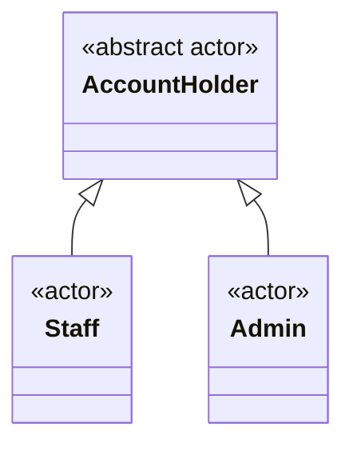

Mũi tam giác hướng về actor tổng quát. Admin và Staff cùng chuyên biệt hóa Account Holder; mô hình không dùng kế thừa Admin từ Staff để suy diễn các quyền Staff đang TBD. Admin có đầy đủ quyền từ brief, được ghi riêng trong matrix.

Đăng nhập diễn ra khi chưa có JWT nhưng người gọi vẫn là người sở hữu tài khoản. Điều này không tạo quyền truy cập ẩn danh vào dữ liệu nghiệp vụ. Đăng nhập là UC độc lập; các UC được bảo vệ có xác thực làm precondition, không `include` đăng nhập ở mỗi request.

### 2.3 Permission Matrix

`Có` có căn cứ từ brief hoặc quyết định Confirmed của user; `Không` là bị cấm; `TBD` chưa thể coi là quyền đã cấp. Các quyền đã Confirmed được ghi theo từng dòng; ô TBD không cấp quyền.

| Nhóm UC | Admin | Staff | Điểm cần chốt |
|---|---|---|---|
| UC-AUTH01 | Có | Có | Access JWT 30 phút, không refresh; Confirmed |
| UC-CAT01/02, UC-PRD01/02 | Có | Có | Danh sách mặc định ẩn bản ghi xóa mềm |
| UC-CAT03/04/05, UC-PRD03/04/05 | Có | Không | Catalog policy Confirmed tại TBD-04 |
| UC-INV01 — xem tồn | Có | Có | Query/DTO Selected, xem Inventory contracts |
| UC-INV02 — nhập kho | Có | Có | Quantity nguyên > 0; không automatic retry — Confirmed |
| UC-INV03 — điều chỉnh | Có | Không | Signed delta khác 0, reason bắt buộc — Confirmed |
| UC-INV04 — lịch sử kho | Có | Có | Confirmed; gồm lịch sử sản phẩm đã xóa mềm |
| UC-CUS01…04 | Có | Có | Fields/quyền Confirmed, BR-21/22 |
| UC-CUS05 — xóa mềm | Có | Không | BR-22; delete lặp 204 |
| UC-CUS06 — lịch sử thay đổi | Có | Không | BR-23; đọc được sau xóa mềm |
| UC-ORD01/02/03 | Có | Có | Confirmed: Admin/Staff tạo và xem mọi đơn; list đã Implemented |
| UC-ORD04 — hủy | Có, Pending | Chỉ đơn mình tạo, Pending | Confirmed; có source, lặp Cancelled200 giữ audit/reason gốc |
| UC-ORD05 — hoàn tất | Có, Pending | Chỉ đơn mình tạo, Pending | Confirmed và Implemented; lặp Completed200 |
| UC-REP01/02/03 | Có | Không | Công thức TBD-06 |
| UC-USR01; UC-USR02…06 | Có | Không | List/detail/create/change-role/set-active Confirmed; BR-19/20 |

UC-ORD06, UC-ORD07 và UC-INV05 là hành vi nội bộ được `include`; không có endpoint hay quyền gọi trực tiếp. Chúng sử dụng danh tính của UC khởi tạo để ghi nhận người thực hiện.

## 3. Complete Use Case Inventory

### 3.1 ID and Relationship Conventions

ID dùng prefix theo subsystem: AUTH, CAT, PRD, INV, CUS, ORD, REP, USR. ID không đổi theo người gọi. `Base` là mục tiêu actor; `Include` là phần bắt buộc của một UC khác; `Conditional Proposed` chỉ tồn tại nếu phương án mở được duyệt. Lỗi thiếu kho hay token hết hạn là nhánh của UC, không phải UC mới.

### 3.2 Full Inventory

`Required scope` là mục tiêu từ brief; mô hình UC cho các subsystem tương lai vẫn Proposed. UC-AUTH01 và các UC-USR02…06 có contract và source hiện có, không có nghĩa toàn bộ inventory đã triển khai.

| ID | Use Case | Actor khởi tạo | Quan hệ | Scope / ghi chú |
|---|---|---|---|---|
| UC-AUTH01 | Đăng nhập và nhận JWT | Account Holder | Base | Confirmed; source hiện có, xem mục 4.1 |
| UC-CAT01 | Liệt kê/tìm danh mục | Admin, Staff | Base | Required scope; paging/filter/sort |
| UC-CAT02 | Xem chi tiết danh mục | Admin, Staff | Base | Required scope |
| UC-CAT03 | Tạo danh mục | Admin | Base | Required scope |
| UC-CAT04 | Sửa danh mục | Admin | Base | Required scope |
| UC-CAT05 | Xóa mềm danh mục | Admin | Base | Confirmed: chặn category còn active product, delete lặp 204 |
| UC-PRD01 | Liệt kê/tìm sản phẩm | Admin, Staff | Base | Required scope; paging/filter/sort |
| UC-PRD02 | Xem chi tiết sản phẩm | Admin, Staff | Base | Required scope |
| UC-PRD03 | Tạo sản phẩm | Admin | Base | Required scope; SKU duy nhất |
| UC-PRD04 | Sửa sản phẩm | Admin | Base | Required scope; ảnh hưởng giá tương lai |
| UC-PRD05 | Xóa mềm sản phẩm | Admin | Base | Required scope; giữ đơn cũ |
| UC-INV01 | Xem tồn kho | Admin, Staff | Base | Required scope; kho duy nhất |
| UC-INV02 | Nhập kho | Admin, Staff | Base | Required scope; tăng tồn |
| UC-INV03 | Điều chỉnh tồn kho | Admin | Base | Required scope; tăng/giảm, không âm |
| UC-INV04 | Xem lịch sử biến động kho | Admin, Staff | Base | Confirmed, source hiện có |
| UC-INV05 | Ghi nhận biến động kho | Nội bộ | Include | Bắt buộc khi tồn thay đổi; không endpoint |
| UC-CUS01 | Liệt kê/tìm khách hàng | Admin, Staff | Base | Confirmed, source hiện có; ẩn customer đã xóa |
| UC-CUS02 | Xem chi tiết khách hàng | Admin, Staff | Base | Confirmed, DTO profile |
| UC-CUS03 | Tạo khách hàng | Admin, Staff | Base | Confirmed, fields BR-21; audit cùng transaction |
| UC-CUS04 | Sửa khách hàng | Admin, Staff | Base | Confirmed, PUT thay profile; audit khi có thay đổi |
| UC-CUS05 | Xóa mềm khách hàng | Admin | Base | Confirmed, BR-22; giữ history/reference |
| UC-CUS06 | Xem lịch sử thay đổi khách hàng | Admin | Base | Confirmed bổ sung bởi user; BR-23, gồm cả customer đã xóa |
| UC-ORD01 | Tạo đơn hàng nhiều dòng | Admin, Staff | Base | Required scope |
| UC-ORD02 | Liệt kê/tìm đơn hàng | Admin, Staff | Base | Required scope; Admin/Staff mọi đơn Confirmed, query Selected/Implemented |
| UC-ORD03 | Xem chi tiết đơn hàng | Admin, Staff | Base | Required scope; dữ liệu lịch sử |
| UC-ORD04 | Hủy đơn hàng | Admin; Staff chỉ đơn mình tạo | Base | Lifecycle/hoàn kho Confirmed; source hiện có |
| UC-ORD05 | Hoàn tất đơn hàng | Admin; Staff chỉ đơn mình tạo | Base | Confirmed và Implemented; owner OrderService/OrderLifecyclePolicy |
| UC-ORD06 | Kiểm tra và định giá đơn | Nội bộ | Include từ UC-ORD01 | Kiểm tra sản phẩm, số lượng, giá; policy create Confirmed; list/report còn TBD |
| UC-ORD07 | Trừ kho cho đơn hàng | Nội bộ | Include từ UC-ORD01 | Bảo vệ cạnh tranh và gọi UC-INV05 |
| UC-REP01 | Xem doanh thu theo ngày | Admin | Base | Required scope; semantics TBD-06 |
| UC-REP02 | Xem doanh thu theo tháng | Admin | Base | Required scope; semantics TBD-06 |
| UC-REP03 | Xem top sản phẩm bán chạy | Admin | Base | Required scope; ranking TBD-06 |
| UC-USR01 | Quản lý người dùng | Admin | Umbrella | Required capability, phân rã thành UC-USR02…06 |
| UC-USR02 | Liệt kê/tìm tài khoản | Admin | Base thuộc UC-USR01 | Confirmed, source hiện có |
| UC-USR03 | Xem chi tiết tài khoản | Admin | Base thuộc UC-USR01 | Confirmed, source hiện có |
| UC-USR04 | Tạo tài khoản | Admin | Base thuộc UC-USR01 | Confirmed, source hiện có |
| UC-USR05 | Đổi role tài khoản | Admin | Base thuộc UC-USR01 | Confirmed; BR-19/20 |
| UC-USR06 | Bật/tắt active tài khoản | Admin | Base thuộc UC-USR01 | Confirmed; BR-19/20 |

UC-USR01 giữ ID umbrella để không phá traceability cũ. Phân rã này không bổ sung tự đăng ký, refresh, đặt lại mật khẩu hay xóa người dùng.

### 3.3 Use Case Relationships — Proposed

Mermaid dùng flowchart để biểu diễn quan hệ use case; nhãn `include` tương ứng quan hệ UML, không biểu diễn HTTP call riêng.

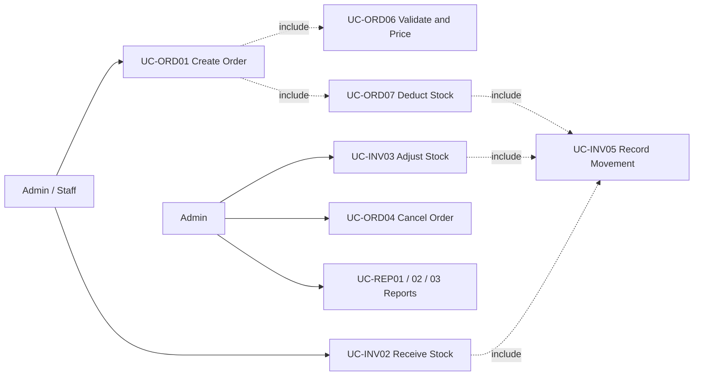

UC-INV05 được thực hiện cho từng sản phẩm có thay đổi tồn, không phải một dòng lịch sử cho toàn bộ đơn. UC-ORD04 chỉ ghi lịch sử khi chuyển Pending → Cancelled thực sự đổi tồn; lặp hủy không thêm movement. Owners cancel/hoàn kho là [OrderService](../src/OrderInventory.Application/Orders/OrderService.cs) và [EfInventoryWriter](../src/OrderInventory.Infrastructure/Persistence/EfInventoryWriter.cs).

### 3.4 Detail Selection and Shared Contract

Phần 4 mô tả sâu các UC có rủi ro về bảo mật, dữ liệu lịch sử, cạnh tranh kho, vòng đời đơn và định nghĩa báo cáo. Catalog/customer CRUD còn lại tái sử dụng hợp đồng DTO/validation/authorization, nhưng không vì thế được coi là đã đặc tả field hay quyền còn TBD.

**Error mapping nền tảng đã Selected/Implemented:** 400 validation, 401 thiếu/sai xác thực, 403 thiếu quyền, 404 không tìm thấy, 409 xung đột và 500 lỗi không dự kiến; ProblemDetails có `errorCode`, `traceId`, validation `errors`. Owner là [ProblemResponses](../src/OrderInventory.Api/Errors/ProblemResponses.cs), [GlobalExceptionHandler](../src/OrderInventory.Api/Errors/GlobalExceptionHandler.cs) và [Program](../src/OrderInventory.Api/Program.cs). 401 giữ Bearer challenge. Staff gọi endpoint Admin-only trả 403 theo AC-02. Chính sách che giấu tài nguyên của subsystem chưa triển khai vẫn TBD-10.

Không ghi số lượng truy cập, tác giả cá nhân hoặc ngày phê duyệt giả định. Tần suất sử dụng, giới hạn tải và người duyệt là TBD.

## 4. Detailed Use Case Specifications

UC-AUTH01, UC-USR02…06, UC-CAT01…05, UC-PRD01…05, UC-INV01…05 và UC-CUS01…06 có contract đã chốt. Order có policy Confirmed và source tại owners được dẫn; Reporting vẫn **Proposed realization**. Flow có gate TBD không được xem là business contract đã duyệt. Ngoại lệ theo hợp đồng lỗi chung; không trả exception/EF entity cho người gọi.

### 4.1 UC-AUTH01 — Đăng nhập và nhận JWT

| Field | Specification |
|---|---|
| Primary actor | Account Holder, chuyên biệt thành Admin hoặc Staff |
| Trigger | Người dùng gửi thông tin đăng nhập |
| Preconditions | Tài khoản đã được cấp và active; cấu hình ký token hợp lệ |
| Success postconditions | Danh tính được xác thực; JWT được cấp với role đã xác định; không trả password/hash |
| Failure postconditions | Không cấp JWT; không thay đổi đơn/tồn kho |
| Rules | BR-01, BR-02, BR-04, BR-14, BR-20 |
| Status / owner | Confirmed cho username/password, access-only 30 phút; [AuthenticationService](../src/OrderInventory.Application/Identity/AuthenticationService.cs), [JWT issuer](../src/OrderInventory.Infrastructure/Identity/JwtTokenIssuer.cs) |

**Main flow — Confirmed contract, Selected realization**

Actor gửi username/password; server xác thực tài khoản active và lấy role từ dữ liệu có thẩm quyền, rồi trả `LoginResult`. DTO và HTTP status nằm ở [API hiện có](../README.md#api-hiện-có); validation/normalization thuộc [IdentityValidation](../src/OrderInventory.Application/Identity/IdentityValidation.cs). Không cho client tự cấp role qua login request.

**Alternative flows**

- **A1 — Access token hết hạn:** đăng nhập lại; không có refresh UC/endpoint.
- **A2 — Quản trị thay đổi role/active:** token cũ bị từ chối ở request kế tiếp theo BR-20. Selected: TokenVersion tăng khi có thay đổi thực sự; kiểm active/current role/version từ DB cho mỗi request. Điều này chấp nhận một DB lookup để tránh token giữ quyền cũ đến hết 30 phút.

**Exceptions**

- **E1:** Credentials sai hoặc tài khoản inactive → 401 với thông báo chung, không tiết lộ tài khoản có tồn tại.
- **E2:** DTO không hợp lệ → 400; không trả lại password đã gửi.
- **E3:** Thiếu khóa ký hoặc lỗi persistence → không cấp token; lỗi cấu hình phải làm startup/readiness thất bại theo phương án deployment.

Không có refresh hoặc self-register. Ngoại lệ anonymous đã Confirmed cho Swagger UI/spec chỉ ở Development không cấp quyền anonymous vào dữ liệu nghiệp vụ.

### 4.2 UC-PRD03 — Tạo sản phẩm

| Field | Specification |
|---|---|
| Primary actor / trigger | Admin gửi sản phẩm mới |
| Preconditions | JWT Admin, category chưa xóa, SKU hợp lệ và chưa được dùng |
| Success postconditions | Product và balance 0 cùng commit; trả 201 ProductDto + Location; không tạo movement 0 |
| Failure postconditions | Không để Product/balance dở dang |
| Rules / status | BR-02…06; Confirmed về SKU/giá/số lượng; Selected realization |
| Owners | [CatalogService](../src/OrderInventory.Application/Catalog/CatalogService.cs), [CatalogRules](../src/OrderInventory.Domain/Catalog/CatalogRules.cs), [EfCatalogData](../src/OrderInventory.Infrastructure/Persistence/EfCatalogData.cs) |

**Main flow — Confirmed contract, Implemented realization**

1. Boundary xác thực Admin và nhận CreateProductRequest; Application kiểm tra các field.
2. Service mở owner transaction, khóa category và xác nhận chưa bị xóa.
3. SKU trim/uppercase được kiểm tra và bảo vệ bởi unique index không lọc row đã xóa.
4. Tạo Product và balance 0 trong cùng transaction, đọc ProductDto, commit và trả 201.

**Alternative flows:** tồn dương ban đầu phải qua UC-INV02/history. UC-PRD04 cập nhật category/name/description/giá, giữ SKU bất biến; SKU được gửi lại chỉ được bằng SKU hiện có sau chuẩn hóa. Category create/update không yêu cầu tên duy nhất.

**Exceptions:** input sai hoặc giá không phải VND nguyên dương → 400; SKU trùng kể cả đã xóa hoặc race unique index → 409; category không tồn tại/đã xóa → 404; lỗi ghi Product/balance → rollback cả hai. Không nhận OnHand từ payload catalog.

### 4.3 UC-PRD05 — Xóa mềm sản phẩm

| Field | Specification |
|---|---|
| Primary actor / trigger | Admin yêu cầu xóa product; UC-CAT05 áp dụng cho category |
| Preconditions | JWT Admin; đối tượng tồn tại; product không còn tồn/category không còn active product |
| Success postconditions | Trả 204, ẩn khỏi read/list hiện tại, giữ record/SKU/history |
| Failure postconditions | Không đổi deleted flag, balance hoặc movements |
| Rules / status | BR-02/03/05/06/10; catalog policy Confirmed; đọc đơn lịch sử BR-09 thuộc Phase 04 |
| Owners | [CatalogService](../src/OrderInventory.Application/Catalog/CatalogService.cs), [EfCatalogData](../src/OrderInventory.Infrastructure/Persistence/EfCatalogData.cs) |

**Main flow:** service mở transaction, khóa đối tượng, kiểm tra điều kiện còn tồn/tham chiếu, đặt soft-delete, lưu và commit. Category assignment/delete cùng khóa category; stock write/delete cùng khóa product để tránh khoảng trống giữa kiểm tra và mutation.

**Alternative flows:** đã xóa → 204, không mutation; balance 0 được giữ lại, movement lịch sử vẫn đọc được. SKU không được tái sử dụng hoặc khôi phục tự động.

**Exceptions:** không tồn tại → 404; product còn tồn/category còn active product → 409; lỗi persistence → rollback; request cạnh tranh phải bảo vệ cùng invariants. Quyền/tham chiếu Customer/Order chưa được tự suy ra từ policy catalog.

### 4.4 UC-INV02 — Nhập kho

| Field | Specification |
|---|---|
| Primary actor / trigger | Admin hoặc Staff gửi ReceiptRequest cho một product |
| Preconditions | JWT hợp lệ; product chưa xóa; quantity nguyên 1..2147483647; stock sau thay đổi trong giới hạn |
| Success postconditions | Tồn tăng đúng quantity; đúng một Receipt movement, actual balanceAfter và actor từ JWT |
| Failure postconditions | Balance và history cùng rollback |
| Rules / status | BR-02/04/05/06/08/17; quantity và no automatic retry Confirmed |
| Owners | [InventoryService](../src/OrderInventory.Application/Inventory/InventoryService.cs), [EfInventoryWriter](../src/OrderInventory.Infrastructure/Persistence/EfInventoryWriter.cs) |

**Main flow:** validate → owner transaction → khóa product active → conditional SQL update/OUTPUT → stage movement → SaveChanges → đọc DTO → commit. Adapter không tự commit/retry. UC-INV05 là hành vi ghi movement nội bộ, không endpoint riêng.

**Alternative flows:** các writes cùng product được tuần tự hóa; mỗi movement dùng balanceAfter của chính update. Catalog demo seed gọi cùng writer dưới transaction/marker owner của [CatalogSeedService](../src/OrderInventory.Application/Seeding/CatalogSeedService.cs). Batch receipt không thuộc v1.

**Exceptions:** quantity/input sai → 400; product thiếu/đã xóa → 404; vượt max stock → 409; movement save lỗi → rollback stock; timeout sau commit có thể thành công → không tự retry hoặc khẳng định đã rollback. Chưa có bảo đảm HTTP idempotency.

### 4.5 UC-INV03 — Điều chỉnh tồn kho

| Field | Specification |
|---|---|
| Primary actor / trigger | Admin gửi chênh lệch kiểm kê |
| Preconditions | JWT Admin; product chưa xóa; delta nguyên khác 0, reason 1..512 sau trim; kết quả không âm/overflow |
| Success postconditions | Đúng signed delta và một Adjustment movement cùng transaction |
| Failure postconditions | Balance/history không đổi |
| Rules / status | BR-02/04/05/06/08/17; signed delta, reason và quyền Confirmed |
| Owners | [InventoryService](../src/OrderInventory.Application/Inventory/InventoryService.cs), [InventoryMovement](../src/OrderInventory.Domain/Inventory/InventoryMovement.cs), [writer](../src/OrderInventory.Infrastructure/Persistence/EfInventoryWriter.cs) |

**Main flow:** Admin boundary/Application policy → validate delta/reason → owner transaction → product lock và guarded update/OUTPUT → movement → save/read DTO → commit.

**Alternative flows:** delta dương/âm dùng cùng writer/history path. UC-INV01 trả tồn hiện tại chưa xóa; UC-INV04 cho Admin/Staff đọc lịch sử, gồm product đã xóa, filter ProductId/ActorId/Type và khoảng [from,to); sort/paging thực thi tại SQL theo [contracts](../src/OrderInventory.Application/Inventory/Contracts.cs).

**Exceptions:** Staff → 403 trước mutation; zero delta/thiếu reason → 400; âm tồn/vượt giới hạn → 409; product thiếu/đã xóa → 404; persistence lỗi rollback toàn transaction. Không hỗ trợ ghi đè tồn tuyệt đối hoặc automatic write retry.

### 4.6 UC-ORD01 / UC-ORD03 — Tạo đơn nguyên tử và đọc chi tiết

| Field | Specification |
|---|---|
| Primary actor | Admin/Staff; cả hai xem mọi đơn, user Confirmed |
| Trigger | POST order với Customer bắt buộc và danh sách productId/quantity; GET order theo ID |
| Preconditions | JWT hợp lệ; Customer và Product chưa xóa khi lấy khóa; input theo OrderPricingPolicy |
| Success postconditions | Order Pending, lines/snapshots, stock decrement và Sale movements cùng commit; create201+Location, detail200 DTO |
| Failure postconditions | Lỗi trước commit rollback toàn bộ; lỗi tại commit có thể outcome unknown, không khẳng định rollback |
| Rules | BR-04…09, BR-15/17/18; Customer bắt buộc, whole VND bounds Confirmed |
| Owners | [OrderService](../src/OrderInventory.Application/Orders/OrderService.cs), [pricing](../src/OrderInventory.Application/Orders/OrderPricingPolicy.cs), [contracts](../src/OrderInventory.Application/Orders/Contracts.cs), [OrdersController](../src/OrderInventory.Api/Controllers/OrdersController.cs) |

**Main flow — Confirmed create/detail, kỹ thuật Selected**

1. Kiểm quyền và input: 1–100 dòng, IDs/quantity dương, gộp productId trùng; quantity gộp không vượt int.MaxValue.
2. Mở owner transaction ReadCommitted; khóa/reload Customer bắt buộc, từ chối row thiếu/đã xóa.
3. Khóa Products theo ID tăng dần, từ chối thiếu/đã xóa; snapshot server SKU/tên/giá dưới cùng transaction.
4. Tính quantity × unit price và tổng dòng, không nhận giá/tổng/actor/status từ client. Giá/tổng VND nguyên, tối đa 18 chữ số mỗi dòng và đơn; không làm tròn.
5. Lưu Order Pending và các dòng lấy IDs; CreatedBy/CreatedAt do server, completion/cancellation audit ban đầu null.
6. Shared writer giảm kho có điều kiện và lấy actual balanceAfter; thêm một Sale movement/dòng chuẩn hóa, FK đúng OrderLine/Product. Không commit/retry trong helper.
7. Save changes và đọc DTO dưới transaction; commit được xác nhận rồi trả201+Location. GET detail đọc retained snapshots, không join active Product/Customer làm mất dòng.

**Alternative flows:** dòng trùng gộp trước khóa; rename/reprice sau commit không thay snapshot; soft-delete Customer/Product không làm mất đơn cũ. Không có khách lẻ thiếu Customer trong contract đã chốt. Concurrent price/delete được phân xử bằng cùng update lock, không hứa giá theo thời điểm request tới.

**Exceptions:** input/overflow400, missing/deleted reference404, thiếu kho409, persistence fault trước commit rollback và ProblemDetails; deadlock được phân loại write_conflict409. Lỗi commit khác trả503 `commit_outcome_unknown` + orderId/traceId để đối soát trước gửi lại; không automatic retry/idempotency guarantee. Mất toàn bộ phản hồi mạng không chứng minh rollback hoặc đảm bảo nhận được orderId. Lifecycle policy Confirmed, owners ở UC-ORD04/05; report policy vẫn Proposed/TBD.

**Internal use cases:** UC-ORD06 chuẩn hóa/định giá; UC-ORD07 trừ kho; UC-INV05 ghi movement. Chúng dùng transaction và actor của create, không có endpoint độc lập. [EfOrderData](../src/OrderInventory.Infrastructure/Persistence/EfOrderData.cs), [Order mapping](../src/OrderInventory.Infrastructure/Persistence/Configurations/OrderConfiguration.cs) và [Orders migration](../src/OrderInventory.Infrastructure/Persistence/Migrations/20261107163830_Orders.cs) là owners hiện có.

### 4.7 UC-ORD04 — Hủy đơn hàng, Confirmed Policy / Source hiện có

| Field | Specification |
|---|---|
| Primary actor | Admin mọi đơn; Staff chỉ đơn mình tạo |
| Trigger | POST cancel với JSON body; reason optional, `{}` hợp lệ |
| Preconditions | JWT/ownership hợp lệ; Pending cho chuyển trạng thái mới |
| Success postconditions | Cancelled terminal; hoàn đúng lượng đã trừ một lần, gồm product đã xóa mềm; trạng thái/kho/movement cùng commit |
| Failure postconditions | Lỗi trước commit rollback toàn bộ; commit chưa rõ kết quả cần đối soát |
| Rules | BR-02/05/06/11/12/17 |
| Owners | [OrdersController](../src/OrderInventory.Api/Controllers/OrdersController.cs), [OrderService](../src/OrderInventory.Application/Orders/OrderService.cs), [OrderLifecyclePolicy](../src/OrderInventory.Application/Orders/OrderLifecyclePolicy.cs), [EfOrderData](../src/OrderInventory.Infrastructure/Persistence/EfOrderData.cs), [EfInventoryWriter](../src/OrderInventory.Infrastructure/Persistence/EfInventoryWriter.cs) |

**Main flow — policy Confirmed, kỹ thuật Selected và có source**

1. Xác thực và kiểm Admin/Staff chủ đơn, độc lập với quyền đọc mọi đơn; kiểm quyền trước thao tác lặp.
2. Mở transaction ReadCommitted, dùng cùng order lock với complete để quyết định transition.
3. Pending → Cancelled có điều kiện; chỉ bên thắng ghi actor/time server và cancellation reason. Reason optional là lựa chọn Selected của người triển khai: trim, tối đa512 ký tự, blank→null; không nhận actor/time/status từ client.
4. Hoàn lượng gốc theo productId tăng dần qua shared writer; mỗi dòng ghi một `CancellationReturn` delta dương, source OrderLine/Product khớp. State/audit/stock/history cùng transaction; helper không commit riêng.
5. Commit toàn bộ rồi trả200 OrderDto, gồm `cancelledAt`, `cancelledBy`, `cancellationReason`; snapshots/tổng tiền không đổi.

**Alternative flows**

- **A1 — Đã Cancelled:** actor được phép nhận200 giữ actor/time/reason gốc, không hoàn kho hoặc thêm movement lần nữa. Reason mới không thay lý do đã lưu.
- **A2 — Product đã xóa mềm:** hoàn balance theo productId gốc; quyền bán lại vẫn theo catalog policy.

**Exceptions**

- **E1:** Staff không phải chủ đơn →403 kể cả hủy lặp; thiếu JWT401; đơn không tồn tại404.
- **E2:** Completed →409 `invalid_order_state`; không hủy đơn đã hoàn tất. Reason quá512 ký tự hoặc body sai →400 validation.
- **E3:** Complete/cancel cùng Pending: chỉ một terminal transition; bên thua409 và không đổi tồn.
- **E4:** Ghi state/stock/movement thất bại trước commit → rollback toàn bộ. Commit chưa rõ kết quả →503 để đối soát, không tự retry.

### 4.8 UC-ORD05 — Hoàn tất đơn hàng, Confirmed / Implemented

| Field | Specification |
|---|---|
| Primary actor | Admin mọi đơn; Staff chỉ đơn mình tạo |
| Trigger | POST complete không body |
| Preconditions | JWT và ownership hợp lệ; Pending cho chuyển trạng thái mới |
| Success postconditions | Completed terminal với actor/time server; không đổi tồn hoặc lịch sử kho |
| Failure postconditions | Không đổi trạng thái/audit một phần |
| Rules | BR-02/11/17; policy doanh thu riêng BR-13/TBD-06 |
| Owners | [OrdersController](../src/OrderInventory.Api/Controllers/OrdersController.cs), [OrderService](../src/OrderInventory.Application/Orders/OrderService.cs), [OrderLifecyclePolicy](../src/OrderInventory.Application/Orders/OrderLifecyclePolicy.cs), [EfOrderData](../src/OrderInventory.Infrastructure/Persistence/EfOrderData.cs) |

**Main flow — policy Confirmed, kỹ thuật Selected**

1. Boundary xác thực; Application kiểm quyền resource trước khi xét thao tác lặp.
2. Transaction ReadCommitted, lock dòng Order rồi conditional Pending → Completed; affected rows quyết định thành công.
3. Ghi completedAt/completedBy từ server và trả200 OrderDto sau commit. Không đọc/ghi stock hoặc movement.
4. Revenue eligibility/recognition vẫn chưa được quyết định bởi thao tác này.

**Alternative flow — Đã Completed:** actor được phép nhận200 OrderDto, giữ actor/time gốc; không UPDATE hoặc commit mutation mới. Quyền đọc mọi đơn không cấp Staff quyền complete đơn người khác, kể cả thao tác lặp.

**Exceptions**

- **E1:** Staff không phải chủ đơn403; thiếu JWT401; đơn không tồn tại404.
- **E2:** Cancelled hoặc trạng thái khác không hợp lệ →409 `invalid_order_state`, không mở lại. Schema hiện tại hỗ trợ Cancelled với audit/state constraint riêng.
- **E3:** Lỗi trước commit không lưu audit/state một phần; lỗi commit chưa rõ kết quả →503 `commit_outcome_unknown` với orderId/traceId để GET đối soát. Không tự retry hoặc coi mất phản hồi là rollback.

### 4.9 UC-REP01 / UC-REP02 — Doanh thu theo ngày / tháng

| Field | Specification |
|---|---|
| Primary actor | Admin |
| Trigger | Admin yêu cầu báo cáo trong một khoảng ngày, group theo ngày (UC-REP01) hoặc tháng (UC-REP02) |
| Preconditions | JWT Admin; đã chốt RevenuePolicy, timezone, currency và cách diễn giải khoảng thời gian |
| Success postconditions | Trả RevenueReportDto khớp policy và dữ liệu nguồn; không đổi đơn/tồn kho |
| Failure postconditions | Không trả dữ liệu một phần hay dữ liệu của vai trò không có quyền |
| Rules | BR-02, BR-04, BR-13, BR-15 |
| Open decisions | TBD-06, TBD-14; lifecycle và whole VND bounds không chốt report policy |

**Main flow — Proposed, theo phương án báo cáo tại TBD-06**

1. Boundary xác thực và chặn Staff trước khi truy vấn số liệu.
2. Validate from/to, granularity và giới hạn khoảng thời gian; giá trị giới hạn còn TBD.
3. RevenuePolicy xác định khoảng nửa mở `[from, to)`, timezone nghiệp vụ và trạng thái được tính.
4. RevenueReadService gọi IRevenueQuery để đọc các Order Completed có completedAt thuộc khoảng đã chuyển đổi.
5. Query aggregate theo ngày hoặc tháng trong timezone đã chốt, dùng quantity và unitPriceSnapshot của OrderLine; không dùng giá hiện tại của Product.
6. Trả các bucket doanh thu cùng metadata diễn giải thời gian/tiền tệ cần thiết.

**Alternative flows**

- **A1 — Không có đơn đủ điều kiện:** Proposed trả kết quả rỗng; có lấp bucket bằng 0 hay không thuộc TBD-06.
- **A2 — Đổi policy ghi nhận doanh thu:** phải thay đồng thời query, fixture và tài liệu; không tự suy ra tiền đã thanh toán vì v1 không có thanh toán online.

**Exceptions**

- **E1:** Staff gọi → 403 theo AC-02, không lộ tổng doanh thu trong message/log trả về.
- **E2:** Khoảng ngày/timezone/granularity không hợp lệ → Proposed 400.
- **E3:** Query thất bại → lỗi qua global handler; không trả tổng một phần như kết quả đầy đủ.

Formula Proposed là tổng `quantity × unitPriceSnapshot` của dòng thuộc đơn đủ điều kiện. Thuế, chiết khấu, hoàn tiền, đa tiền tệ và các khoản phí không được brief định nghĩa. Không cộng/trừ các thành phần giả định này; phải làm rõ trước nếu chúng ảnh hưởng cách cửa hàng hiểu “doanh thu”.

### 4.10 UC-REP03 — Top sản phẩm bán chạy

| Field | Specification |
|---|---|
| Primary actor | Admin |
| Trigger | Admin yêu cầu top sản phẩm trong khoảng thời gian |
| Preconditions | JWT Admin; policy thời gian/trạng thái giống báo cáo doanh thu; metric và top N đã chốt |
| Success postconditions | Danh sách xếp hạng đúng policy, vẫn gồm sản phẩm lịch sử đã xóa nếu có giao dịch đủ điều kiện |
| Failure postconditions | Không trả kết quả sai/không được phép; dữ liệu không đổi |
| Rules | BR-02, BR-09, BR-13 |
| Open decisions | TBD-06, TBD-11, TBD-14 |

**Main flow — Proposed**

1. Kiểm tra quyền Admin, khoảng thời gian và top N.
2. Áp dụng cùng tập đơn đủ điều kiện như UC-REP01/02.
3. Aggregate theo productId ổn định; Proposed xếp giảm dần theo tổng quantity, productId là khóa phụ khi đồng hạng.
4. Tên/SKU hiển thị lấy từ snapshot theo policy biểu diễn sản phẩm đã đổi tên; cách chọn nhãn snapshot cụ thể TBD-06.
5. Trả TopProductReportDto; không lọc mất lịch sử chỉ vì Product hiện đã soft-delete.

**Alternative flows**

- **A1 — Chọn top theo tiền thay vì quantity:** là phương án khác cần duyệt; metric phải hiện rõ trong contract và fixture.
- **A2 — Không có dữ liệu:** Proposed trả danh sách rỗng.

**Exceptions**

- **E1:** Staff → 403 theo AC-02.
- **E2:** top N/metric/khoảng thời gian không hợp lệ → Proposed 400.
- **E3:** Không đọc được dữ liệu → ProblemDetails; không dùng giá bán hiện tại để thay dữ liệu lịch sử bị thiếu.

### 4.11 UC-PRD01 / UC-ORD02 — Liệt kê, lọc và sắp xếp

| Field | Specification |
|---|---|
| Primary actor | Admin/Staff; cả hai xem mọi đơn theo user Confirmed |
| Trigger | GET products hoặc GET orders với query |
| Preconditions | JWT role hiện tại hợp lệ; query theo validation/allowlist |
| Success postconditions | DTO page và totalCount đúng cùng filter; SQL paging/sort ổn định; không đổi dữ liệu |
| Failure postconditions | Không chạy query ngoài bounds/allowlist hoặc mở quyền anonymous |
| Rules | BR-01/02/04/16; Order snapshots BR-09/15/18 |
| Owners | CatalogValidation/EfCatalogData cho product; [OrderQueryValidation](../src/OrderInventory.Application/Orders/OrderQueryValidation.cs), [OrderService](../src/OrderInventory.Application/Orders/OrderService.cs), [EfOrderData](../src/OrderInventory.Infrastructure/Persistence/EfOrderData.cs) cho order |

**Main flow — Implemented, query defaults Selected**

1. Boundary/Application kiểm JWT/role, page/size, sort allowlist và filter bounds. Không suy ra ownership restriction cho Staff vì user đã chọn xem mọi đơn.
2. Product query ẩn active catalog theo policy hiện hành. Order query dùng retained Orders/OrderLines, không join active Product/Customer.
3. Order filters: customerId/createdBy/productId dương, status Pending/Completed/Cancelled, search≤200 trên SKU/name snapshots, CreatedAt UTC [from,to), whole VND total bounds. Không nhận SQL expression hoặc field tùy ý.
4. SQL áp dụng filter → count → sort/page → summary DTO + lineCount. Default page1/size20(max100), sort-createdAt; allow id/createdAt/total ± và ID ascending tie cho sort khác ID. Detail DTO chứa lines như trước.
5. Trả PagedResult; search/order vẫn hiển thị sau Product rename/reprice/soft-delete hoặc Customer soft-delete, không sao chép contact Customer.

**Alternative flows:** không match/trang vượt dữ liệu → empty items, giữ totalCount; optional blank search→null; status case-insensitive→Pending/Completed/Cancelled. Offset paging ổn định cho dataset không đổi, không cam kết snapshot xuyên request hoặc giữa count/page khi có concurrent commits.

**Exceptions:** query sai400 ProblemDetails/errors; thiếu JWT401, role ngoài Admin/Staff403; SQL failure theo global handler. Query cho phép Pending/Completed/Cancelled; báo cáo còn Proposed/TBD.

### 4.12 UC-CUS05 — Xóa mềm khách hàng

| Field | Specification |
|---|---|
| Primary actor | Admin |
| Trigger | Actor yêu cầu xóa Customer |
| Preconditions | JWT Admin hợp lệ; Customer tồn tại, kể cả đã xóa |
| Success postconditions | Customer bị ẩn khỏi list/detail; giữ record/history; sự kiện Deleted cùng commit với dấu xóa |
| Failure postconditions | Không đổi Customer hoặc thêm audit entry một phần |
| Rules | BR-02, BR-04, BR-18, BR-22/23 |
| Status / owner | Confirmed và Implemented tại [CustomerService](../src/OrderInventory.Application/Customers/CustomerService.cs); Order CustomerId FK Restrict đã có; đọc đơn giữ reference sau xóa |

**Main flow**

1. Boundary và Application kiểm tra quyền Admin, mở transaction và tải Customer dưới update lock.
2. Đặt dấu xóa mềm; tạo audit Deleted với actor từ JWT, thời điểm server và field name `isDeleted`.
3. Ghi và commit Customer/audit cùng transaction; không hard delete hoặc cascade.
4. Trả 204. Admin có thể đọc UC-CUS06 dù profile thông thường đã ẩn.

**Alternative flows**

- **A1 — Đã xóa:** trả 204, không thêm sự kiện xóa thứ hai.
- **A2 — Có Order tham chiếu trong tương lai:** giữ record/reference, không cascade; phải kiểm chứng tại slice Order, không coi là quan hệ FK đã tồn tại.

**Exceptions**

- **E1:** Staff → 403 trước kiểm tra existence; thiếu JWT → 401.
- **E2:** Customer không tồn tại → 404; lỗi cạnh tranh được phân loại → 409.
- **E3:** Lỗi ghi Customer/audit trước commit → rollback; không trả thành công khi audit chưa được lưu.

### 4.13 UC-USR01 — Quản lý người dùng; UC-USR02…06

| Field | Specification |
|---|---|
| Primary actor | Admin |
| Trigger | Admin xem danh sách/chi tiết, tạo tài khoản, đổi role hoặc bật/tắt active |
| Preconditions | JWT Admin hợp lệ theo trạng thái account hiện tại |
| Success postconditions | Đọc/trả UserDto hoặc cập nhật tài khoản; không lộ password/hash/token; giữ BR-19/20 |
| Failure postconditions | Không đổi tài khoản/quyền |
| Rules | BR-01, BR-02, BR-04, BR-14, BR-16, BR-19, BR-20 |
| Status / owners | Tập thao tác và bảo vệ Admin cuối cùng Confirmed bởi user; [UsersController](../src/OrderInventory.Api/Controllers/UsersController.cs), [UserAdministrationService](../src/OrderInventory.Application/Identity/UserAdministrationService.cs), [IdentityValidation](../src/OrderInventory.Application/Identity/IdentityValidation.cs) |

**Main flows — Confirmed scope**

| Child UC | Mục tiêu / điều kiện thành công | Rationale / owner |
|---|---|---|
| UC-USR02 | Admin yêu cầu list với query hợp lệ; nhận trang UserDto và metadata | Không lộ account data cho Staff; [ListAsync](../src/OrderInventory.Application/Identity/UserAdministrationService.cs) |
| UC-USR03 | Admin yêu cầu account theo ID; nhận UserDto khi tồn tại | Không trả entity/hash; [GetAsync](../src/OrderInventory.Application/Identity/UserAdministrationService.cs) |
| UC-USR04 | Admin gửi username/password/role hợp lệ; tạo account active và trả UserDto | Username duy nhất sau normalization; password chỉ được hash qua adapter; [CreateAsync](../src/OrderInventory.Application/Identity/UserAdministrationService.cs) |
| UC-USR05 | Admin đổi role trong Admin/Staff; nếu thay đổi, giữ ít nhất một Admin active và thu hồi token cũ | BR-19/20; [ChangeRoleAsync](../src/OrderInventory.Application/Identity/UserAdministrationService.cs) |
| UC-USR06 | Admin gửi active state rõ ràng; nếu thay đổi, giữ ít nhất một Admin active và thu hồi token cũ | BR-19/20; [SetActiveAsync](../src/OrderInventory.Application/Identity/UserAdministrationService.cs) |

Selected realization: UserAccount int PK; trim username và `ToUpperInvariant` cho uniqueness; username 3–64 ký tự ASCII, bắt đầu chữ/số rồi cho phép chữ/số/`_`/`.`/`-`; password 12–128. Role nhận literal Admin/Staff không phân biệt hoa thường. UserList dùng page=1, pageSize=20, tối đa 100; search tối đa 64; filter role/active; sort allowlist ở IdentityValidation. Đây là giới hạn Identity, không chốt Money/quantity hay query của nghiệp vụ khác.

Selected concurrency: transaction Serializable và rowversion; không tự retry write. [EfUserStore](../src/OrderInventory.Infrastructure/Identity/EfUserStore.cs) và `SQL last-Admin tests` (local-only) là owner của bằng chứng bảo vệ cạnh tranh.

**Alternative flows**

- **A1 — List không có kết quả/trang vượt dữ liệu:** trả trang rỗng theo query contract.
- **A2 — Role/active đã bằng giá trị yêu cầu:** trả trạng thái hiện tại; không tăng TokenVersion.

**Exceptions**

- **E1:** Staff gọi bất kỳ thao tác quản lý người dùng → 403 theo AC-02.
- **E2:** Input sai/thiếu active state → 400; ID không tồn tại → 404.
- **E3:** Username trùng, vi phạm BR-19 hoặc write conflict → 409 ProblemDetails; không lưu mutation một phần.

Method/path/status được ghi một lần trong [API hiện có](../README.md#api-hiện-có). Không suy diễn thêm sửa username, reset password, xóa account hay thao tác hàng loạt.

### 4.14 UC-CUS01…04 / UC-CUS06 — Profile và lịch sử Customer

| Field | Specification |
|---|---|
| Primary actor | Admin/Staff cho UC-CUS01…04; chỉ Admin cho UC-CUS06 |
| Trigger | Tìm/xem profile, tạo/sửa Customer, hoặc Admin yêu cầu lịch sử |
| Preconditions | JWT hợp lệ; field/query theo BR-21; detail/update/history cần ID tồn tại |
| Success postconditions | DTO được phân trang hoặc profile hợp lệ được lưu; mỗi thay đổi tạo/sửa có audit cùng transaction; history chứa action/actor/time/tên trường |
| Failure postconditions | Request không làm đổi Customer hoặc audit một phần |
| Rules | BR-01/02/04/14/16/18/21/22/23 |
| Owners | [CustomersController](../src/OrderInventory.Api/Controllers/CustomersController.cs), [CustomerService](../src/OrderInventory.Application/Customers/CustomerService.cs), [contracts](../src/OrderInventory.Application/Customers/Contracts.cs), [EfCustomerData](../src/OrderInventory.Infrastructure/Persistence/EfCustomerData.cs) |

**Main flows**

| UC | Flow và điều kiện thành công |
|---|---|
| UC-CUS01 | Kiểm JWT/quyền và query → lọc active Customer trên SQL → count/sort/page có ID phụ → trả `PagedResult<CustomerDto>`. Search tên/phone/email; không lấy toàn bảng vào memory |
| UC-CUS02 | Tìm active Customer → trả CustomerDto; không expose rowversion/isDeleted/audit nội bộ |
| UC-CUS03 | Validate/normalize → mở transaction → lưu Customer lấy ID → thêm Created audit bằng actor/time server → commit cả hai → 201 + Location |
| UC-CUS04 | Validate/normalize → mở transaction → lock/reload active Customer → thay toàn bộ profile và xác định field names thay đổi → thêm Updated audit → commit → 200 DTO |
| UC-CUS06 | Kiểm Admin trước lookup → xác nhận Customer tồn tại, cho phép đã xóa → SQL count/page history của đúng Customer, newest-first với ID phụ → trả audit DTO |

**Alternative flows:** optional rỗng/bị bỏ qua ở PUT → null; phone/email trùng được chấp nhận; no-op sau normalize trả profile hiện tại, không audit mới; list/history trang vượt dữ liệu trả rỗng nhưng giữ totalCount. Không tạo UserAccount cho Customer.

**Exceptions:** thiếu JWT → 401; Staff gọi history → 403; missing/deleted profile ở UC-CUS02/04 → 404 (history vẫn đọc được sau delete); field/query sai → 400 với errors; save Customer/audit lỗi trước commit → rollback, global ProblemDetails không lộ thông tin liên hệ. Chưa có contract idempotency cho POST; không tự retry ghi khi mất phản hồi. Customer bắt buộc/chưa xóa khi tạo đơn, retained OrderLine snapshots đã Confirmed/Implemented.

## 5. Static Modeling

### 5.1 System Context — Proposed

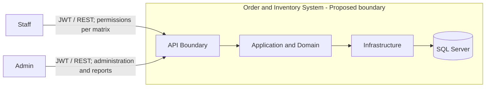

API bao gồm các subsystem nghiệp vụ; SQL Server nằm trong ranh giới giải pháp triển khai. Client gọi API là công cụ bên ngoài phạm vi frontend v1, có thể là Swagger hoặc HTTP client. Customer không có tài khoản/luồng tự đặt hàng chỉ vì được lưu trong database. Không thêm payment gateway hay dịch vụ thông báo vào context.

### 5.2 Conceptual Class Model — Proposed

Mô hình sau là miền v1 dự kiến, không phải ERD hiện có. UserAccount/catalog/inventory và [Customer](../src/OrderInventory.Domain/Customers/Customer.cs) đã có source/mapping; Order/OrderLine và CustomerId FK đã có source/mapping; completion/cancellation audit đã có source. `Identifier`, `Quantity`, `Money`, `Instant` là kiểu khái niệm; ID/total bounds của entity tương lai còn TBD-08. Schema hiện có, gồm CustomerAuditEntries, nằm trong [README](../README.md#cấu-trúc-và-schema-hiện-có).

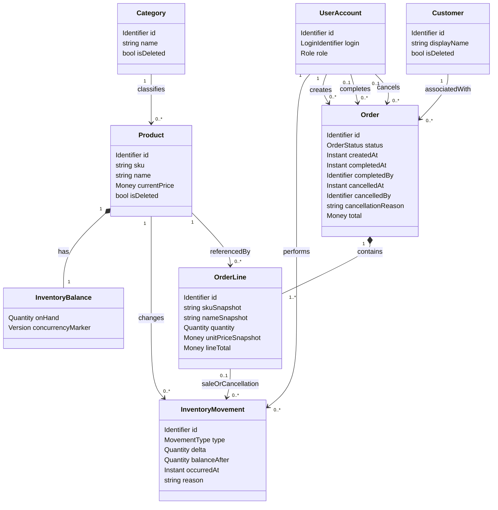

Các multiplicity là Proposed: mỗi Product thuộc một Category; mỗi Product có một balance cho kho duy nhất; Order có ít nhất một dòng; Customer của Order bắt buộc theo xác nhận hiện hành. Một movement nhập/điều chỉnh không cần OrderLine; movement Sale/CancellationReturn bắt buộc tham chiếu đúng một dòng và product tương ứng; tối đa một movement mỗi loại cho từng dòng. Nếu chọn mô hình một product xuất hiện nhiều dòng trong đơn thay vì gộp, phải sửa policy history và cardinality ở chỗ phân bổ movement.

`concurrencyMarker` chỉ là điểm mở cho mô hình tương lai; catalog/Customer đã dùng rowversion và update lock, stock writer dùng conditional update. Customer.isDeleted đã Implemented; Order snapshots, completion/cancellation audit và CancellationReturn đã có source. Mapping và migrations sở hữu shape schema. Không lấy class model này làm migration authority.

### 5.3 Entity Responsibilities and Invariants

| Concept | Trách nhiệm / bất biến | Trạng thái |
|---|---|---|
| UserAccount | Danh tính Admin/Staff, active state và hiệu lực token; giữ BR-19/20 | Identity Implemented; [Domain owner](../src/OrderInventory.Domain/Identity/UserAccount.cs), liên kết nghiệp vụ tương lai Proposed |
| Category | Phân loại sản phẩm; policy xóa không cascade phá lịch sử | Proposed association; xóa theo TBD-04 |
| Product | SKU duy nhất; giữ liên kết lịch sử khi xóa mềm | BR-03/09/10 Required; cách enforce Proposed |
| InventoryBalance | onHand ≥ 0; một số dư cho mỗi sản phẩm trong kho duy nhất | Implemented; [mapping](../src/OrderInventory.Infrastructure/Persistence/Configurations/InventoryConfiguration.cs) |
| InventoryMovement | balanceAfter = balanceBefore + delta tại thời điểm thay đổi; một dòng cho một thay đổi thực tế | Implemented; [entity](../src/OrderInventory.Domain/Inventory/InventoryMovement.cs) |
| Customer | Profile khách hàng, không đồng nhất UserAccount; soft-delete giữ lịch sử | BR-18/21/22; [Domain owner](../src/OrderInventory.Domain/Customers/Customer.cs) |
| CustomerAuditEntry | Action/actor/time/tên trường, không sao chép profile; Admin đọc sau xóa | BR-23; [Domain owner](../src/OrderInventory.Domain/Customers/CustomerAuditEntry.cs) |
| Order | Bao gồm nhiều dòng, createdBy và trạng thái; commit cùng tác động kho khi có | BR-07/11/12; complete/cancel hiện có |
| OrderLine | Lượng bán và thông tin bán tại thời điểm tạo; không phụ thuộc giá hiện tại để đọc đơn cũ | BR-09 Required; snapshot/giá tính toán Proposed |

Số dư sau của một movement cũ không nhất thiết bằng tồn hiện tại, vì có thể đã có movement mới. Kiểm tra đối soát phải so cùng thời điểm hoặc dùng chuỗi `openingBalance + Σ delta = onHand`. Seed tồn dương phải đi qua cơ chế ghi lịch sử/điểm mở đầu được định nghĩa; không tạo số dư mà không thể đối soát.

### 5.4 Conceptual Persistence Constraints — Proposed

| Constraint dự kiến | Mục đích | Quyết định còn mở |
|---|---|---|
| Unique index SKU | Đảm bảo duy nhất cả khi tạo đồng thời, gồm row đã xóa | Implemented: normalized SKU + CI_AS collation, unfiltered unique index |
| Unique balance key theo productId | Không có hai số dư cho cùng sản phẩm | Có tách bảng balance hay không TBD-07/08 |
| Check constraint onHand ≥ 0 | Lớp bảo vệ cuối cho bất biến kho | Conditional update/isolation vẫn phải chốt; constraint không thay thế flow |
| FK OrderLine → Order/Product | Giữ liên kết và ngăn xóa vật lý phá đơn cũ | Soft delete và lịch sử TBD-04 |
| FK Movement → Product/actor và OrderLine tùy loại | Truy vết nguồn thay đổi tồn | [Movement mapping](../src/OrderInventory.Infrastructure/Persistence/Configurations/InventoryConfiguration.cs): composite FK source line/product; unique source line/type cho một Sale và một CancellationReturn |
| Ràng buộc chuyển trạng thái/version | Ngăn terminal transition cùng thắng và hoàn kho hai lần | [OrderConfiguration](../src/OrderInventory.Infrastructure/Persistence/Configurations/OrderConfiguration.cs) và [EfOrderData](../src/OrderInventory.Infrastructure/Persistence/EfOrderData.cs) cho complete/cancel |
| Money precision/scale, quantity bounds | Tránh mất chính xác/tràn số | TBD-08/11 |

Constraints catalog/inventory đã có tại CatalogInventory migration; Customer/audit thuộc [CustomerConfiguration](../src/OrderInventory.Infrastructure/Persistence/Configurations/CustomerConfiguration.cs) và [Customers migration](../src/OrderInventory.Infrastructure/Persistence/Migrations/20261106190613_Customers.cs), với audit FK Restrict tới Customer/UserAccount và check action. Identity thuộc [DbContext](../src/OrderInventory.Infrastructure/Persistence/OrderInventoryDbContext.cs) và [InitialIdentity](../src/OrderInventory.Infrastructure/Persistence/Migrations/20261103010353_InitialIdentity.cs). Order/OrderLine và CustomerId FK thuộc [Orders migration](../src/OrderInventory.Infrastructure/Persistence/Migrations/20261107163830_Orders.cs). Completion audit và state constraint Pending/Completed thuộc forward [OrderCompletion migration](../src/OrderInventory.Infrastructure/Persistence/Migrations/20261109172927_OrderCompletion.cs); migration này giữ nguyên lịch sử. Forward [OrderCancellation migration](../src/OrderInventory.Infrastructure/Persistence/Migrations/20261110181151_OrderCancellation.cs) mở Cancelled audit và CancellationReturn, giữ composite FK source line/product và unique source line/type.

## 6. Object and Class Structuring

### 6.1 COMET Categories and Layer Mapping — Proposed

| COMET stereotype | Trách nhiệm | Phân bổ tầng dự kiến |
|---|---|---|
| «boundary» | Nhận/trả HTTP, hợp đồng DTO, chuyển lỗi; adapter giao tiếp persistence/token | API cho HTTP; Infrastructure cho adapter bên ngoài; port do Application sở hữu |
| «entity» | Trạng thái/khái niệm miền tồn tại lâu dài, bất biến nội tại | Domain; mapping persistence ở Infrastructure |
| «control» | Điều phối một UC, authorization theo tài nguyên, transaction và thứ tự thực hiện | Application services |
| «application logic» | Quy tắc chuyển trạng thái, tính giá, kiểm tra lượng và chính sách doanh thu | Domain cho logic miền thuần; Application cho policy của use case |

HTTP controller là boundary. OrderService mới là control điều phối UC; OrderPricingPolicy là application logic. Không cần thêm một class “control” và một class “service” trùng trách nhiệm chỉ để đủ nhãn COMET. Dependency inversion cho phép control gọi port mà không phụ thuộc EF Core.

### 6.2 Boundary Objects — Current Identity and Proposed Remaining

| Object / contract | Trách nhiệm | UC liên quan |
|---|---|---|
| [AuthController](../src/OrderInventory.Api/Controllers/AuthController.cs), LoginRequest, LoginResult | Identity owner hiện có; contract tại [Application](../src/OrderInventory.Application/Identity/Contracts.cs) | UC-AUTH01 |
| [CategoriesController](../src/OrderInventory.Api/Controllers/CategoriesController.cs), [ProductsController](../src/OrderInventory.Api/Controllers/ProductsController.cs), catalog DTO | Catalog CRUD/list hiện có | UC-CAT01…05, UC-PRD01…05 |
| [InventoryController](../src/OrderInventory.Api/Controllers/InventoryController.cs), ReceiptRequest, AdjustmentRequest, MovementDto | Tồn/nhập/điều chỉnh/history hiện có | UC-INV01…04 |
| [CustomersController](../src/OrderInventory.Api/Controllers/CustomersController.cs), CustomerDto/CustomerAuditDto | CRUD và lịch sử thay đổi hiện có; contract tại [Application](../src/OrderInventory.Application/Customers/Contracts.cs) | UC-CUS01…06 |
| [OrdersController](../src/OrderInventory.Api/Controllers/OrdersController.cs), CreateOrderRequest, OrderDto | Create/list/detail/complete/cancel hiện có | UC-ORD01/02/03/04/05 hiện có |
| ReportsController, RevenueReportDto, TopProductReportDto | Validate query báo cáo và trả projection | UC-REP01…03 |
| [UsersController](../src/OrderInventory.Api/Controllers/UsersController.cs), UserDto | Identity owner hiện có; contract tại Application | UC-USR02…06 |
| GlobalExceptionHandler | Ánh xạ exception được phân loại thành ProblemDetails, che lỗi nội bộ | Tất cả UC HTTP |
| RequestValidators, PagedResultDto | Validation và kết quả danh sách | CRUD/list/report |
| EfInventoryWriter / EfDataAccess | Adapter SQL/EF cho đọc/ghi có ràng buộc | Catalog, inventory, customer, order |
| SqlRevenueQuery | Adapter aggregate báo cáo; EF query tối ưu hoặc stored procedure còn TBD | UC-REP01…03 |
| [JwtTokenIssuer](../src/OrderInventory.Infrastructure/Identity/JwtTokenIssuer.cs), [PasswordService](../src/OrderInventory.Infrastructure/Identity/PasswordService.cs) | Adapter bảo mật hiện có | UC-AUTH01, UC-USR04 |

### 6.3 Entity and Control Objects — Proposed

| Category | Object | Trách nhiệm | Realizes |
|---|---|---|---|
| «entity» | UserAccount, Category, Product, Customer | Danh tính, catalog và khách hàng | AUTH, CAT, PRD, CUS, USR |
| «entity» | CustomerAuditEntry | Lịch sử tạo/sửa/xóa Customer, giữ actor/time/field names | UC-CUS03…06 |
| «entity» | InventoryBalance, InventoryMovement | Số dư và dấu vết thay đổi kho | UC-INV01…05, UC-ORD07 |
| «entity» | Order, OrderLine | Đơn/dòng và thông tin bán hàng lịch sử | UC-ORD01…05 |
| «control» | AuthenticationService | Kiểm tra credentials, lấy role, cấp token qua port | UC-AUTH01 |
| «control» | CatalogService | Điều phối CRUD, kiểm tra SKU/tham chiếu, paging | UC-CAT01…05, UC-PRD01…05 |
| «control» | InventoryService | Transaction của nhập/điều chỉnh, đọc tồn/lịch sử | UC-INV01…04; dùng UC-INV05 |
| «control» | [CustomerService](../src/OrderInventory.Application/Customers/CustomerService.cs) | CRUD/audit cùng transaction, quyền ở Application và boundary | UC-CUS01…06 |
| «control» | OrderService | Transaction toàn đơn; validation/giá/kho; lifecycle | UC-ORD01…07 |
| «control» | RevenueReadService | Quyền báo cáo, chuẩn hóa query và aggregate projection | UC-REP01…03 |
| «control» | [UserAdministrationService](../src/OrderInventory.Application/Identity/UserAdministrationService.cs) | Owner quản trị tài khoản hiện có | UC-USR02…06; gate Staff policies nghiệp vụ khác vẫn mở |

### 6.4 Application Logic and Ports — Proposed Business Design

Identity/catalog/inventory/Customer hiện có dùng các port trong [Application/Abstractions](../src/OrderInventory.Application/Abstractions); [BootstrapSeedService](../src/OrderInventory.Application/Seeding/BootstrapSeedService.cs) sở hữu transaction của account data và marker qua `ISeedHistoryStore`. ICatalogData/IInventoryWriter/IInventoryData và [ICustomerData](../src/OrderInventory.Application/Abstractions/ICustomerData.cs) đã có source; [IOrderData](../src/OrderInventory.Application/Abstractions/IOrderData.cs) đã có; port Reporting vẫn Proposed.

| Object / port | Trách nhiệm | Quy tắc / gate |
|---|---|---|
| [OrderPricingPolicy](../src/OrderInventory.Application/Orders/OrderPricingPolicy.cs) | Chuẩn hóa dòng và bounds, Domain/Orders chụp giá/tính tiền | BR-15; policy create đã Confirmed |
| StockRules | Quantity hợp lệ và số dư không âm về mặt nghiệp vụ; không thay thế database concurrency | BR-05/08 |
| [OrderLifecyclePolicy](../src/OrderInventory.Application/Orders/OrderLifecyclePolicy.cs) | Policy lifecycle/ownership; complete/cancel hiện có | BR-11/12/17; quyền Confirmed tại TBD-02/10 |
| ResourceAuthorizationPolicy | Role và ownership/phạm vi đọc | BR-02; TBD-02/10 |
| RevenuePolicy | Eligibility, timestamp, bucket, metric và rounding | BR-13; TBD-06/08 |
| IInventoryWriter | Tăng/giảm có điều kiện, trả balanceAfter; ghi movement trong transaction hiện hành | BR-05…08 |
| IUnitOfWork | Bắt đầu/commit/rollback transaction chung; không cho helper commit riêng | BR-07/12 |
| ICatalogData, ICustomerData, [IOrderData](../src/OrderInventory.Application/Abstractions/IOrderData.cs) | Các port đọc/ghi hiện có theo UC | Service/port style Selected; list/complete/cancel hiện có |
| IRevenueQuery | Projection báo cáo được lọc và aggregate tại SQL | R-T08 |
| ITokenIssuer, IPasswordVerifier | Hợp đồng bảo mật tách khỏi orchestration | BR-01/14 |

UC-INV05 có thể do IInventoryWriter thực hiện cùng persistence update. Không nhất thiết có một public service riêng cho mỗi UC `include`. Domain không tham chiếu các port/Application service này ngược lên trên.

### Customer mutation và audit — Implemented

[CustomerService](../src/OrderInventory.Application/Customers/CustomerService.cs) là owner transaction; [EfCustomerData](../src/OrderInventory.Infrastructure/Persistence/EfCustomerData.cs) dùng cùng DbContext/connection. Audit chỉ lưu metadata vì cần truy vết thao tác mà không nhân bản thông tin liên hệ. Không có endpoint sửa/xóa audit hoặc restore Customer.

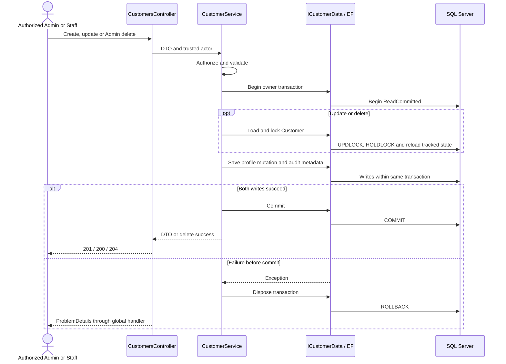

No-op update/repeated delete kết thúc mà không thêm audit. Create có thể flush Customer để lấy ID trước khi ghi audit; cả hai vẫn thuộc một transaction. Lỗi mất kết nối tại commit không tự chứng minh rollback; không tự replay POST.

### 6.5 Sequence — UC-ORD01 Create Order, Proposed

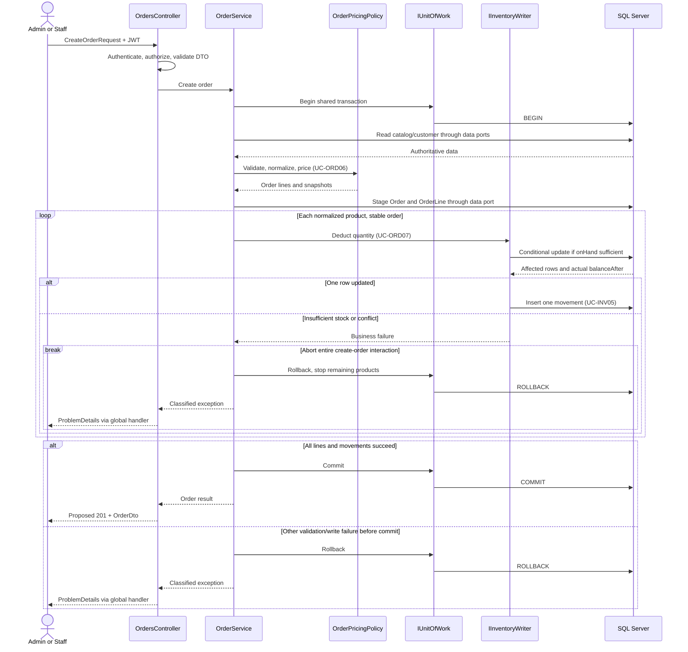

Gọi SQL trực tiếp trong sơ đồ là lược giản tương tác qua adapter, không cho phép OrderService phụ thuộc SQL Server/EF. Khi bất kỳ dòng thất bại, vòng lặp dừng ngay và đi vào rollback; các bước còn lại không được thực hiện. Lỗi chưa biết kết quả tại commit cần reconciliation theo TBD-12, không thuộc nhánh “đã rollback chắc chắn”.

### 6.6 Sequence — UC-ORD04 Cancel With Restock, Selected Implementation

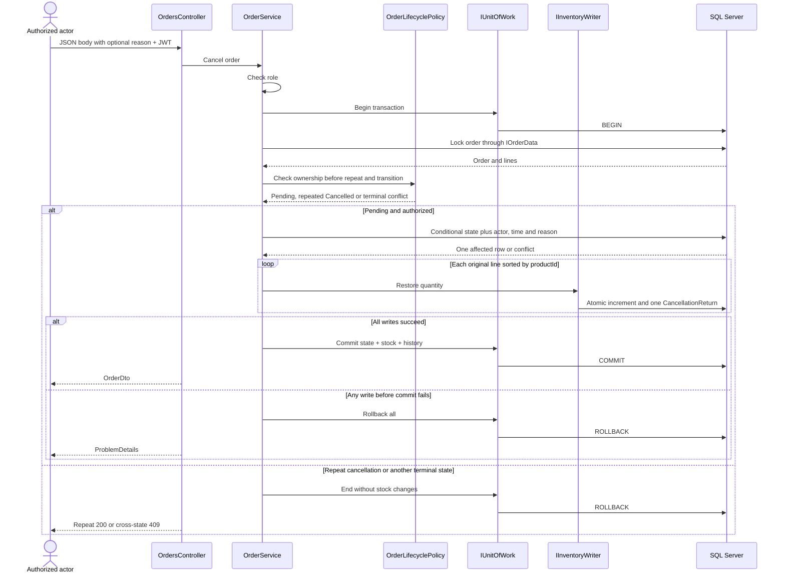

Business policy đã Confirmed; owners hiện có là [OrderService](../src/OrderInventory.Application/Orders/OrderService.cs), [EfOrderData](../src/OrderInventory.Infrastructure/Persistence/EfOrderData.cs) và [EfInventoryWriter](../src/OrderInventory.Infrastructure/Persistence/EfInventoryWriter.cs). Actor “Authorized actor” tuân theo matrix: Admin mọi đơn, Staff chỉ đơn mình tạo. Không gọi UC-INV02 để hoàn kho, vì hoàn kho cần giữ nguyên transaction hủy đơn và loại movement riêng.

Commit mất phản hồi trả503 outcome unknown và cần đối soát; không thuộc nhánh khẳng định rollback trước commit.

### 6.7 Sequence — UC-REP01/02/03, Proposed

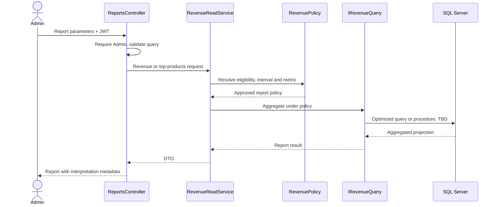

Không đưa toàn bộ đơn về memory để tính báo cáo. Chọn query tối ưu hay stored procedure là TBD-06; sequence không khẳng định đã có procedure.

### 6.8 Order State Model — Confirmed Policy, Partial Implementation

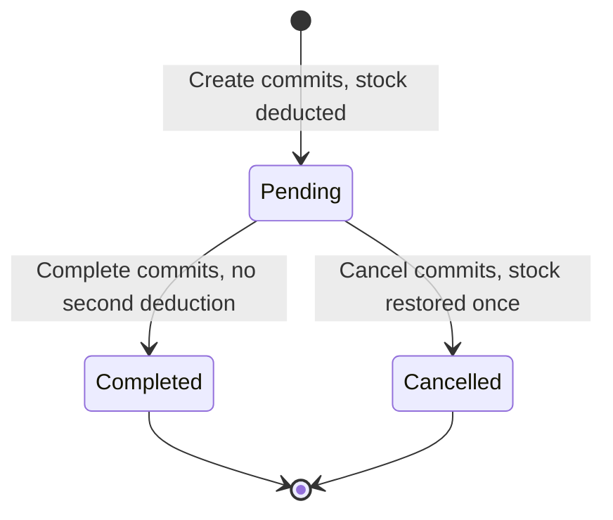

| Transition | UC | Guard dự kiến | Tác động kho | Trạng thái |
|---|---|---|---|---|
| Chưa tồn tại → Pending | UC-ORD01 | DTO, sản phẩm, giá và tồn hợp lệ | Trừ kho + movement trong transaction tạo | Confirmed/Implemented |
| Pending → Completed | UC-ORD05 | Admin hoặc Staff chủ đơn; conditional state update thắng | Không đổi tồn | Confirmed/Implemented |
| Pending → Cancelled | UC-ORD04 | Admin hoặc Staff chủ đơn; conditional update thắng | Hoàn đúng lượng đã trừ + movement cùng transaction | Confirmed; có source |
| Completed → Cancelled | Không có UC | Bị từ chối409; trả hàng/hoàn tiền ngoài scope | Không đổi tồn | Confirmed restriction; có source |
| Cancelled → Pending/Completed | Không có UC | Bị từ chối409; không tự mở lại đơn | Không đổi tồn | Confirmed restriction |

Pending đã giảm on-hand, không cần reservation subsystem riêng. Completed/Cancelled là terminal theo user Confirmed. Lặp cùng thao tác trả200, giữ audit gốc và không thêm hiệu ứng; chuyển terminal khác trả409. Timeout tự hủy Pending ngoài scope. [OrderConfiguration](../src/OrderInventory.Infrastructure/Persistence/Configurations/OrderConfiguration.cs) cho lưu Pending/Completed/Cancelled và audit tương ứng từng terminal state. Quyết định trạng thái không chốt RevenuePolicy.

### 6.9 Product State Model — Proposed

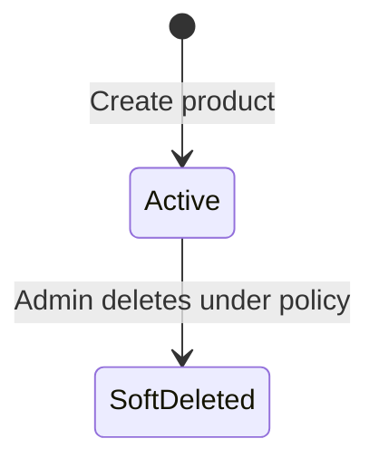

SoftDeleted là trạng thái dữ liệu vẫn được giữ, không phải xóa vật lý. Không vẽ restore vì brief chưa yêu cầu UC khôi phục. Đơn cũ tiếp tục đọc snapshot ở cả hai trạng thái. InventoryBalance là một giá trị có bất biến, không cần ép thành state machine theo từng số lượng.

## 7. Overall Software Architecture

### 7.1 Architectural Style

**Required:** Web API với bốn tầng API / Application / Domain / Infrastructure, SQL Server và EF Core. Domain không phụ thuộc tầng khác; controller mỏng, nghiệp vụ ở Application theo AGENTS.

**Proposed:** một ứng dụng phân lớp, chia module nghiệp vụ trong cùng đơn vị triển khai (modular monolith). Một database và transaction cục bộ giúp giữ đơn/kho/lịch sử đồng nhất. Không cần event bus, distributed transaction, cache hay dịch vụ tách riêng cho v1. Logic miền thuần có thể đặt trong Domain và được Application điều phối; không đặt orchestration/I/O trong entity.

| Layer | Trách nhiệm | Không được làm |
|---|---|---|
| API | HTTP routing, authentication/authorization boundary, DTO binding, validation integration, ProblemDetails, OpenAPI | Tính giá/trừ kho trực tiếp trong controller; trả EF entity |
| Application | Use case, resource policy, control objects, transaction boundary qua port, projection contract | Phụ thuộc implementation EF/SQL/JWT cụ thể |
| Domain | Entity/value concept, bất biến và logic miền thuần | Tham chiếu API/Application/Infrastructure, HTTP hoặc DbContext |
| Infrastructure | EF Core mappings, migrations, SQL query, concurrency adapter, token/password adapters | Tự định nghĩa lại policy doanh thu/trạng thái khác với use case |

### 7.2 Runtime Layer Interaction — Proposed

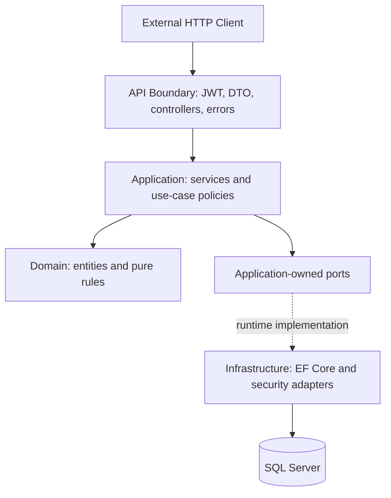

Mũi tên ở đây là tương tác runtime. Nó không phải compile dependency Application → Infrastructure. Hai loại quan hệ được tách ra ở package model để tránh vô tình đưa EF Core vào Domain/Application.

### 7.3 Subsystem Decomposition — Proposed

| Subsystem | Trách nhiệm | Control / logic chủ đạo | UC |
|---|---|---|---|
| Identity & Access — hiện có | Đăng nhập, kiểm token/account mỗi request, quản trị tài khoản | [Application Identity](../src/OrderInventory.Application/Identity), [API Security](../src/OrderInventory.Api/Security) | UC-AUTH01, UC-USR02…06 |
| Catalog — hiện có | Catalog CRUD, SKU, giá hiện tại, soft delete | [CatalogService](../src/OrderInventory.Application/Catalog/CatalogService.cs) | UC-CAT01…05, UC-PRD01…05 |
| Inventory — hiện có | Balance, receipt/adjustment/history và writer dùng chung | [InventoryService](../src/OrderInventory.Application/Inventory/InventoryService.cs), [EfInventoryWriter](../src/OrderInventory.Infrastructure/Persistence/EfInventoryWriter.cs) | UC-INV01…05 |
| Customers | CRUD profile + lịch sử thay đổi chỉ Admin; quan hệ Order còn Proposed | CustomerService/ICustomerData hiện có | UC-CUS01…06 |
| Ordering | Đơn nhiều dòng, snapshot, trừ kho, trạng thái | OrderService, OrderPricingPolicy, OrderLifecyclePolicy | UC-ORD01…07 |
| Reporting | Projection doanh thu/top sản phẩm, không sửa dữ liệu | RevenueReadService, RevenuePolicy, IRevenueQuery | UC-REP01…03 |

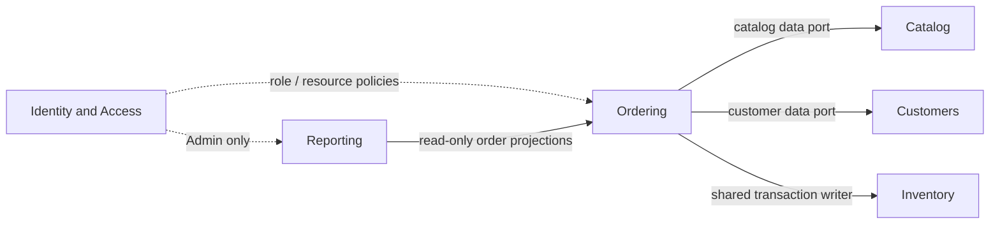

Ordering dùng cùng inventory persistence port trong transaction tạo/hủy đơn; không gọi endpoint nhập kho hoặc InventoryService tự commit. Reporting có thể query projection qua adapter từ dữ liệu đơn, không bắt buộc gọi OrderService rồi tải tất cả đơn. Các mũi tên thể hiện nhu cầu dữ liệu/phối hợp, không mặc định concrete service imports xuyên module.

### 7.4 Package Model and Dependency Rules — Selected Foundation

Các project hiện có trong [OrderInventory.sln](../OrderInventory.sln); project references là nguồn kiểm tra dependency. Nội dung nghiệp vụ tương lai vẫn Proposed.

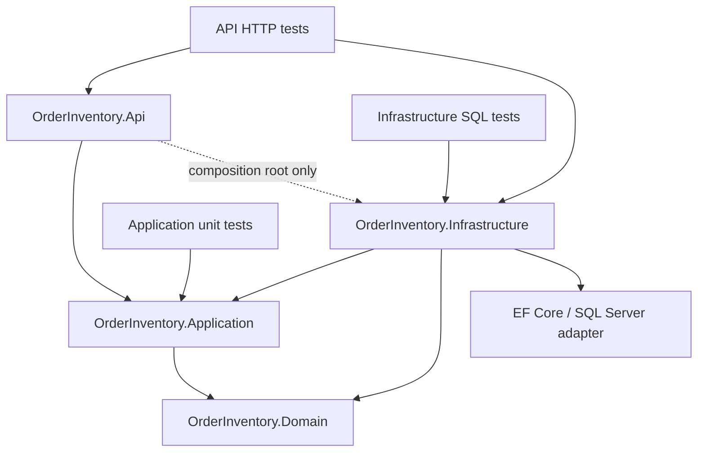

| From | To | Quy tắc dự kiến | Căn cứ |
|---|---|---|---|
| Domain | Tầng khác | Cấm | Required, R-T01 |
| Application | Domain | Cho phép | Logic miền dùng trong use case |
| Application | API / Infrastructure | Cấm | Selected dependency inversion |
| Infrastructure | Application / Domain | Cho phép | Triển khai port và mapping entity |
| API controllers | Application | Cho phép | Controller chỉ điều phối HTTP |
| API composition root | Infrastructure | Cho phép khi đăng ký dependency | Selected; không dùng để đưa DbContext vào controller |
| Domain/Application | EF Core, SQL connection, HTTP details | Cấm trong phương án này | Giữ logic độc lập và test được |
| Infrastructure | Quyết định nghiệp vụ mới | Không | Policy có chủ sở hữu trong Domain/Application |

**Lựa chọn của người triển khai:** service thuần và port chuyên biệt giữ Domain/Application độc lập, đủ cho quy mô v1. Không chọn MediatR/CQRS, generic repository hoặc DbContext trực tiếp trong Application vì thêm cơ chế hoặc làm mờ ranh giới đã chọn. Manual Application validation giữ quy tắc dùng lại được từ HTTP và bootstrap, không chỉ ở DTO binding.

### 7.5 Local Deployment — Selected, Verification Tracked Separately

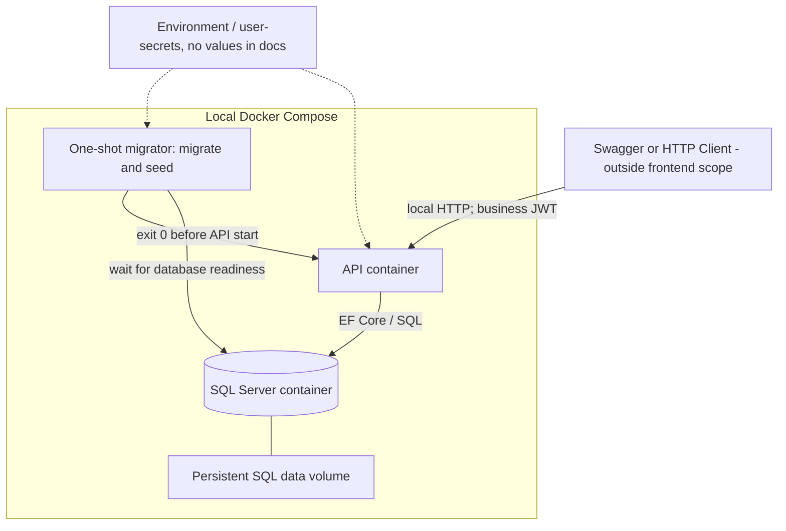

| Deployment concern | Owner / quyết định | Giới hạn |
|---|---|---|
| Khởi động / pins | [Compose](../compose.yaml), [Dockerfile](../Dockerfile), [global.json](../global.json), [package manifest](../Directory.Packages.props) | Manifest Selected không chứng minh clean startup pass |
| Migration / readiness | [DbMigrator](../tools/OrderInventory.DbMigrator/Program.cs) chạy trước API; [Program](../src/OrderInventory.Api/Program.cs) kiểm schema/Admin active | CLI [HealthProbe](../src/OrderInventory.Api/Hosting/HealthProbe.cs), không mở public health route |
| Seed | Application seed owner, marker và data cùng transaction; không autocommit helper | [BootstrapSeedService](../src/OrderInventory.Application/Seeding/BootstrapSeedService.cs), [CatalogSeedService](../src/OrderInventory.Application/Seeding/CatalogSeedService.cs), [OrderSeedService](../src/OrderInventory.Application/Seeding/OrderSeedService.cs) hiện có; seed không là revenue oracle |
| Secrets | `Initialize-Local.ps1` (local-only), `.env` bị ignore và user-secrets; [mẫu](../.env.example) không có giá trị thật | Không overwrite secret đã có; không đưa vào build args/log/report |
| Logs | [Program](../src/OrderInventory.Api/Program.cs) cấu hình Serilog console | Retention/rate limit/hiệu năng vẫn TBD-14 |
| Swagger | UI/spec anonymous chỉ Development — user Confirmed | Không mở ngoại lệ cho endpoint nghiệp vụ |
| Persistence | Volume trong Compose giữ dữ liệu qua restart | Không tự xóa volume khi lỗi; backup/restore chưa thuộc v1 |

V1 dừng ở chạy cục bộ. [README](../README.md#cấu-hình-và-chạy-local) giữ command và đường lấy credentials riêng trên máy; `report` (local-only) giữ kết quả môi trường/startup.

### 7.6 API Surface — Current Identity and Proposed Business APIs

**Identity/catalog/inventory/Customer hiện có:** route/method/status được ghi tại [README — API hiện có](../README.md#api-hiện-có), với link tới controller/DTO/OpenAPI owner. UC-USR01 là umbrella, không có endpoint riêng. **Endpoint create/list/detail/complete/cancel đã có; Reporting vẫn Proposed**; các UC `include` cũng không có endpoint.

| Method | Endpoint | UC | Quyền / trạng thái |
|---|---|---|---|
| GET | `/api/v1/categories` | UC-CAT01 | Admin, Staff |
| GET | `/api/v1/categories/{id}` | UC-CAT02 | Admin, Staff |
| POST | `/api/v1/categories` | UC-CAT03 | Admin |
| PUT | `/api/v1/categories/{id}` | UC-CAT04 | Admin |
| DELETE | `/api/v1/categories/{id}` | UC-CAT05 | Admin; soft delete, tham chiếu TBD-04 |
| GET | `/api/v1/products` | UC-PRD01 | Admin, Staff |
| GET | `/api/v1/products/{id}` | UC-PRD02 | Admin, Staff |
| POST | `/api/v1/products` | UC-PRD03 | Admin |
| PUT | `/api/v1/products/{id}` | UC-PRD04 | Admin |
| DELETE | `/api/v1/products/{id}` | UC-PRD05 | Admin; soft delete |
| GET | `/api/v1/inventory` | UC-INV01 | Admin, Staff |
| POST | `/api/v1/inventory/receipts` | UC-INV02 | Admin, Staff |
| POST | `/api/v1/inventory/adjustments` | UC-INV03 | Admin |
| GET | `/api/v1/inventory/movements` | UC-INV04 | Admin/Staff Confirmed |
| GET | `/api/v1/customers` | UC-CUS01 | Admin/Staff, Confirmed |
| GET | `/api/v1/customers/{id}` | UC-CUS02 | Admin/Staff, Confirmed |
| POST | `/api/v1/customers` | UC-CUS03 | Admin/Staff, Confirmed |
| PUT | `/api/v1/customers/{id}` | UC-CUS04 | Admin/Staff, Confirmed |
| DELETE | `/api/v1/customers/{id}` | UC-CUS05 | Admin; soft delete lặp 204, Confirmed |
| GET | `/api/v1/customers/{id}/history` | UC-CUS06 | Admin; gồm customer đã xóa, Confirmed |
| POST | `/api/v1/orders` | UC-ORD01 | Admin/Staff, Confirmed và Implemented |
| GET | `/api/v1/orders` | UC-ORD02 | Admin/Staff mọi đơn Confirmed; query Selected/Implemented |
| GET | `/api/v1/orders/{id}` | UC-ORD03 | Admin/Staff xem mọi đơn, Confirmed và Implemented |
| POST | `/api/v1/orders/{id}/cancel` | UC-ORD04 | Admin mọi đơn, Staff chủ đơn; JSON body với reason optional;200OrderDto, repeat giữ audit/reason gốc |
| POST | `/api/v1/orders/{id}/complete` | UC-ORD05 | Implemented; Admin mọi đơn, Staff chủ đơn; không body, 200 OrderDto |
| GET | `/api/v1/reports/revenue?groupBy=day` | UC-REP01 | Admin |
| GET | `/api/v1/reports/revenue?groupBy=month` | UC-REP02 | Admin |
| GET | `/api/v1/reports/top-products` | UC-REP03 | Admin |

Không có register, refresh, payment, shipment hay endpoint xóa đơn. Quyền lifecycle theo matrix Confirmed; quyền đọc mọi đơn giữ nguyên.

**Proposed DTO/query contracts**

| Contract | Nội dung dự kiến | Gate |
|---|---|---|
| CreateProductRequest | SKU, tên, categoryId, unit price | [Contracts](../src/OrderInventory.Application/Catalog/Contracts.cs), CatalogRules/Validation và CatalogSchemaFilter là owners hiện có |
| ReceiptRequest / AdjustmentRequest | productId, integer quantity hoặc signed delta, reason | [Inventory contracts](../src/OrderInventory.Application/Inventory/Contracts.cs); quantity > 0, delta khác 0; reason bắt buộc cho adjustment |
| CustomerRequest / CustomerDto / CustomerAuditDto | Profile và lịch sử field names; không nhận actor/isDeleted từ payload | [Customer contracts](../src/OrderInventory.Application/Customers/Contracts.cs), [CustomerSchemaFilter](../src/OrderInventory.Api/OpenApi/CustomerSchemaFilter.cs) hiện có; BR-21/22/23 |
| CreateOrderRequest | CustomerId bắt buộc và 1–100 dòng productId/quantity | [Contracts](../src/OrderInventory.Application/Orders/Contracts.cs), [OrderPricingPolicy](../src/OrderInventory.Application/Orders/OrderPricingPolicy.cs); server price/total/actor, merge/bounds Confirmed |
| CancelOrderRequest | JSON body bắt buộc; reason optional trim≤512, blank→null là kỹ thuật Selected | [Contracts](../src/OrderInventory.Application/Orders/Contracts.cs), [OrderService](../src/OrderInventory.Application/Orders/OrderService.cs); actor/time server, repeat giữ reason gốc |
| OrderDto | Snapshot/detail và completion/cancellation audit; DTO owner [Contracts](../src/OrderInventory.Application/Orders/Contracts.cs) | [EfOrderData](../src/OrderInventory.Infrastructure/Persistence/EfOrderData.cs); Admin/Staff xem mọi đơn, không Customer contact |
| ListQuery | page/pageSize, allowed filter/sort và UTC interval | [Order contracts](../src/OrderInventory.Application/Orders/Contracts.cs) và [OrderQueryValidation](../src/OrderInventory.Application/Orders/OrderQueryValidation.cs) hiện có; report query vẫn Proposed |
| ReportQuery | from, to, granularity hoặc metric/top N | Timezone, interval, max range và ranking TBD-06/14 |

Identity DTO/query và ProblemDetails đã có owner dẫn ở mục 3.4 và 4.13. Đường dẫn query báo cáo trong bảng chỉ minh họa hai UC trên cùng resource; `day/month` và interval contract vẫn cần duyệt. Không expose raw SQL expression hay property arbitrary từ request.

### 7.7 Cross-cutting Design and Architecture Risks

| Concern | Proposed design | Giới hạn / bằng chứng cần có |
|---|---|---|
| Exception handling | GlobalExceptionHandler ánh xạ lỗi nghiệp vụ/infrastructure thành ProblemDetails | Authentication challenges/forbidden và model validation cũng cần tích hợp cùng shape; không mặc định exception handler bắt mọi response |
| Validation | Manual Application validation Selected cho nền tảng; domain giữ invariant, DB giữ uniqueness/check/FK | Bounds nghiệp vụ mới vẫn phải chốt trước implementation |
| Transaction ownership | OrderService/InventoryService sở hữu transaction theo UC; helper dùng transaction hiện hành | Không mở/commit transaction riêng cho movement hoặc từng dòng |
| Concurrency | Conditional stock update và conditional status transition | Complete dùng order update lock và conditional Pending update trong ReadCommitted; owners EfOrderData/OrderConfiguration; kiểm trên SQL Server |
| Historical reads | OrderLine snapshot, giữ Product/FK và đường đọc lịch sử có chủ ý | EF soft-delete filter/join không được làm mất dòng đơn; cần integration test |
| Reporting | Aggregate tại database, chỉ projection, index theo query plan | Stored procedure không tự chứng minh nhanh; cần plan/đo theo fixture và policy |
| Observability | Serilog + trace correlation; log transaction outcome phù hợp | Không log body login/token; không coi timeout commit là rollback đã biết |
| Authorization | JWT role + kiểm active/current role/version mỗi request đã có; Customer CRUD/audit Confirmed | Token policy theo BR-20; Admin/Staff xem mọi đơn Confirmed; lifecycle Admin mọi đơn, Staff chỉ đơn mình tạo Confirmed |
| Customer audit | Application transaction bao phủ profile mutation và append audit; chỉ Admin đọc | BR-23; không ghi bản sao PII; database role hardening/retention chưa là tính năng v1 |
| Request retry | Giữ contract trung thực về kết quả chưa rõ | Chưa có idempotency store/key trong baseline; chỉ movement-per-change không ngăn HTTP duplicate |

Không dùng EF InMemory hoặc mock để kết luận đã giải quyết transaction, unique constraints và race kho trên SQL Server. Unit test chỉ chứng minh phần logic/application-owned contract tương ứng.

## 8. Software Quality Attributes

### 8.1 Quality Goals and Mechanisms

| Attribute | Mục tiêu | Proposed design support |
|---|---|---|
| Integrity / consistency | Không âm kho, không lưu đơn dở, history khớp balance | Transaction chung, conditional update, DB constraints |
| Security | Xác thực và phân quyền đúng; không lộ secret hoặc dữ liệu ngoài quyền | JWT/RBAC, resource policy, DTO, redaction và ProblemDetails |
| Auditability | Mọi thay đổi tồn truy được nguồn và số dư sau thay đổi | InventoryMovement cùng transaction, actor/source reference |
| Historical correctness | Đơn cũ không bị đổi do sửa/xóa catalog | Snapshot, giữ reference và đường query lịch sử |
| Reliability | Lỗi được xử lý có kiểm soát; startup không phục vụ schema chưa sẵn sàng | Rollback, bootstrap gate, classified errors |
| Performance | List/report truy vấn hữu hạn theo tải đã chốt | Database paging/filter/sort, projection/aggregate và query plan |
| Maintainability / testability | Domain độc lập, nghiệp vụ không nằm ở controller | Package dependency rules, services/ports, unit tests |
| Reproducibility | Chạy local và fixture lặp lại được | Compose, migration/seed có chủ sở hữu, test DB tách biệt |

### 8.2 Measurable Quality Scenarios

Các measure có căn cứ AC là yêu cầu nghiệm thu. Các measure bổ sung được ghi **Proposed target**, chưa là SLA, chưa đo và chưa đạt. Không có kết quả benchmark hay test thực tế trong tài liệu này.

| ID | Attribute / stimulus | Response dự kiến | Measure / acceptance | Status / source |
|---|---|---|---|---|
| QA-01 | Security: Staff gọi report hoặc user-management operation đã chốt | Từ chối, không chạy mutation hay trả dữ liệu bị cấm | Mọi request trong tập forbidden role cases trả 403; 0 dữ liệu/thay đổi ngoài quyền | Required, AC-02; Identity HTTP tests hiện có, report API chưa triển khai |
| QA-02 | Atomicity: đơn nhiều dòng có một sản phẩm thiếu kho | Rollback đơn, dòng, số dư và movement | So sánh trước/sau: 0 Order/OrderLine/movement mới và 0 thay đổi stock của request thất bại | Required, AC-03 |
| QA-03 | Concurrency: tồn = 1; hai request khác nhau đồng thời mua 1 | Một commit; request còn lại bị từ chối nghiệp vụ | Chính xác 1 đơn thành công, onHand = 0, 1 sale movement; không có thời điểm commit âm kho | Required, AC-04; cơ chế Proposed |
| QA-04 | Auditability: nhập, điều chỉnh hoặc bán làm đổi tồn | Ghi movement cùng thay đổi | Với mỗi thay đổi, đúng 1 row; balanceAfter khớp thời điểm cập nhật; chuỗi delta đối soát đúng tồn cuối | Required, AC-05 |
| QA-05 | Historical correctness: tạo đơn rồi xóa mềm sản phẩm; mở rộng Proposed thêm sửa tên/giá trước khi xóa | Catalog ẩn sản phẩm; đơn vẫn hiển thị đúng thông tin | Required: xóa mềm không mất/sai thông tin đơn. Proposed theo BR-15: SKU/tên/giá/tổng snapshot bất biến qua đổi catalog; 0 dòng bị mất do filter/join | AC-07 Required; mở rộng snapshot Proposed |
| QA-06 | Query correctness: fixture cố định, filter/sort/page sản phẩm và đơn | Chỉ trả dữ liệu đúng scope/filter, thứ tự ổn định | So kết quả từng trang với tập chuẩn; 0 dòng ngoài quyền, không thiếu/trùng trong dataset không đổi; page size đúng contract | Required, AC-06; chi tiết contract TBD |
| QA-07 | Report correctness: fixture gồm đơn đủ/không đủ điều kiện và biên ngày/tháng | Aggregate theo policy được duyệt | Tổng và ranking khớp oracle độc lập; mỗi giao dịch biên thuộc đúng 1 bucket theo `[from,to)` Proposed | Required, AC-08; oracle gate TBD-06 |
| QA-08 | Error safety: lỗi không dự kiến trong request | Global handler trả ProblemDetails, có correlation dự kiến | Proposed 500; 0 stack trace/password/token/connection secret trong response; log cũng không chứa secret | Required outcome, AC-09/R-T13 |
| QA-09 | Local operability: chạy Compose với cấu hình hợp lệ trên môi trường sạch | Database sẵn sàng → migrate/seed → API ready, Swagger dùng được theo policy | API + SQL chạy, fixture tồn tại một lần; lặp startup không nhân đôi seed; thời gian ready tối đa TBD-13/14 | Required core, AC-01; idempotent seed Proposed |
| QA-10 | Regression confidence: chạy suite sau thay đổi service | Unit tests chứng minh logic tạo đơn/trừ kho và lỗi liên quan | Các test thuộc scope đã chốt pass; test regression được thêm trước khi sửa lỗi | Required, AC-10/AGENTS; suite service/order hiện có local-only; kết quả theo execution report |
| QA-11 | Lifecycle repeat/race: complete/complete, cancel/cancel hoặc complete/cancel cùng một Pending | Một terminal transition; repeat200 giữ audit gốc, cross-state409; không hoàn kho hai lần | Tối đa1 return mỗi lượng đã trừ; rollback nếu state/stock/history lỗi; complete không đổi kho | Confirmed policy; complete/cancel có source; kết quả checks/races theo execution report local |
| QA-12 | Performance: tải list và report trên dataset đã đóng băng | Database paging/aggregation giữ thời gian đáp ứng trong mục tiêu | Candidate Proposed: 10 client đồng thời, mỗi client 100 request; 1.000 sản phẩm, 10.000 đơn × 2 dòng; p95 list ≤ 500 ms, report ≤ 2 s; cấu hình máy/index phải ghi lại | Proposed target, TBD-14; không phải số đo thực tế |
| QA-13 | Architecture: thêm rule hoặc use case mới | Không tạo dependency ngược từ Domain, không đặt business logic ở HTTP controller | 0 project reference từ Domain tới ba tầng còn lại; unit test rule không cần HTTP/SQL | Required architectural outcome, R-T01; cách kiểm tra Proposed |
| QA-14 | API contract: lỗi validation, thiếu token, thiếu role và lỗi nghiệp vụ | Error shape nhất quán dù không phải mọi lỗi đều ném exception | Tập kiểm thử mỗi nhóm trả ProblemDetails hợp lệ, không entity/secret; HTTP status theo contract | Required, R-T02; nền tảng lỗi đã Implemented, bằng chứng ở report |
| QA-15 | Customer audit: tạo/sửa/xóa, kể cả lỗi audit và đọc sau xóa mềm | Customer/audit cùng commit hoặc rollback; Admin đọc history đúng customer, Staff bị từ chối | 0 mutation một phần khi ghi audit lỗi; 1 event cho mỗi thay đổi, 0 event cho normalized no-op/repeated delete; 0 contact values trong audit DTO; Staff history/delete 403; customer đã xóa vẫn có history | Confirmed BR-22/23; unit/real SQL/HTTP tests local |

**Proposed revenue fixture minh họa, chỉ dùng sau khi duyệt policy:** Completed A có `2 × 100`, Completed B có `1 × 50` trong cùng bucket → doanh thu 250 đơn vị tiền; Pending/Cancelled không cộng vào. Thêm đơn đúng biên đầu/cuối ngày và tháng để kiểm tra timezone và khoảng nửa mở. Đây là dữ liệu giả để thiết kế test, không phải dữ liệu seed đã có, currency thực hay business rule đã duyệt.

### 8.3 Verification Strategy — Current Identity and Future Business Evidence

| Verification level | Chứng minh điều gì | Không được kết luận từ nó |
|---|---|---|
| Unit — Domain/Application | Pricing/lifecycle/permission policy đã chốt; orchestration thành công/thiếu kho/lỗi ghi; controller không chứa nghiệp vụ | Không chứng minh transaction/isolation/SQL uniqueness bằng mock |
| SQL Server integration | Rollback nhiều dòng, conditional update, history balance, SKU race, complete/cancel và mixed writers theo Phase05 được giao | Không thay SQL Server bằng EF InMemory rồi tuyên bố AC-04 đạt |
| HTTP integration | JWT/role/resource scope, DTO validation, ProblemDetails kể cả 401/403, paging và projection | Không mặc định framework defaults đã khớp contract |
| Local smoke | Compose, startup migration/seed, Swagger, đăng nhập và một luồng tạo đơn | Không thay bằng mô tả deployment hoặc ảnh Swagger chưa chạy |
| Report verification | Query và oracle độc lập trên fixture nhỏ đã biết, biên ngày/tháng, sản phẩm đã xóa | Không dùng chính output query làm expected value |
| Targeted performance | Đo QA-12 sau khi đóng băng workload, môi trường và policy | Không gọi một query “tối ưu” chỉ vì viết stored procedure |

Test service layer là Required. Boundary unit/SQL/HTTP đã Selected và có suite Identity; bài stock/order/report còn chờ phần triển khai tương ứng. Bài test tranh đơn vị cuối phải có điểm đồng bộ rõ cho hai request, một fixture riêng và assertion kết quả; không dùng vòng stress ngẫu nhiên để thay bằng chứng xác định. Test database phải tách khỏi dữ liệu phát triển và secret phải được cấp bên ngoài code.

Chỉ chạy test hiệu năng khi mục tiêu/workload đã duyệt. Lệnh chạy nằm trong [README](../README.md#kiểm-tra), kết quả và blocker nằm trong `report Phase 01–02` (local-only). Thiết kế và source tồn tại không thay bằng chứng test pass.

## 9. Traceability Matrix

### 9.1 Requirements → Use Cases → Current or Proposed Design

Identity/catalog/inventory/Customer dẫn tới owner hiện có; Complete/cancel có owners hiện có; Reporting vẫn Proposed ở mục 5–7. “Tất cả UC” chỉ những UC áp dụng trong inventory, không bổ sung chức năng để lấp bảng. Capability chưa rõ giữ gate TBD.

| Requirement | Use Cases | Proposed design components | Verification / gate |
|---|---|---|---|
| R-F01 | UC-AUTH01; precondition của tất cả UC được bảo vệ | [AuthenticationService](../src/OrderInventory.Application/Identity/AuthenticationService.cs), [token validator](../src/OrderInventory.Api/Security/CurrentAccountTokenValidator.cs) | QA-01/14; Identity contract Confirmed, evidence ở report |
| R-F02 | Catalog/inventory/order/customer theo matrix; UC-REP01…03, UC-USR01 | ResourceAuthorizationPolicy, role checks ở boundary, application resource scope | QA-01; TBD-02/10 |
| R-F03 | UC-CAT01…05, UC-PRD01…05 | [CatalogService](../src/OrderInventory.Application/Catalog/CatalogService.cs), [domain](../src/OrderInventory.Domain/Catalog), [EfCatalogData](../src/OrderInventory.Infrastructure/Persistence/EfCatalogData.cs) | QA-05/06; catalog policy Confirmed/Implemented |
| R-F04 | UC-INV01…05; UC-ORD07, UC-ORD04 | [InventoryService](../src/OrderInventory.Application/Inventory/InventoryService.cs), [writer](../src/OrderInventory.Infrastructure/Persistence/EfInventoryWriter.cs), [reads](../src/OrderInventory.Infrastructure/Persistence/EfInventoryData.cs) | QA-03/04; receipt/adjust/history và order stock integration có source |
| R-F05 | UC-CUS01…06 | [CustomersController](../src/OrderInventory.Api/Controllers/CustomersController.cs), [CustomerService](../src/OrderInventory.Application/Customers/CustomerService.cs), Customer/CustomerAuditEntry, [ICustomerData](../src/OrderInventory.Application/Abstractions/ICustomerData.cs) | BR-21/22/23, QA-15; field/delete/role/audit Confirmed; Customer–Order required FK hiện có |
| R-F06 | UC-ORD01/02/03/04/05/06/07 hiện có | [OrdersController](../src/OrderInventory.Api/Controllers/OrdersController.cs), [OrderService](../src/OrderInventory.Application/Orders/OrderService.cs), [OrderLifecyclePolicy](../src/OrderInventory.Application/Orders/OrderLifecyclePolicy.cs), [Order/OrderLine](../src/OrderInventory.Domain/Orders/Order.cs) | QA-02/03/11; lifecycle Confirmed; source có, verification theo execution report local |
| R-F07 | UC-REP01…03 | ReportsController, RevenueReadService, RevenuePolicy, IRevenueQuery | QA-01/07; TBD-06 |
| R-F08 | UC-USR01 umbrella; UC-USR02, UC-USR03, UC-USR04, UC-USR05, UC-USR06 | [UsersController](../src/OrderInventory.Api/Controllers/UsersController.cs), [UserAdministrationService](../src/OrderInventory.Application/Identity/UserAdministrationService.cs), [UserAccount](../src/OrderInventory.Domain/Identity/UserAccount.cs) | QA-01; BR-19/20, Identity tests hiện có |
| R-T01 | Tất cả UC | [Solution/project references](../OrderInventory.sln), Application services, Domain thuần | QA-13; nền tảng hiện có |
| R-T02 | Tất cả UC HTTP | [Identity contracts](../src/OrderInventory.Application/Identity/Contracts.cs), [ProblemResponses](../src/OrderInventory.Api/Errors/ProblemResponses.cs), [GlobalExceptionHandler](../src/OrderInventory.Api/Errors/GlobalExceptionHandler.cs) | QA-08/14; Identity/catalog/inventory Selected/Implemented |
| R-T03 | UC-CAT01, UC-PRD01, UC-INV01/04, UC-CUS01/06, UC-ORD02; UC-USR02 | [Catalog queries](../src/OrderInventory.Application/Catalog/Contracts.cs), [Inventory queries](../src/OrderInventory.Application/Inventory/Contracts.cs), [Customer queries](../src/OrderInventory.Application/Customers/Contracts.cs), UserListQuery và [OrderListQuery](../src/OrderInventory.Application/Orders/Contracts.cs) hiện có | QA-06; order query defaults Selected tại executable owners |
| R-T04 | UC-PRD05, UC-ORD03; UC-REP01…03 đọc lịch sử | OrderLine snapshots, historical read projections, giữ Product reference | QA-05; TBD-04/11 |
| R-T05 | UC-ORD01/06/07; UC-INV05 | [OrderService](../src/OrderInventory.Application/Orders/OrderService.cs), IUnitOfWorkTransaction, IInventoryWriter, [EfOrderData](../src/OrderInventory.Infrastructure/Persistence/EfOrderData.cs) | QA-02; SQL rollback/source/race tests local, evidence execution report |
| R-T06 | UC-ORD07, UC-INV03; mọi UC thay đổi tồn | StockRules, conditional update, check constraint | QA-03; gate TBD-01 |
| R-T07 | UC-INV02/03/05, UC-ORD07; UC-ORD04 hoàn kho | InventoryMovement, shared transaction writer | QA-04/11; không có write-behind history |
| R-T08 | UC-REP01…03 | SqlRevenueQuery, RevenuePolicy, query/index design | QA-07/12; query plan và oracle TBD-06/14 |
| R-T09 | Tất cả UC HTTP | OpenAPI description, Serilog integration, correlation | QA-08/09/14; config/sinks TBD-13/14 |
| R-T10 | UC-AUTH01, UC-USR02…06, UC-ORD/INV | `Application tests` (local-only), `SQL tests` (local-only), `HTTP tests` (local-only) | QA-10; order/stock tests local-only, kết quả theo execution report |
| R-T11 | Hỗ trợ mọi UC sau bootstrap | [Compose](../compose.yaml), [DbMigrator](../tools/OrderInventory.DbMigrator/Program.cs), [BootstrapSeedService](../src/OrderInventory.Application/Seeding/BootstrapSeedService.cs), [HealthProbe](../src/OrderInventory.Api/Hosting/HealthProbe.cs) | QA-09; current evidence ở report |
| R-T12 | Tài liệu hệ thống và API, không phải UC nghiệp vụ | [README](../README.md): ERD Identity, run guide và API owner | AC-11 toàn v1 chờ các phase nghiệp vụ và startup verification |
| R-T13 | UC-AUTH01, UC-USR04 và hạ tầng mọi UC | `Initialize-Local` (local-only), [PasswordService](../src/OrderInventory.Infrastructure/Identity/PasswordService.cs), [mẫu cấu hình](../.env.example) | QA-08/14; không lưu secret/hash/token trong docs/report |
| R-S01 | Toàn bộ inventory theo scope | Một kho, một local deployment, không payment/frontend/tenant modules | Review scope và TBD register; không deploy v1 |

### 9.2 Brief Acceptance Criteria → Design Verification

| Brief AC | Yêu cầu quan sát | Design / UC dự kiến | Bằng chứng cần có sau triển khai |
|---|---|---|---|
| AC-01 | Compose chạy API + SQL, tự migration/seed, Swagger mở được | Deployment/Bootstrap, UC-AUTH01 làm bước smoke tiếp theo | Chạy từ môi trường sạch; startup/seed và OpenAPI được kiểm chứng; QA-09 |
| AC-02 | JWT; Staff bị 403 với endpoint Admin | UC-AUTH01, UC-USR02…06; UC-REP01…03 tương lai | HTTP Identity tests hiện có; kết quả ở report; report security chờ phase 6 |
| AC-03 | Thiếu kho trả ProblemDetails, không lưu gì | UC-ORD01/07, shared transaction | Snapshot dữ liệu trước/sau failed multiline order; QA-02 |
| AC-04 | Hai đơn mua đơn vị cuối, đúng một thành công | UC-ORD07, conditional update | SQL Server concurrency test có đồng bộ; QA-03 |
| AC-05 | Mỗi thay đổi có một history row, số dư đúng | UC-INV02/03/05, UC-ORD07; UC-ORD04 hoàn kho | Đối soát movement/balance trong fixture; QA-04 |
| AC-06 | Sản phẩm/đơn paging/filter/sort | UC-PRD01, UC-ORD02 | HTTP/query fixture kiểm scope và thứ tự; QA-06 |
| AC-07 | Xóa mềm sản phẩm, đơn cũ vẫn đúng | UC-PRD05, UC-ORD03 | Required: create → delete → read order; mở rộng Proposed thêm rename/reprice theo BR-15; QA-05 |
| AC-08 | Báo cáo đúng dữ liệu mẫu đã biết | UC-REP01…03, RevenuePolicy, SqlRevenueQuery | Oracle theo policy được duyệt, biên ngày/tháng/ranking; QA-07 |
| AC-09 | Lỗi chưa xử lý trả ProblemDetails, không stack trace | GlobalExceptionHandler và pipeline lỗi | Fault-injection HTTP test, kiểm response/log; QA-08/14 |
| AC-10 | dotnet test pass; test tạo đơn/trừ kho | Application/Domain test boundary | Output suite thực tế, không thay bằng checklist thiết kế; QA-10 |
| AC-11 | README có ERD, cách chạy, API list | README + thiết kế này làm route ban đầu | ERD/schema và OpenAPI khớp implementation; hướng dẫn chạy được thử lại |

**Trạng thái bằng chứng:** Identity/catalog/stock và Customer CRUD/audit có unit/SQL/HTTP evidence trong report thực thi (local-only). Order create/detail đã có source; evidence SQL/HTTP xem execution report local. Order list đã có source và integration evidence; complete có source, verification theo execution report local. Cancel/hoàn kho có source; kiểm chứng5.2/5.3 theo execution report local. Reporting chưa triển khai. Chưa nghiệm thu toàn bộ v1; không suy ra hoàn thành từ tài liệu hoặc số test của các slice đã có.

### 9.3 Consistency and Change Rules for This Design

- Khi đổi lifecycle, đồng bộ UC-ORD04/05, state constraint, return movement, API và QA-11; RevenuePolicy vẫn cần quyết định riêng TBD-06.
- Khi chốt quyền, dùng cùng matrix cho actor/UC/API/resource policy; không biến ô Staff TBD thành quyền mặc định.
- Khi chốt SKU/delete/snapshot, đối chiếu conceptual model, UC-PRD03/05, historical query và QA-05.
- Khi chốt report policy, cập nhật các UC-REP, formula, fixture và query contract; không sửa expected value để che sai lệch query.
- Khi triển khai, liên kết tới executable owners thật và đối chiếu lại tên Proposed; không giữ hai mô tả hành vi mâu thuẫn giữa thiết kế và source.

### 9.4 Source and Authority Index

| Artifact hiện có | Vai trò |
|---|---|
| `AGENTS.md` (local-only) | Quy tắc cộng tác/kiến trúc, test và secret |
| `brief.md` (local-only) | Nguồn yêu cầu nghiệp vụ, draft quyền, AC và câu hỏi mở |
| `report_template.md` (local-only) | Chỉ tham khảo cấu trúc COMET và độ chi tiết; không mang actor/domain/stack vào thiết kế này |
| [README.md](../README.md) | Điểm vào tài liệu project |
| [system-design.md](system-design.md) | Contract Identity/catalog/inventory/Customer/Order đã chốt, complete/cancel có source; Reporting còn Proposed; không thay thế brief hoặc tự đóng TBD |
| `Implementation contract` (local-only) | Gate và lựa chọn thực thi có phân biệt user Confirmed với implementer Selected |
| `Phase 01–02 report` (local-only) | Bằng chứng stateful và phần verification còn thiếu |

Các executable owner hiện có được dẫn trong README và các dòng Identity/catalog/inventory/Customer ở trên. Customer–Order và complete/cancel có source; Reporting vẫn Proposed/TBD; không có deployment production được chọn hoặc thực hiện.
